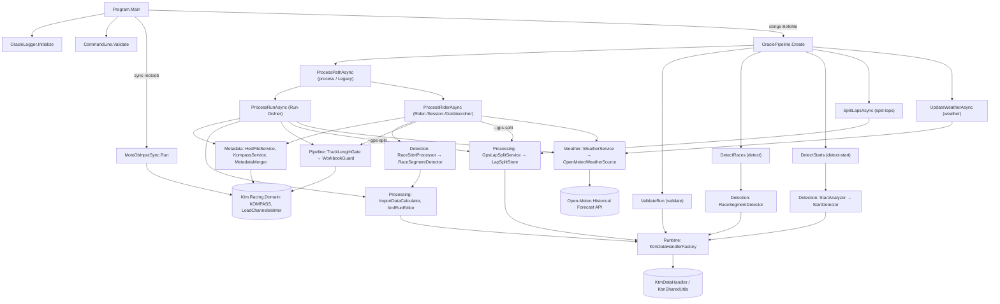

# ORACLE & SENTINEL – Funktionsreferenz

## 1. Zweck des Dokuments

Dieses Dokument ist eine vollständige Funktionsübersicht der Konsolenanwendungen **ORACLE** (Namespace `Ktm.Racing.Oracle`) und **SENTINEL** (Namespace `SENTINEL`). Es listet je Modul (Ordner) alle Klassen, Records, Interfaces und Enums mit ihren öffentlichen und internen Methoden sowie Properties mit Logik; private Methoden, die Kern-Geschäftslogik enthalten, sind mit „privat“ markiert.

Je Methode werden Zweck, Parameter, Rückgabe, Abhängigkeiten und Seiteneffekte (Dateizugriffe, Sperren, Konsolen-/Log-Ausgabe, Aufrufe der KTM-API `KtmDataHandler`, Zugriffe auf KOMPASS und `loadChannels.xlsx`, Exit-Codes) beschrieben. Alle Aussagen sind aus dem Code abgeleitet; was sich aus dem Code nicht eindeutig ergibt, ist als **unklar** markiert (Sammlung in [Abschnitt 15](#15-als-unklar-markierte-punkte)).

Die gemeinsam genutzte Bibliothek `Ktm.Racing.Domain` (`C:\Dev\Ktm.Racing.Domain`) wird nicht dokumentiert; [Abschnitt 13](#13-verwendete-typen-aus-ktmracingdomain) listet nur die Domain-Typen, die ORACLE verwendet.

**Konventionen**

- `(Z. N)` = Zeilennummer der Deklaration in der verlinkten Datei.
- „atomar“ = Schreiben über `AtomicFile` (Temp-Datei im selben Ordner + `File.Move(..., overwrite: true)`), siehe [`AtomicFile`](#atomicfile).
- „Konsole/Log“ = Ausgabe über `Console.WriteLine`; in ORACLE landet sie über [`OracleLogger`](#oraclelogger) zusätzlich in der Log-Datei.
- Exit-Codes werden mit Zahl und Namen angegeben, siehe [`OracleExitCode`](#oracleexitcode).

## 2. Stand

| Angabe | Wert |
|---|---|
| Repository | `C:\Dev\KTM Offroad Racing Automated Calculation and Logging Editor` |
| Git-Commit (`git rev-parse --short HEAD`) | `5cd69ea` |
| Erstellt | 2026-10-21 |
| Hinweis | Zeilennummern werden mit `render.py` automatisch aus dem Code des angegebenen Commits (zzgl. der Änderungen dieses Branches) ermittelt. Konsolen- und Logmeldungen sind englisch und werden wörtlich zitiert. |
| Zielplattform | .NET 8 (`net8.0`); ORACLE zusätzlich `Platforms AnyCPU;x64` |
| Nicht enthalten | Testprojekte `ORACLE.Tests`, `SENTINEL.Tests` |

## 3. Inhaltsverzeichnis

1. [Zweck des Dokuments](#1-zweck-des-dokuments)
2. [Stand](#2-stand)
3. [Inhaltsverzeichnis](#3-inhaltsverzeichnis)
4. [Architekturüberblick](#4-architekturüberblick)
5. [Kommandozeile (CLI)](#5-kommandozeile-cli)
6. [Modul Einstieg](#6-modul-einstieg) – [`Program`](#program), [`CommandLine`](#commandline)
7. [Modul Pipeline](#7-modul-pipeline) – [`OraclePipeline`](#oraclepipeline), [`OracleConfig`](#oracleconfig), [`GpsSettings`](#gpssettings), [`GpsLapSplitSettings`](#gpslapsplitsettings), [`TrackLengthSettings`](#tracklengthsettings), [`OracleExitCode`](#oracleexitcode), [`OracleExitCodes`](#oracleexitcodes), [`OracleStatus`](#oraclestatus), [`StepStatus`](#stepstatus), [`OracleLogger`](#oraclelogger), [`ProcessingLock`](#processinglock), [`AtomicFile`](#atomicfile), [`InputFingerprint`](#inputfingerprint), [`LapHistory`](#laphistory), [`RunFolderInspector`](#runfolderinspector), [`RunFolders`](#runfolders), [`RunRepair`](#runrepair), [`TrackLengthGate`](#tracklengthgate), [`WorkbookGuard`](#workbookguard)
8. [Modul Processing](#8-modul-processing) – [`ImportDataCalculator`](#importdatacalculator), [`RunCalcResult`](#runcalcresult), [`RunGpsData`](#rungpsdata), [`XmlRunEditor`](#xmlruneditor), [`GpsLapSplitService`](#gpslapsplitservice), [`KtmSplitDataAccess`](#ktmsplitdataaccess), [`LapSplitStore`](#lapsplitstore), [`MotoDbInputSync`](#motodbinputsync)
9. [Modul Detection](#9-modul-detection) – [`RaceSegmentDetector`](#racesegmentdetector), [`RaceClassification.cs`](#raceclassificationcs), [`RaceDetectionThresholds`](#racedetectionthresholds), [`RaceStintProcessor`](#racestintprocessor), [`StartAnalyzer`](#startanalyzer), [`StartDetector`](#startdetector)
10. [Modul Metadata](#10-modul-metadata) – [`RunMetadata`](#runmetadata), [`HedFileService`](#hedfileservice), [`KompassService`](#kompassservice), [`MetadataMerger`](#metadatamerger), [`PathMetadataParser`](#pathmetadataparser), [`BikeAlias`](#bikealias)
11. [Modul Runtime](#11-modul-runtime) – [`KtmRuntime`](#ktmruntime), [`KtmDataHandlerFactory`](#ktmdatahandlerfactory), [`ChannelResolver`](#channelresolver), [`KtmWriteErrors`](#ktmwriteerrors)
    - 11a. [Modul Weather](#11a-modul-weather) – [`WeatherSettings`](#weathersettings), [`OpenMeteoWeatherSource`](#openmeteoweathersource), [`WeatherCalculator`](#weathercalculator), [`MeteoXml`](#meteoxml), [`WeatherService`](#weatherservice)
12. [SENTINEL](#12-sentinel) – [`Program` (SENTINEL)](#sentinel-program), [`SentinelConfig`](#sentinelconfig), [`RunWatcher`](#runwatcher), [`StabilityTracker`](#stabilitytracker), [`RunSnapshot`](#runsnapshot), [`DownloadDoneWriter`](#downloaddonewriter)
13. [Verwendete Typen aus Ktm.Racing.Domain](#13-verwendete-typen-aus-ktmracingdomain)
14. [Externe Abhängigkeiten](#14-externe-abhängigkeiten)
15. [Als „unklar“ markierte Punkte](#15-als-unklar-markierte-punkte)

## 4. Architekturüberblick

**ORACLE** ist das Postprocessing-Werkzeug für WinTAX4-Runs (Ordnerstruktur `…\<Event>\<Session>\<Gerät>\Run_xxx\Lap_xxx`). Laut Code-Kommentaren wird es von KRAKEN als EXE-Job gestartet und liefert einen [`OracleExitCode`](#oracleexitcode). Hauptaufgaben: Metadaten ermitteln (.HED / KOMPASS), `.HED` in jedem Run sicherstellen, `sVehicle` und Rundendistanzen berechnen (Import-Daten über `KtmDataHandler`), XML-Properties schreiben, Track-Länge prüfen und in `loadChannels.xlsx` (Sheet CIRCUITS) eintragen, optional Runs per GPS-Ziellinie in Laps teilen.

**SENTINEL** ist ein eigenständiger Dauer-Prozess, der überwachte Ordner pollt und für stabile (fertig synchronisierte) `Run_*`-Ordner eine `download.done` schreibt, die laut Code-Kommentar KRAKEN zum Start der Job-Pipeline nutzt. SENTINEL hat keine Projektreferenz auf ORACLE oder `Ktm.Racing.Domain`.

Hauptaufrufkette von ORACLE:

Zentrale Dateien im Dateisystem (aus dem Code):

| Datei/Ordner | Ort | Geschrieben von |
|---|---|---|
| `oracle.status.json` | Run-Ordner (`process` auf einen Run) bzw. Geräteordner (`process` auf Rider/Session) | [`OracleStatus`](#oraclestatus) (atomar) |
| `oracle.lock` | Geräte-/Run-Ordner während der Verarbeitung | [`ProcessingLock`](#processinglock) (`DeleteOnClose`) |
| `*.HED` (kanonisch `{Season}{Event}_{Bike}{Session}.HED`) | jeder Run-Ordner | [`HedFileService`](#hedfileservice) |
| `Car.xml`, `Session.xml`, `RunLapHeader.xml`, `Lap_*\LapHeader.xml` | Run-/Lap-Ordner | [`XmlRunEditor`](#xmlruneditor), [`LapSplitStore`](#lapsplitstore) |
| Import-Daten (Kanal `sVehicle`) | Run (über `AddImportDataToRun`) | [`ImportDataCalculator`](#importdatacalculator) |
| `_ORACLE_removed\` | Run-Ordner | [`RunRepair`](#runrepair) |
| `_ORACLE_original\<Zeitstempel>\`, `_ORACLE_split_tmp\` | Run-Ordner | [`LapSplitStore`](#lapsplitstore), [`GpsLapSplitService`](#gpslapsplitservice) |
| `logs\oracle-<yyyyMMdd-HHmmss>-<PID>.log` | Anwendungsordner (Fallback `%TEMP%\ORACLE\logs`) | [`OracleLogger`](#oraclelogger) |
| `loadChannels.xlsx` (Sheets CIRCUITS/HED) | `OracleConfig.MotoDbLoadChannelsPath` | `LoadChannelsWriter` (Domain) über [`TrackLengthGate`](#tracklengthgate), [`MotoDbInputSync`](#motodbinputsync) |
| Längenvorschläge für KODE | `TrackLengthSettings.SuggestionsDirectory` | `TrackLengthSuggestionStore` (Domain) über [`TrackLengthGate`](#tracklengthgate) |
| `download.done` | Run-Ordner | SENTINEL [`DownloadDoneWriter`](#downloaddonewriter) |
| `.HED`: `trackCondition` in `[TRACK]`, Sektion `[WEATHER]` | jeder Run-Ordner | [`HedFileService.SetWeather`](#hedfileservice) über [`WeatherService`](#weatherservice) |
| `Lap_*\Meteo.xml` | jeder Lap-Ordner | [`MeteoXml`](#meteoxml) über [`WeatherService`](#weatherservice) |

## 5. Kommandozeile (CLI)

### 5.1 ORACLE

Aufruf: `ORACLE.exe <Befehl> [Argumente]`. Befehle und Optionen werden ohne Beachtung der Groß-/Kleinschreibung erkannt. Vor dem Routing prüft [`CommandLine.Validate`](#commandline) die Argumente; unbekannte Optionen oder zusätzliche Positionsargumente führen zu Exit-Code 2.

| Befehl | Syntax | Erlaubte Optionen | Ausgeführt durch |
|---|---|---|---|
| `process` | `ORACLE.exe process <run\|rider> [--force] [--gps-split]` | `--force`, `--gps-split` | [`OraclePipeline.ProcessPathAsync`](#oraclepipeline) |
| `validate` | `ORACLE.exe validate <runPath>` | keine | [`OraclePipeline.ValidateRun`](#oraclepipeline) |
| `detect` | `ORACLE.exe detect <riderPath\|runPath>` | keine | [`OraclePipeline.DetectRaces`](#oraclepipeline) |
| `detect-start` | `ORACLE.exe detect-start <riderPath\|runPath>` | keine | [`OraclePipeline.DetectStarts`](#oraclepipeline) |
| `split-laps` | `ORACLE.exe split-laps <event\|session\|device\|run> [--dry-run] [--undo]` | `--dry-run`, `--undo` | [`OraclePipeline.SplitLapsAsync`](#oraclepipeline) |
| `weather` | `ORACLE.exe weather <event\|session\|device\|run> [--force]` | `--force` | [`OraclePipeline.UpdateWeatherAsync`](#oraclepipeline) |
| `sync-motodb` | `ORACLE.exe sync-motodb [--kompass <KOMPASS.json>] [--workbook <loadChannels.xlsx>]` | `--kompass <Wert>`, `--workbook <Wert>` | [`MotoDbInputSync.Run`](#motodbinputsync) (ohne `OraclePipeline`) |
| Legacy | `ORACLE.exe <runPath> [--force] [--gps-split]` | `--force`, `--gps-split` | `Program.HandleLegacyAsync` → `ProcessPathAsync` |
| `merge` | – | – | entfernt: Meldung „The 'merge' command has been removed.“, Exit-Code 2 |

Optionen (laut `Program.PrintUsage`):

| Option | Bedeutung |
|---|---|
| `--force` | Idempotenz-Prüfung (`oracle.status.json`) ignorieren, erneut verarbeiten; bei `weather`: Wetter erneut abrufen |
| `--gps-split` | Runs vor der Verarbeitung per GPS-Ziellinie in Laps teilen (wie `split-laps`) |
| `--dry-run` | `split-laps`: nur anzeigen, was geteilt würde |
| `--undo` | `split-laps`: Original-Laps der letzten Teilung wiederherstellen |
| `--kompass <Pfad>` | `sync-motodb`: KOMPASS.json; ohne Angabe `OracleConfig.DatabaseFilePath` |
| `--workbook <Pfad>` | `sync-motodb`: loadChannels.xlsx; ohne Angabe `OracleConfig.MotoDbLoadChannelsPath` |

Regeln der Argumentprüfung (aus `CommandLine.OptionsFor`/`Validate` und `Program`):

- Ohne Argumente: Ausgabe der Verwendung (`PrintUsage`), Exit-Code 2.
- Die Optionsprüfung beginnt bei `process`, `split-laps`, `weather`, `validate`, `detect`, `detect-start` ab Index 2 (Index 1 ist der Pfad), bei `sync-motodb` und im Legacy-Modus ab Index 1.
- Wert-Optionen (`--kompass`, `--workbook`) brauchen einen Folgewert, der nicht mit `--` beginnt („Option … expects a value.“).
- Ein unbekanntes Argument mit `--` ergibt „Unknown option: …“, sonst „Unexpected argument: … (enclose paths containing spaces in quotes).“
- Fehlt bei `process`/`validate`/`detect`/`detect-start`/`split-laps`/`weather` der Pfad, gibt `Program` „Fehler: Pfad fehlt.“ samt Verwendung aus und liefert Exit-Code 2.
- Folge aus dem Code: Da die Optionsprüfung bei `process` erst ab Index 2 beginnt, wird z. B. bei `process --force` der Text `--force` als Pfad übernommen; `ProcessPathAsync` meldet dann einen nicht existierenden Pfad (Exit-Code 3).
- `PrintUsage` nennt bei `detect` nur `<riderPath>`, die Fehlermeldung in `HandleDetect` `<riderPath|runPath>`; der Code akzeptiert beides (Run-Ordner werden über `IsRunLocation` erkannt).

Exit-Codes (vollständig in [`OracleExitCode`](#oracleexitcode)): 0 Erfolg, 1 allgemeiner Fehler, 2 ungültige Argumente, 3 Daten nicht gefunden, 4 teilweise erfolgreich, 5 Ressource gesperrt, 6 Track-Länge fehlt, 7 ungültige Daten.

### 5.2 SENTINEL

SENTINEL wertet keine Kommandozeilenargumente aus (`Main(string[] args)` liest `args` nicht). Konfiguration über `sentinel-config.json` im Anwendungsverzeichnis ([`SentinelConfig`](#sentinelconfig)); Beenden mit Strg+C. Exit-Code 1, wenn keine `WatchPaths` konfiguriert sind, sonst 0 nach Strg+C.

## 6. Modul Einstieg

#### `Program`

Datei: [Program.cs](../ORACLE/Program.cs). Klasse ohne Namespace (Top-Level, `using Ktm.Racing.Oracle`). Einstiegspunkt von ORACLE: initialisiert das Dual-Logging, validiert die Argumente, routet den Befehl an [`MotoDbInputSync`](#motodbinputsync) oder [`OraclePipeline`](#oraclepipeline) und gibt den Exit-Code zurück. Der XML-Doc-Kommentar der Klasse nennt nur `process`, `validate` und den Legacy-Modus; die tatsächlich gerouteten Befehle stehen in [Abschnitt 5](#5-kommandozeile-cli).

| Methode | Zweck | Parameter | Rückgabe | Abhängigkeiten | Seiteneffekte |
|---|---|---|---|---|---|
| `Main` (Z. 25) | Einstieg: Logger starten, Argumente prüfen, Befehl routen, Exit-Code ausgeben | `string[] args` | `Task<int>` – Exit-Code als `int` | `OracleLogger.Initialize`, `CommandLine.Validate`, `MotoDbInputSync.Run`, `OracleConfig.Load`, `OraclePipeline.Create` und deren Befehle | Konsole/Log: Startzeile mit Log-Pfad, Argumente, Fehlermeldungen, „ORACLE beendet. Exit-Code N (Name)“. Ohne Argumente → `PrintUsage`, Exit 2; Validierungsfehler → Exit 2. `sync-motodb` wird **vor** `OraclePipeline.Create` behandelt (keine `MarelliDataBrowse`-Instanz). `InvalidDataException` mit Meldungsbeginn „oracle-config.json“ → Exit 7; jede andere Exception → Exit 1 mit Ausgabe der Inner-Exception-Kette und des StackTrace. Erstellt die Log-Datei (über `OracleLogger`). |
| `HandleProcessAsync` (Z. 97) – privat | Befehl `process` | `string[] args`, `OraclePipeline pipeline` | `Task<OracleExitCode>` | `OraclePipeline.ProcessPathAsync` | Ohne Pfad: Konsole „Fehler: Pfad fehlt.“ + Verwendung, Exit 2. Liest `--force`/`--gps-split` aus allen Argumenten. |
| `HandleValidate` (Z. 114) – privat | Befehl `validate` | `string[] args`, `OraclePipeline pipeline` | `OracleExitCode` | `OraclePipeline.ValidateRun` | Ohne Pfad: Konsole + Exit 2. |
| `HandleDetect` (Z. 129) – privat | Befehl `detect` | `string[] args`, `OraclePipeline pipeline` | `OracleExitCode` | `OraclePipeline.DetectRaces` | Ohne Pfad: Konsole + Exit 2. |
| `HasFlag` (Z. 142) – privat | Prüft, ob ein Schalter in den Argumenten vorkommt (case-insensitive) | `string[] args`, `string flag` | `bool` | – | keine |
| `GetOption` (Z. 145) – privat | Liefert den Wert hinter der ersten Option `name` | `string[] args`, `string name` | `string?` (`null`, wenn nicht vorhanden) | – | keine |
| `MissingPath` (Z. 153) – privat | Einheitliche Meldung bei fehlendem Pfad (für `detect-start`, `split-laps`) | `string usage` | `OracleExitCode.InvalidArguments` (2) | – | Konsole: „Fehler: Pfad fehlt.“ + Verwendung |
| `HandleLegacyAsync` (Z. 166) – privat | Legacy-Modus: `args[0]` ist der Run-Pfad, Ablauf wie `process` | `string[] args`, `OraclePipeline pipeline` | `Task<OracleExitCode>` | `OraclePipeline.ProcessPathAsync` | Konsole: „[legacy] Kein Command erkannt …“ |
| `PrintUsage` (Z. 180) – privat | Gibt Verwendung, Optionen und Exit-Codes 0–7 aus | – | `void` | – | Konsole/Log |

#### `CommandLine`

Datei: [CommandLine.cs](../ORACLE/CommandLine.cs). Statische Klasse zur Validierung der Kommandozeile: unbekannte Optionen werden abgewiesen statt ignoriert.

| Methode | Zweck | Parameter | Rückgabe | Abhängigkeiten | Seiteneffekte |
|---|---|---|---|---|---|
| `OptionsFor` (Z. 7) | Erlaubte Schalter, Wert-Optionen und Startindex der Optionsprüfung je Befehl | `string command` | `(string[] Flags, string[] ValueOptions, int FirstOptionIndex)`: `sync-motodb` → ([], [`--kompass`, `--workbook`], 1); `process` → ([`--force`, `--gps-split`], [], 2); `split-laps` → ([`--dry-run`, `--undo`], [], 2); `weather` → ([`--force`], [], 2); `validate`/`detect`/`detect-start` → ([], [], 2); sonst (Legacy) → ([`--force`, `--gps-split`], [], 1) | – | keine |
| `Validate` (Z. 19) | Prüft alle Argumente | `string[] args` | `string?` – Fehlermeldung oder `null` (gültig; auch bei leerem `args`) | `OptionsFor` | keine (Meldung wird von `Program.Main` ausgegeben). `merge` → „The 'merge' command has been removed.“ |

## 7. Modul Pipeline

#### `OraclePipeline`

Datei: [OraclePipeline.cs](../ORACLE/Pipeline/OraclePipeline.cs). Zentrale Orchestrierung aller ORACLE-Befehle. Felder: `IMarelliDataBrowse _browse` (KtmDataHandler, Run-Erkennung und Pfadparsing), `OracleConfig _config`, `List<RunRepairResult> _repairs` (in diesem Aufruf reparierte Runs).

Statusschritte (`OracleStatus.SetStep`), die die Pipeline schreibt: `inputs`, `discovery`, `metadata`, `gpsSplit`, `properties`, `calculations` (Run-Modus), `raceDetection`, `stint` (Rider-Modus), `trackLength`, `invalidated` (über `MarkOutdated`).

| Methode | Zweck | Parameter | Rückgabe | Abhängigkeiten | Seiteneffekte |
|---|---|---|---|---|---|
| Konstruktor (Z. 40) | Pipeline mit expliziten Abhängigkeiten (u. a. für Tests) | `IMarelliDataBrowse browse`, `OracleConfig config` | – | – | `ArgumentNullException` bei `null` |
| `Create` (Z. 53) | Factory mit Standardabhängigkeiten | – | `OraclePipeline` | `new MarelliDataBrowse()` (KtmDataHandler), `OracleConfig.Load()` | Konsole (Konfigurationsmeldung); wirft `InvalidDataException` bei ungültiger `oracle-config.json` |
| `ProcessRunAsync` (Z. 76) | Vollständige Verarbeitung eines einzelnen Run-Ordners: Sperren, Idempotenz, Metadaten, .HED, optional GPS-Split, Berechnung + XML je Run, Track-Länge, Status | `string runPath`, `bool force = false`, `bool gpsSplit = false` | `Task<OracleExitCode>`: 3 (Pfad fehlt, Metadaten ohne KOMPASS-Fehler, keine gültigen Runs), Code aus `RecoverInterruptedSplits` (1/5), 5 (Geräte- oder Run-Sperre belegt; Track-Länge: `loadChannels.xlsx` gesperrt), Code aus `CheckProcessedTrackLength` bei bereits verarbeitetem Run, 7 (KOMPASS ungültig), 1 (keine einzige Berechnung erfolgreich), 6 (keine eindeutige Track-Länge bei `Enforce`), 4 (nicht alle Runs berechnet), 0 | `RecoverInterruptedSplits`, `ProcessingLock`, `OracleStatus`, `CheckProcessedTrackLength`, `_browse.IsRunLocation`, `RecordInputs`, `ResolveMetadataAsync`, `SetMetadataStep`, `DiscoverRuns`, `TrackLengthGate.FromConfig`, `ResolveKnownTrackLength`, `HedFileService.EnsureHedInAllRuns`, `RunGpsLapSplitAsync`, `ImportDataCalculator.RunCalculationPipeline`, `XmlRunEditor.SetRunProperties`, `ApplyWeatherAsync`, `FinishTrackLength`; bei bereits verarbeitetem Run `CatchUpWeatherAsync` | Sperren `oracle.lock` im Geräteordner (Elternordner) **und** im Run-Ordner. Konsole/Log. Schreibt `.HED` (atomar, löscht abweichend benannte `.HED`), Import-Daten über `AddImportDataToRun`, `Car.xml`/`Session.xml`/`LapHeader.xml`/`RunLapHeader.xml` (atomar), ggf. CIRCUITS in `loadChannels.xlsx` und Längenvorschlag, `oracle.status.json` im Run-Ordner (atomar, auch bei Fehlschlägen). Liest KOMPASS. Ist der Pfad kein WinTAX-Run, nur Warnung (Verarbeitung läuft weiter). |
| `ValidateRun` (Z. 241) | Integritätsprüfung eines Runs: Existenz, WinTAX-Run, `Lap_*`-Ordner, `cableData.ztx` (> 0 Bytes), Ladbarkeit und Kanäle | `string runPath` | `OracleExitCode`: 0, 3 (Ordner fehlt, kein WinTAX-Run, keine Laps, keine gültige `cableData.ztx`), 7 (`LoadRun` ≤ 0, keine Kanäle, Exception beim Laden) | `_browse.IsRunLocation`, `KtmDataHandlerFactory.CreateReader` (`SetDataLocation`, `LoadRun`, `GetChannelsNames`, `ReleaseObjects`) | Nur lesend. Konsole/Log mit Prüfergebnissen. |
| `DetectStarts` (Z. 341) | Befehl `detect-start`: gültige Gatterstarts erkennen (read-only) | `string path` | `OracleExitCode`: 3 (Pfad fehlt) oder Ergebnis von `StartAnalyzer.Run` | `StartAnalyzer` | Konsole/Log; lesender Zugriff über KtmDataHandler |
| `DetectRaces` (Z. 351) | Befehl `detect`: Renn-Erkennung (read-only) mit Tabellenausgabe je Run | `string folderPath` | `OracleExitCode`: 3 (Pfad fehlt oder keine Runs), sonst 0 | `RaceSegmentDetector` (`_config.RaceDetection`, `_config.Gps`; ohne Track-Länge) | Konsole/Log: Distanz, vGPS, Gas, Drehzahl, Urteil (`RENNEN`/`FEHLER`/`-`, „(review)“ bei geringer Konfidenz). Lesender Zugriff über KtmDataHandler. Hinweis: Der XML-Kommentar über `DetectStarts` gehört inhaltlich zu `DetectRaces`. |
| `ProcessPathAsync` (Z. 393) | Befehl `process`/Legacy: Vorbereitung und Routing auf Run- oder Rider-Verarbeitung | `string path`, `bool force = false`, `bool gpsSplit = false` | `Task<OracleExitCode>`: 3 (Pfad fehlt), Code aus `RecoverInterruptedSplits`, sonst Ergebnis von `ProcessRunAsync`/`ProcessRiderAsync` | `NormalizeDeviceFolders` (wenn `NormalizeDeviceFolderName`), `RecoverInterruptedSplits`, `RunRepair.RepairAll` (wenn `RepairOrphanLapFolders`), `_browse.IsRunLocation` | Kann Geräteordner umbenennen (`Directory.Move`) und verwaiste Lap-Ordner nach `_ORACLE_removed` verschieben – beides **vor** dem ersten Zugriff über die WinTAX-API. Füllt `_repairs`. |
| `ProcessRiderAsync` (Z. 427) | Renn-bewusste Verarbeitung eines Rider-/Session-/Geräteordners („Option C“): Renn-Runs mit durchgehender `sVehicle`-Distanz und fortlaufender Lap-Nummer; bei mehreren Geräteordnern rekursiv je Gerät | `string riderPath`, `bool force = false`, `bool gpsSplit = false` | `Task<OracleExitCode>`: bei mehreren Geräten `OracleExitCodes.Combine`; ohne verarbeitbare Runs 0 (nur leere Runs), 7 (beschädigte Runs) oder 3; 5 (Sperre belegt / `loadChannels.xlsx` gesperrt); Idempotenz-Code (0 wird bei beschädigten Runs zu 4); 7/3 (Metadaten); 1 (kein Run berechnet, aber Fehler); 6; 4 (beschädigte oder fehlgeschlagene Runs); 0 | `NormalizeDeviceFolders`, `RecoverInterruptedSplits`, `_browse.FindRuns`, `RunFolderInspector.FindSkipped`, `DetermineStatusFolder`, `ProcessingLock`, `OracleStatus`, `CheckProcessedTrackLength`, `RecordInputs`, `ResolveMetadataAsync` (repräsentativ mit dem ersten Run), `SetMetadataStep`, `TrackLengthGate`, `ResolveKnownTrackLength`, `HedFileService.EnsureHedInAllRuns`, `SetEmptyRunProperties`, `RunGpsLapSplitAsync`, `ParseTrackLength`, `RaceStintProcessor.ProcessRider`, `ApplyWeatherAsync`, `FinishTrackLength`; bei bereits verarbeitetem Ordner `CatchUpWeatherAsync` | Sperre `oracle.lock` im Status-/Geräteordner. `oracle.status.json` im Geräteordner (bzw. `riderPath`, wenn Runs über mehrere Geräteordner verteilt sind oder keine Runs gefunden wurden). `.HED` in allen Runs inkl. leerer Runs; XML-Metadaten in leeren Runs; Import-Daten und XML in allen berechneten Runs; ggf. CIRCUITS/Vorschlag. Konsole/Log inkl. Liste übersprungener (beschädigter) und leerer Runs sowie Zusammenfassung. |
| `SetEmptyRunProperties` (Z. 626) – privat | Setzt Run-Metadaten (`Car.xml`, `Session.xml`) in leeren Runs | `IReadOnlyList<string> emptyRuns`, `RunMetadata metadata` | `void` | `XmlRunEditor.SetRunProperties` (ohne Rundendistanzen) | XML-Schreiben (atomar); Fehler je Run nur als Warnung in Konsole/Log |
| `SetMetadataStep` (Z. 643) – privat | Statusschritt `metadata`: `success`, wenn Rider und Track gesetzt, sonst `partial` | `OracleStatus status`, `RunMetadata metadata` | `void` | `OracleStatus.SetStep` | Konsole: Warnung bei unvollständigen Metadaten („in KODE pflegen“) |
| `RecordInputs` (Z. 661) – privat | Protokolliert den Datenstand von KOMPASS und `loadChannels.xlsx` | `OracleStatus status` | `void` | `InputFingerprint.Describe` | Liest beide Dateien (Hash); Konsole/Log; Statusschritt `inputs` |
| `DetermineStatusFolder` (Z. 679) – privat | Ordner für `oracle.status.json`: gemeinsamer Elternordner der Runs, sonst `riderPath` | `string riderPath`, `IReadOnlyList<string> runs` | `string` | – | keine |
| `ParseTrackLength` (Z. 694) – internal | Track-Länge (Text) → Meter wie die Längenprüfung | `string trackLength` | `double` (0 bei unbekannt/ungültig) | `TrackLengthRules.Parse` (Domain) | keine |
| `ResolveKnownTrackLength` (Z. 701) – privat | Bestimmt die bekannte Track-Länge vor den Berechnungen und übernimmt sie in die Metadaten | `TrackLengthGate gate`, `RunMetadata metadata` | `TrackLengthDecision` | `TrackLengthGate.ResolveKnown` | Setzt `metadata.TrackLength`; Konsole/Log; liest KOMPASS, CIRCUITS und Vorschlagsordner |
| `FinishTrackLength` (Z. 716) – privat | Schließt die Längenprüfung nach den Berechnungen ab (ggf. Schätzung, auch mit Runden anderer verarbeiteter Runs desselben Events) | `TrackLengthGate gate`, `TrackLengthDecision known`, `RunMetadata metadata`, `IReadOnlyList<string> runs`, `string hedFolder`, `IEnumerable<IReadOnlyList<double>> lapDistances`, `string origin`, `OracleStatus status` | `OracleExitCode`: 5 (`Locked`), 6 (`Missing` und `TrackLength.Enforce`), 0 (`Missing` ohne `Enforce`, oder OK) | `LapHistory.FindEventFolder`, `LapHistory.ReadProcessedLapDistances`, `TrackLengthGate.Complete`, `HedFileService.EnsureHedInAllRuns`, `XmlRunEditor.SetTrackLength` | Bei geänderter Länge: `.HED` aller Runs neu (atomar) und `Session.xml/TrackLen` (atomar). Über `Complete`: ggf. Schreiben von CIRCUITS in `loadChannels.xlsx` (unter Mutex) und Vorschlagsdatei. Statusschritt `trackLength`. Konsole/Log inkl. Warnungen. |
| `CheckProcessedTrackLength` (Z. 772) – privat | Bei bereits verarbeitetem Ordner (Idempotenz-Skip): Track-Länge prüfen/nachholen ohne Vollverarbeitung | `IReadOnlyList<string> runs`, `string origin` (Statusordner) | `OracleExitCode?`: `null` = neu verarbeiten (keine `.HED`; oder keine Länge, keine gespeicherten Rundendistanzen und vorheriger Exit nicht 5/6); 5; 6 bzw. 0 (ohne `Enforce`); 0 | `HedFileService.ReadMetadata`, `_browse.GetEventName`, `TrackLengthGate`, `OracleStatus.Load`, `LapHistory.ReadLapDistances`/`FindEventFolder`/`ReadProcessedLapDistances`, `HedFileService.SetTrackLength`/`SetTrackSurface`, `XmlRunEditor.SetTrackLength` | Bei geänderter Länge: `.HED` und `Session.xml` aller Runs (atomar). Aktualisiert bei Änderung oder vorherigem Exit 5/6 den vorhandenen Status (Schritt `trackLength` mit `correctedAtUtc`, ggf. `correctedFrom`; Exit 5/6 → 0 bzw. 4) und speichert ihn. Aktualisiert `surface` in `.HED`, wenn KOMPASS einen anderen Untergrund liefert. Über `Complete` ggf. CIRCUITS/Vorschlag. Konsole/Log. |
| `RunGpsLapSplitAsync` (Z. 863) – privat | Teilt Runs per GPS-Ziellinie in Laps (eine Linie je Track aus der KOMPASS-Koordinate) | `IReadOnlyList<string> runs`, `RunMetadata metadata`, `OracleStatus? status`, `bool dryRun = false`, `bool lockRuns = false` | `Task<IReadOnlyList<GpsLapSplitOutcome>>` (leer ohne Koordinate) | `ResolveFinishLineAsync`, `GpsLapSplitService` (`_config.GpsLapSplit`, `_config.Gps`, `beforeSwap` = `InvalidateProcessedStatus`) | Siehe [`GpsLapSplitService`](#gpslapsplitservice): Verschieben/Schreiben von Lap-Ordnern, Backup, Manifest, ggf. Invalidierung von `oracle.status.json`. Konsole/Log je Run; Statusschritt `gpsSplit` (`skipped`/`partial`/`success`). Ohne Koordinate: Hinweis „Lat/Lon in KODE eintragen“. |
| `SplitLapsAsync` (Z. 918) | Befehl `split-laps`: alle Runs unter einem Event-/Session-/Geräte-/Run-Ordner teilen, Probelauf oder Rückgängig | `string path`, `bool dryRun`, `bool undo` | `Task<OracleExitCode>`: 3 (Pfad fehlt, keine Run-Ordner, keine Ergebnisse); 5 (kein Geräteordner sperrbar); 7 (keine Ergebnisse und KOMPASS ungültig); Undo: 4 bei Fehlern oder gesperrten Geräten, sonst 0; Split: 1 (alle fehlgeschlagen), 4 (einzelne Fehler, Sperren, nicht ermittelbarer Track, nicht wiederhergestellte Unterbrechungen), 0 | `RunFolderInspector.FindRunFolders`, `ProcessingLock`, `LapSplitStore.RecoverInterruptedLocked`/`FindLatestSplit`, `UndoSplit`, `InvalidateProcessedStatus`, `KompassService.ParseEventFromPath`, `ResolveMetadataAsync` (nur ohne `--dry-run`), `RunGpsLapSplitAsync` (`lockRuns: true`) | Sperrt alle betroffenen Geräteordner (`oracle.lock`) bis zum Ende. Ohne `--dry-run` bzw. mit `--undo`: Wiederherstellung unterbrochener Teilungen. Undo: Run-Sperre, Wiederherstellung der Original-Laps, Invalidierung von `oracle.status.json`. Split: Schreiben der Laps (siehe `GpsLapSplitService`). `ResolveMetadataAsync` kann `.HED` kopieren/schreiben. Konsole/Log. Fehlerzählung beim Undo nur, wenn noch eine Teilung existiert. |
| `UpdateWeatherAsync` (Z. 1137) | Befehl `weather`: Wetter für alle Runs unter einem Event-/Session-/Geräte-/Run-Ordner, je Geräteordner | `string path`, `bool force` | `Task<OracleExitCode>` über `OracleExitCodes.Combine`: 3 (Pfad fehlt, keine Runs, keine `.HED`, Schritt übersprungen), 5 (Geräteordner gesperrt), 4 (teilweise), 1 (alle Abrufe fehlgeschlagen), 0 | `_browse.IsRunLocation`/`FindRuns`, `RunFolders.InOrder`, `ProcessingLock`, `OracleStatus.Load`, `ReadHedMetadata`, `ComputeWeatherAsync` | Sperre `oracle.lock` je Geräteordner. Ohne `--force` werden Geräte übersprungen, deren Status bereits einen erfolgreichen Schritt `weather` hat. Aktualisiert nur den Schritt `weather` vorhandener `oracle.status.json` (Geräte- und Run-Ordner); legt keinen neuen Status an. Schreibt `.HED`/`Meteo.xml` (siehe [`WeatherService`](#weatherservice)). Konsole/Log. |
| `ApplyWeatherAsync` (Z. 1102) – privat | Wetter-Schritt in `process` | `IReadOnlyList<string> runs`, `RunMetadata metadata`, `OracleStatus status` | `Task` | `ComputeWeatherAsync` | Setzt Schritt `weather` im Status (bei `Weather.Enabled = false`: `skipped`). Ändert nie den Exit-Code. |
| `CatchUpWeatherAsync` (Z. 1117) – privat | Holt das Wetter für bereits verarbeitete Ordner nach, wenn der Schritt fehlt oder nicht erfolgreich war (auch bei Exit 5/6) | `IReadOnlyList<string> runs`, `string statusFolder` | `Task` | `OracleStatus.Load`/`Save`, `ReadHedMetadata`, `ComputeWeatherAsync` | Aktualisiert nur den Schritt `weather` der vorhandenen `oracle.status.json` (atomar); Konsole/Log. |
| `ComputeWeatherAsync` (Z. 1205) – privat | KOMPASS-Koordinate auflösen und `WeatherService.ApplyAsync` ausführen | `IReadOnlyList<string> runs`, `RunMetadata metadata` | `Task<WeatherStepResult>` (Exception → `failed`) | `ResolveFinishLineAsync` (`[weather]`), `WeatherService`, `OpenMeteoWeatherSource` | HTTP-Abruf, Dateischreibzugriffe über `WeatherService`; Konsole/Log |
| `ReadHedMetadata` (Z. 1221) – privat | Metadaten (Track, Land) aus der ersten `.HED` der Runs | `IReadOnlyList<string> runs` | `RunMetadata?` | `HedFileService.ReadMetadata` | Liest Dateien |
| `RecoverInterruptedSplits` (Z. 1048) – privat | Rollt unterbrochene GPS-Lap-Teilungen aller Runs unter `root` zurück | `string root` | `OracleExitCode?`: 1 (Wiederherstellung fehlgeschlagen), 5 (Run gesperrt), `null` (nichts offen) | `LapSplitStore.RecoverInterruptedLocked`, `RunFolderInspector.FindRunFolders` | Geräte-/Run-Sperren, Verschieben/Löschen von Lap-Ordnern, Kopieren von `RunLapHeader.xml`, Manifest-Update; Konsole/Log |
| `UndoSplit` (Z. 1070) – privat | Letzte Teilung eines Runs rückgängig machen; vorher Status invalidieren | `string run` | `SplitUndoResult` | `LapSplitStore.FindLatestSplit`/`Undo`, `InvalidateProcessedStatus` | Status-Invalidierung (atomar); scheitert sie, bleibt der Run unverändert. Siehe `LapSplitStore.Undo`. |
| `InvalidateProcessedStatus` (Z. 1090) – privat | Markiert den Status von Run und Geräteordner als veraltet | `string runPath`, `string reason` | `void` | `OracleStatus.MarkOutdated` | Schreibt `oracle.status.json` (atomar, nur wenn vorhanden); wirft bei Schreibfehlern; Konsole/Log |
| `ResolveFinishLineAsync` (Z. 1234) – privat | Track-Koordinate (Referenz der Ziellinie, auch Ort für das Wetter) aus KOMPASS | `RunMetadata metadata`, `string logPrefix = "[gps-split]"` | `Task<GeoCoordinate?>` | `KompassService.LoadAsync`, `FindFinishLineByTrack` | Liest KOMPASS; Konsole bei fehlendem Verzeichnis |
| `EnrichTrackMetadataAsync` (Z. 1256) – privat | Ergänzt fehlenden Untergrund (`Surface`) aus KOMPASS | `RunMetadata metadata` | `Task` | `KompassService.LoadAsync`, `FindTrackSurface` | Liest KOMPASS (nur wenn `Surface` leer und Track bekannt) |
| `NormalizeDeviceFolders` (Z. 1277) – privat | Benennt Geräteordner mit Leerraum kanonisch um (`AA 01` → `AA01`), tiefste zuerst | `string root` | `string` – ggf. neuer `root`-Pfad | `FindDeviceFolders`, `TryRenameDeviceFolder` | `Directory.Move`; Exceptions nur als Warnung (Konsole/Log) |
| `FindDeviceFolders` (Z. 1318) – privat | Breitensuche nach Ordnern mit direktem `Run_*`-Unterordner (ohne KtmDataHandler) | `string root` | `List<string>` | – | Nur lesend (Verzeichnisliste) |
| `TryRenameDeviceFolder` (Z. 1343) – privat | Benennt einen Geräteordner um, wenn nicht kanonisch und Ziel frei | `string deviceFolder` | `string?` – neuer Pfad oder `null` | `BikeAlias.IsCanonical`/`Normalize` | `Directory.Move`; Konsole/Log (auch bei belegtem Ziel oder Fehler) |
| `ResolveMetadataAsync` (Z. 1379) – privat | Run-Metadaten aus `.HED` (Rider- oder Run-Ordner) oder aus Pfad + KOMPASS | `string runPath` | `Task<(RunMetadata? Metadata, bool KompassInvalid)>` – `null` bei fehlendem Rider-Ordner, fehlendem KOMPASS-Verzeichnis oder Ladefehler; `KompassInvalid` aus `KompassService.LastLoadInvalid` | `HedFileService.FindAndPrepareHedFile`/`ReadMetadata`/`WriteHedFile`, `EnrichPathMetadata`, `CompleteFromKompassAsync`, `KompassService.LoadAsync`/`BuildMetadata`, `EnrichTrackMetadataAsync` | Kopiert ggf. die `.HED` des Rider-Ordners in den Run (`File.Copy`, nicht atomar) oder schreibt eine neue `.HED` (atomar). Liest KOMPASS. Konsole/Log. |
| `CompleteFromKompassAsync` (Z. 1433) – privat | Gleicht `.HED`-Metadaten mit Pfad + KOMPASS ab | `RunMetadata metadata`, `string runPath` | `Task` | `KompassService.LoadAsync`/`CompleteFromPathAndKompass`, `MetadataMerger.Merge` (`_config.PreferHedMetadata`) | Ändert `metadata`; liest KOMPASS; Konsole/Log je Abweichung (Warnung bei `PreferHedMetadata`) |
| `EnrichPathMetadata` (Z. 1464) – privat | Füllt fehlende `EventName`, `SessionName`, `BikeName`, `SeasonName` aus dem Pfad | `RunMetadata metadata`, `string runPath` | `void` | `_browse.GetEventName`/`GetSessionName`/`GetDeviceName`, `BikeAlias.Normalize`, `PathMetadataParser.Parse` | Ändert `metadata` |
| `DiscoverRuns` (Z. 1479) – privat | Gültige WinTAX-Runs eines Pfads | `string runPath` | `List<string>` | `_browse.IsRunLocation`, `_browse.FindRuns` | Nur lesend (KtmDataHandler) |

#### `OracleConfig`

Datei: [OracleConfig.cs](../ORACLE/Pipeline/OracleConfig.cs). Konfiguration von ORACLE, geladen aus `oracle-config.json` im Anwendungsverzeichnis (`AppContext.BaseDirectory`); ohne Datei Standardwerte. Die Datei enthält außerdem [`GpsSettings`](#gpssettings), [`GpsLapSplitSettings`](#gpslapsplitsettings) [`TrackLengthSettings`](#tracklengthsettings) und [`WeatherSettings`](#weathersettings).

| Property | Typ | Standardwert | Bedeutung |
|---|---|---|---|
| `DatabaseDirectory` | `string` | `C:\KTM Tools\KTM Offroad Racing Shared Resources\DistributedTools\resources` | Verzeichnis der KOMPASS-Datenbank |
| `DatabaseFileName` | `string` | `KOMPASS.json` | Dateiname der KOMPASS-Datenbank |
| `MotoDbLoadChannelsPath` | `string` | `C:\KTM Tools\KTM MotoDB\loadChannels.xlsx` | MotoDB-Workbook (CIRCUITS/HED) |
| `TeamMappings` | `Dictionary<string,string>` (case-insensitive) | `01_KTM-FR`/`KTM-FR` → KTM Factory Racing, `02_HQV`/`HQV` → Husqvarna Factory Racing, `03_KTM-DC`/`KTM-DC` → KTM De Carli Racing | Team-Ordner → Teamname |
| `RaceDetection` | [`RaceDetectionThresholds`](#racedetectionthresholds) | `new()` | Schwellen der Renn-Erkennung |
| `Gps` | [`GpsSettings`](#gpssettings) | `new()` | GPS-Kanäle und -Aufbereitung |
| `GpsLapSplit` | [`GpsLapSplitSettings`](#gpslapsplitsettings) | `new()` | Schwellen des GPS-Lap-Splits |
| `TrackLength` | [`TrackLengthSettings`](#tracklengthsettings) | `new()` | Track-Längen-Prüfung |
| `Weather` | [`WeatherSettings`](#weathersettings) | `new()` | Wetter während der Runs |
| `NormalizeDeviceFolderName` | `bool` | `true` | Geräteordner mit Leerraum umbenennen |
| `RepairOrphanLapFolders` | `bool` | `true` | Verwaiste Lap-Ordner nach `_ORACLE_removed` verschieben |
| `PreferHedMetadata` | `bool` | `false` | `true`: abweichende `.HED`-Werte behalten (nur Warnung) |

| Methode | Zweck | Parameter | Rückgabe | Abhängigkeiten | Seiteneffekte |
|---|---|---|---|---|---|
| `DatabaseFilePath` (Z. 77) – Property | Vollständiger KOMPASS-Pfad | – | `string` = `DatabaseDirectory` + `DatabaseFileName` | – | keine |
| `Load()` (Z. 84) | Lädt `oracle-config.json` aus dem Anwendungsverzeichnis | – | `OracleConfig` | `Load(string)` | siehe `Load(string)` |
| `Load(string)` (Z. 88) | Lädt und normalisiert eine Konfigurationsdatei (JSON, case-insensitive Namen, Kommentare und nachgestellte Kommas erlaubt) | `string configPath` | `OracleConfig` (Standardwerte, wenn die Datei fehlt) | `System.Text.Json` | Liest die Datei; Konsole/Log („Keine oracle-config.json gefunden …“ bzw. „… geladen.“). Wirft `InvalidDataException` („oracle-config.json is empty.“ / „oracle-config.json is invalid (…)“) bei `JsonException`, `NotSupportedException`, `ArgumentException` → in `Program.Main` Exit 7. Ersetzt `null`-Unterabschnitte durch Standardobjekte; `TeamMappings` wird case-insensitive neu aufgebaut. |

#### `GpsSettings`

Datei: [OracleConfig.cs](../ORACLE/Pipeline/OracleConfig.cs). Abschnitt `Gps`: GPS-Kanäle und deren Aufbereitung durch `GpsCleaner` (Domain); gilt für `sVehicle`, Rundendistanzen, Renn-Erkennung und GPS-Lap-Split.

Properties: `LatitudeChannel` (`Lat_dez`), `LongitudeChannel` (`Lon_dez`), `MaxSpeedKph` (200), `MinJumpMeters` (10), `MinSegmentSeconds` (2).

| Methode | Zweck | Parameter | Rückgabe | Abhängigkeiten | Seiteneffekte |
|---|---|---|---|---|---|
| `ToCleanOptions` (Z. 152) | Optionen für `GpsCleaner` | – | `GpsCleanOptions` (Domain) | – | keine |
| `Resolve` (Z. 160) – statisch | Kanal exakt (Groß/Klein egal) in der Kanalliste finden | `IEnumerable<string> names`, `string channel` | `string?` | `ChannelResolver.Find` | keine |

#### `GpsLapSplitSettings`

Datei: [OracleConfig.cs](../ORACLE/Pipeline/OracleConfig.cs). Abschnitt `GpsLapSplit` (für `split-laps` und `process --gps-split`).

Properties (Standard): `MinLapSeconds` (20), `MaxSampleGapSeconds` (1), `MinCrossingAngleDegrees` (30), `MinSpeedKph` (5), `SnapRadiusMeters` (50), `LineHalfWidthMeters` (12), `BoundaryToleranceSeconds` (2), `BoundaryDistanceMeters` (15), `FreeSpaceFactor` (1.2), `MaxTimeShiftSamples` (1.0).

| Methode | Zweck | Parameter | Rückgabe | Abhängigkeiten | Seiteneffekte |
|---|---|---|---|---|---|
| `ToOptions` (Z. 204) | Optionen der Durchfahrtserkennung (Sprungschwellen aus `GpsSettings`) | `GpsSettings? gps = null` | `GpsLapSplitOptions` (Domain) | – | keine |
| `ToLineOptions` (Z. 219) | Optionen zur Platzierung der Ziellinie | – | `FinishLineBuildOptions` (Domain) | – | keine |
| `ToDetectorOptions` (Z. 226) | Optionen der Erkennung „bereits geteilt“ | – | `LapSplitDetectorOptions` (Domain) | – | keine |

#### `TrackLengthSettings`

Datei: [OracleConfig.cs](../ORACLE/Pipeline/OracleConfig.cs). Abschnitt `TrackLength` (Track-Längen-Prüfung, [`TrackLengthGate`](#tracklengthgate)).

Properties (Standard): `Enforce` (`true`), `SuggestionsDirectory` (`%OneDriveCommercial%\Workstation - OffroadSync\DevProjects\KTM Internal Software Tools\resources\suggestions`), `ExcludeFirstAndLastLap` (`true`), `MinLapMeters` (300), `MaxLapMeters` (6000), `ClusterTolerance` (0.07), `MinLaps` (3), `MaxRelativeSpread` (0.03), `RoundToMeters` (1), `LockWaitSeconds` (120).

| Methode | Zweck | Parameter | Rückgabe | Abhängigkeiten | Seiteneffekte |
|---|---|---|---|---|---|
| `ResolvedSuggestionsDirectory` (Z. 280) – Property | Vorschlagsordner mit expandierten Umgebungsvariablen | – | `string` (leer, wenn danach noch `%` enthalten ist) | `Environment.ExpandEnvironmentVariables` | keine |
| `ToOptions` (Z. 290) | Optionen für `TrackLengthEstimator` | – | `TrackLengthEstimateOptions` (Domain) | – | keine |

#### `OracleExitCode`

Datei: [OracleExitCode.cs](../ORACLE/Pipeline/OracleExitCode.cs). Enum der Prozess-Rückgabewerte, kompatibel zur KRAKEN-Auswertung (laut Kommentar: Codes 0–9 sind für ORACLE reserviert).

| Wert | Name | Bedeutung | KRAKEN-Reaktion (laut Kommentar) |
|---|---|---|---|
| 0 | `Success` | Alle Schritte erfolgreich | nächsten abhängigen Job starten (z. B. MotoDB) |
| 1 | `GeneralError` | Allgemeiner Fehler (unerwartete Exception, API-Fehler) | Pipeline abbrechen, Logs prüfen |
| 2 | `InvalidArguments` | Ungültige/fehlende Argumente | Job-Konfiguration prüfen |
| 3 | `DataNotFound` | Daten nicht gefunden (Pfad, Runs, Metadaten) | ggf. erneut versuchen (Sync läuft evtl. noch) |
| 4 | `PartialSuccess` | Teilweise erfolgreich (z. B. beschädigte Runs übersprungen) | Warnung, weiter (MotoDB starten) |
| 5 | `ResourceLocked` | Ressource gesperrt (z. B. `loadChannels.xlsx` in Excel offen, Ordner von anderem ORACLE gesperrt) | erneut versuchen |
| 6 | `TrackLengthMissing` | Keine eindeutige Track-Länge, auch nicht schätzbar | MotoDB **nicht** starten; Länge in KODE eintragen |
| 7 | `InvalidData` | Daten unbrauchbar (beschädigter Run, ungültige KOMPASS.json, ungültige `oracle-config.json`) | **kein** Retry; Daten reparieren |

#### `OracleExitCodes`

Datei: [OracleExitCode.cs](../ORACLE/Pipeline/OracleExitCode.cs). Hilfsfunktionen zu `OracleExitCode`.

| Methode | Zweck | Parameter | Rückgabe | Abhängigkeiten | Seiteneffekte |
|---|---|---|---|---|---|
| `Combine` (Z. 86) | Kombiniert Exit-Codes mehrerer Teilläufe (z. B. je Geräteordner) nach Priorität: 1 > 2 > 5 > 6 > 7 > 3 > 4 > 0 | `IEnumerable<OracleExitCode> codes` | `OracleExitCode` (leere Liste → 3) | – | keine |

#### `OracleStatus`

Datei: [OracleStatus.cs](../ORACLE/Pipeline/OracleStatus.cs). Modell und Persistenz der Idempotenz-Datei `oracle.status.json` (JSON, camelCase, eingerückt, `null`-Werte weggelassen).

Properties: `Version` (`"1.0"`), `Path`, `ProcessedAtUtc`, `OracleVersion` (Assembly-Version, 3-stellig), `Steps` (`Dictionary<string, StepStatus>`), `ExitCode`, `ProcessingRevision`. Konstante `CurrentProcessingRevision` = 3 (laut Kommentar: 2 = Metadaten per Muster, Geräte getrennt, Run-Reparatur, leere Runs, Längen-Median; 3 = KOMPASS-Stammdaten ersetzen abweichende `.HED`-Werte).

Enum `OracleStatus.State`:

| Wert | Bedeutung (aus `GetState`) |
|---|---|
| `NotProcessed` | kein lesbarer Status oder fehlgeschlagen → vollständig verarbeiten |
| `Outdated` | `ProcessingRevision` < `CurrentProcessingRevision` → vollständig neu verarbeiten |
| `LengthPending` | `ExitCode` 5 oder 6 **und** Schritt `stint` oder `calculations` vorhanden → nur Track-Länge nachholen |
| `Done` | `ExitCode` 0, oder 4 mit Schritt `discovery` = `partial` |

| Methode | Zweck | Parameter | Rückgabe | Abhängigkeiten | Seiteneffekte |
|---|---|---|---|---|---|
| `GetState` (Z. 90) | Verarbeitungszustand eines Ordners | `string targetPath` | `OracleStatus.State` | `Load` | Liest `oracle.status.json` |
| `IsAlreadyProcessed` (Z. 108) | `true` bei `Done` oder `LengthPending` | `string targetPath` | `bool` | `GetState` | Konsole/Log bei `Outdated` |
| `Load` (Z. 120) | Lädt die Statusdatei eines Ordners | `string directoryPath` | `OracleStatus?` (`null`, wenn fehlend oder nicht lesbar) | `System.Text.Json` | Liest Datei; Warnung in Konsole/Log bei Fehler |
| `Save` (Z. 144) | Speichert die Statusdatei | `string directoryPath` | `void` | `AtomicFile.WriteAllText` | Schreibt `oracle.status.json` atomar (UTF-8 ohne BOM); Fehler nur als Warnung (nicht fatal) |
| `MarkOutdated` (Z. 163) – statisch | Setzt `ProcessingRevision` = 0 und Schritt `invalidated` (`reason`, `atUtc`) | `string directoryPath`, `string reason` | `void` | `Load`, `AtomicFile.WriteAllText` | Schreibt nur, wenn eine Statusdatei existiert (atomar); **wirft** bei Schreibfehlern |
| `SetStep` (Z. 179) | Setzt/ersetzt einen Verarbeitungsschritt | `string stepName`, `string status`, `Dictionary<string,object>? details = null` | `void` | `StepStatus` | Nur im Speicher |
| `Create` (Z. 191) – statisch | Neue Instanz mit aktueller Revision | `string targetPath` | `OracleStatus` | – | keine |
| `GetAssemblyVersion` (Z. 201) – privat | Assembly-Version (`Major.Minor.Build`) | – | `string` (Fallback `0.0.0`) | Reflection | keine |

#### `StepStatus`

Datei: [OracleStatus.cs](../ORACLE/Pipeline/OracleStatus.cs). Status eines Schritts: Konstanten `Success` = `"success"`, `Failed` = `"failed"`, `Partial` = `"partial"`, `Skipped` = `"skipped"`; Properties `Status` (Standard `"success"`) und `Details` (`Dictionary<string, object>?`, beim Schreiben ausgelassen, wenn `null`). Keine Methoden.

#### `OracleLogger`

Datei: [OracleLogger.cs](../ORACLE/Pipeline/OracleLogger.cs). `TextWriter`, der per `Console.SetOut` jede Konsolenausgabe zusätzlich in eine Log-Datei schreibt. Konstante `RetentionDays` = 60.

| Methode | Zweck | Parameter | Rückgabe | Abhängigkeiten | Seiteneffekte |
|---|---|---|---|---|---|
| `LogFilePath` (Z. 31) – Property | Pfad der aktuellen Log-Datei | – | `string` | – | keine |
| `Encoding` (Z. 33) – Property | Encoding des ursprünglichen Konsolen-Writers | – | `System.Text.Encoding` | – | keine |
| `Initialize()` (Z. 51) | Logging mit Ordner `<AppDir>\logs`; bei `IOException`/`UnauthorizedAccessException` Fallback `%TEMP%\ORACLE\logs` | – | `OracleLogger` | `Initialize(string)` | siehe unten |
| `Initialize(string)` (Z. 65) | Legt den Ordner an, löscht alte Logs, öffnet `oracle-<yyyyMMdd-HHmmss>-<PID>.log` und leitet `Console.Out` um | `string logDir` | `OracleLogger` | `DeleteOldLogs` | `Directory.CreateDirectory`; Datei-Erzeugung (`FileMode.Create`, `FileShare.ReadWrite \| Delete`, `AutoFlush`); `Console.SetOut` |
| `DeleteOldLogs` (Z. 88) – statisch | Löscht `oracle-*.log` älter als `maxAge` | `string logDir`, `TimeSpan maxAge` | `int` – Anzahl gelöschter Dateien | – | `File.Delete`; Fehler werden ignoriert |
| `Write(char)` (Z. 108) / `Write(string?)` (Z. 114) | Schreibt an Konsole und Datei | `char` bzw. `string?` | `void` | – | Konsole + Datei |
| `WriteLine(string?)` (Z. 120) | Zeile mit Zeitstempel `[HH:mm:ss.fff]` an Konsole und Datei | `string? value` | `void` | – | Konsole + Datei |
| `WriteLine()` (Z. 127) | Leerzeile an Konsole und Datei | – | `void` | – | Konsole + Datei |
| `Flush` (Z. 133) / `FlushAsync` (Z. 139) | Puffer leeren | – | `void` / `Task` | – | Konsole + Datei |
| `Dispose(bool)` (Z. 145) – protected | Stellt `Console.Out` wieder her und schließt die Datei | `bool disposing` | `void` | – | `Console.SetOut`, Datei schließen |

#### `ProcessingLock`

Datei: [ProcessingLock.cs](../ORACLE/Pipeline/ProcessingLock.cs). Exklusive Ordnersperre über die Datei `oracle.lock` (Konstante `FileName`), gehalten vom Betriebssystem; verhindert, dass zwei ORACLE-Prozesse denselben Geräte-/Run-Ordner gleichzeitig bearbeiten.

| Methode | Zweck | Parameter | Rückgabe | Abhängigkeiten | Seiteneffekte |
|---|---|---|---|---|---|
| `TryAcquire` (Z. 22) – statisch | Sperre anfordern | `string folder` | `ProcessingLock?` – `null`, wenn ein anderer Prozess sperrt (nach 3 Wiederholungen à 200 ms); bei `UnauthorizedAccessException` eine Instanz **ohne** Sperre | – | Erzeugt `oracle.lock` (`FileShare.None`, `FileOptions.DeleteOnClose`) mit Inhalt „<Rechner> pid <PID> <Zeit>“; Warnung in Konsole/Log bei nicht beschreibbarem Ordner; wirft `DirectoryNotFoundException`, wenn der Ordner fehlt |
| `Dispose` (Z. 55) | Gibt die Sperre frei | – | `void` | – | Schließt den Stream; Datei wird durch `DeleteOnClose` gelöscht |

#### `AtomicFile`

Datei: [AtomicFile.cs](../ORACLE/Pipeline/AtomicFile.cs). Atomares Schreiben: Inhalt in `.<Dateiname>.<GUID>.tmp` im selben Ordner, dann `File.Move(..., overwrite: true)`. Feld `Utf8NoBom` (UTF-8 ohne BOM, Standard-Encoding).

| Methode | Zweck | Parameter | Rückgabe | Abhängigkeiten | Seiteneffekte |
|---|---|---|---|---|---|
| `WriteAllText` (Z. 17) | Text atomar schreiben | `string path`, `string content`, `Encoding? encoding = null` | `void` | `Write` | Temp-Datei + Umbenennen |
| `WriteAllLines` (Z. 21) | Zeilen atomar schreiben | `string path`, `IEnumerable<string> lines`, `Encoding? encoding = null` | `void` | `Write` | Temp-Datei + Umbenennen |
| `Save` (Z. 25) | `XDocument` atomar speichern | `XDocument document`, `string path` | `void` | `Write` | Temp-Datei + Umbenennen |
| `Retry` (Z. 35) | Dateisystemoperation bei kurzzeitigen Sperren wiederholen (max. 5 Versuche, Wartezeit 100/200/400/800 ms) | `Action operation` | `void` | – | `Thread.Sleep`; wirft nach dem letzten Versuch; `DirectoryNotFoundException`/`FileNotFoundException` werden nicht wiederholt |
| `Write` (Z. 53) – privat | Gemeinsame Implementierung | `string path`, `Action<string> writeTemp` | `void` | `Retry` | Schreibt Temp-Datei, verschiebt sie, löscht Reste im `finally` (Fehler beim Löschen ignoriert) |

#### `InputFingerprint`

Datei: [InputFingerprint.cs](../ORACLE/Pipeline/InputFingerprint.cs). Beschreibt die Version einer Eingabedatei für Log und Status.

| Methode | Zweck | Parameter | Rückgabe | Abhängigkeiten | Seiteneffekte |
|---|---|---|---|---|---|
| `Describe` (Z. 14) | Kurzbeschreibung: Name, Änderungszeit (UTC), Größe in KB, SHA-256 (erste 12 Hex-Zeichen) und – falls `<Name>.meta.json` existiert – `updatedBy`/`lastUpdatedUtc` | `string path` | `string` („… (missing)“ bzw. „… (not readable: …)“ bei Fehlern) | `SHA256`, `JsonDocument` | Liest die Datei (`FileShare.ReadWrite \| Delete`) und das Sidecar |

#### `LapHistory`

Datei: [LapHistory.cs](../ORACLE/Pipeline/LapHistory.cs). Liest von ORACLE geschriebene Rundendistanzen (`LapDistance` in `LapHeader.xml`) für die Track-Längen-Schätzung.

| Methode | Zweck | Parameter | Rückgabe | Abhängigkeiten | Seiteneffekte |
|---|---|---|---|---|---|
| `FindEventFolder` (Z. 16) | Sucht aufwärts den Ordner mit Namen `eventName` | `string path`, `string eventName` | `string?` | – | keine |
| `ReadProcessedLapDistances` (Z. 33) | Rundendistanzen (> 0) aller von ORACLE verarbeiteten Runs unter dem Event-Ordner außer `excludeRuns` | `string eventFolder`, `IEnumerable<string> excludeRuns` | `IReadOnlyList<IReadOnlyList<double>>` | `RunFolderInspector.FindRunFolders`, `IsProcessedByOracle`, `ReadLapDistance` | Nur lesend |
| `IsProcessedByOracle` (Z. 54) – privat | `oracle.status.json` im Run- oder Geräteordner vorhanden? | `string run` | `bool` | – | keine |
| `ReadLapDistances` (Z. 59) | Rundendistanzen (> 0) der angegebenen Runs | `IEnumerable<string> runs` | `IReadOnlyList<IReadOnlyList<double>>` | `ReadLapDistance` | Nur lesend |
| `ReadLapDistance` (Z. 75) – privat | Liest `LapDistance` aus einer `LapHeader.xml` (invariant) | `string lapHeader` | `double?` | `XDocument` | Nur lesend; IO-/XML-Fehler → `null` |

#### `RunFolderInspector`

Datei: [RunFolderInspector.cs](../ORACLE/Pipeline/RunFolderInspector.cs). Findet `Run_*`-Ordner rein per `System.IO` (ohne native Abhängigkeit) und diagnostiziert, warum ein Ordner kein gültiger WinTAX-Run ist. Record `SkippedRun(string RunPath, string Reason, bool IsEmpty = false)` beschreibt einen übersprungenen Run (`IsEmpty` = leerer Run ohne Lap-Daten).

| Methode | Zweck | Parameter | Rückgabe | Abhängigkeiten | Seiteneffekte |
|---|---|---|---|---|---|
| `FindRunFolders` (Z. 23) | Alle `Run_*`-Ordner unter `root` (bzw. `root` selbst); steigt nicht in Run-, `Lap_*`- und `_ORACLE*`-Ordner ab | `string root` | `IReadOnlyList<string>` (vollständige Pfade, sortiert) | – | Nur lesend |
| `FindSkipped` (Z. 57) | Run-Ordner, die nicht in `validRuns` enthalten sind, mit Diagnose bzw. als leer markiert | `string root`, `IEnumerable<string> validRuns` | `IReadOnlyList<SkippedRun>` | `FindRunFolders`, `IsEmptyRun`, `Diagnose` | Nur lesend |
| `IsEmptyRun` (Z. 69) | Keine `Lap_*`-Ordner und keine Lap in `RunLapHeader.xml` | `string runFolder` | `bool` | `RunRepair.ReferencedLaps` | Nur lesend |
| `Diagnose` (Z. 75) | Ursachen: keine Laps, verwaiste Lap-Ordner, Laps ohne `cableData.ztx`, mehrfach geteilte Laps (`_Def_` mehrfach oder `_App_`), fehlende `Session.xml`/`Car.xml`/`RunLapHeader.xml` | `string runFolder` | `string` | `RunRepair.FindOrphanLaps`, `CountOccurrences` | Nur lesend |
| `IsRunFolderName` (Z. 108) / `Normalize` (Z. 111) / `CountOccurrences` (Z. 114) – privat | Namensprüfung `Run_*`, Pfadnormalisierung, Teilstring-Zählung | – | `bool` / `string` / `int` | – | keine |

#### `RunFolders`

Datei: [RunFolders.cs](../ORACLE/Pipeline/RunFolders.cs). Hilfen für Run-Ordnernamen.

| Methode | Zweck | Parameter | Rückgabe | Abhängigkeiten | Seiteneffekte |
|---|---|---|---|---|---|
| `Number` (Z. 7) | Run-Nummer aus dem Ordnernamen (`Run_1083` → 1083) | `string runPathOrName` | `int` (`int.MaxValue` ohne Nummer) | – | keine |
| `InOrder` (Z. 15) | Runs numerisch sortiert (Run_999 vor Run_1000) | `IEnumerable<string> runPaths` | `List<string>` | `Number` | keine |

#### `RunRepair`

Datei: [RunRepair.cs](../ORACLE/Pipeline/RunRepair.cs). Repariert Runs mit verwaisten Lap-Ordnern (ohne `cableData.ztx`, nicht in `RunLapHeader.xml` referenziert), die WinTAX den ganzen Run verwerfen lassen. Verschoben wird nur, wenn der Run mindestens eine referenzierte Lap mit Daten hat; Ziel `Run\_ORACLE_removed\` (Konstante `RemovedFolderName`); es wird nichts gelöscht. Record `RunRepairResult(string RunPath, IReadOnlyList<string> MovedLaps)`.

| Methode | Zweck | Parameter | Rückgabe | Abhängigkeiten | Seiteneffekte |
|---|---|---|---|---|---|
| `FindOrphanLaps` (Z. 24) | Verwaiste, gefahrlos verschiebbare Lap-Ordner | `string runFolder` | `IReadOnlyList<string>` | `ReferencedLaps` | Nur lesend |
| `Repair` (Z. 45) | Verschiebt verwaiste Lap-Ordner nach `_ORACLE_removed` (Namenskollision → Suffix `.1`, `.2`, …) | `string runFolder` | `RunRepairResult?` (`null`, wenn nichts verschoben) | `FindOrphanLaps` | `Directory.CreateDirectory`, `Directory.Move`; hängt Text an `_ORACLE_removed\README.txt` an (`File.AppendAllText`, nicht atomar); Warnung in Konsole/Log bei Verschiebefehler |
| `RepairAll` (Z. 82) | Repariert alle Runs unter `root` | `string root` | `IReadOnlyList<RunRepairResult>` | `RunFolderInspector.FindRunFolders`, `Repair` | wie `Repair`; Konsole/Log je reparierten Run |
| `ReferencedLaps` (Z. 98) | Lap-Ordner aus `RunLapHeader.xml` (`LapInfo/Path`, erstes Segment) | `string runFolder` | `HashSet<string>?` (`null`, wenn Datei fehlt/ungültig) | `XDocument` | Nur lesend |

#### `TrackLengthGate`

Datei: [TrackLengthGate.cs](../ORACLE/Pipeline/TrackLengthGate.cs). Stellt vor MotoDB sicher, dass der Track eine **eindeutige** Länge hat (MotoDB vergleicht `trackLength` der `.HED` exakt mit `Length` im Sheet CIRCUITS). Priorität: KOMPASS → CIRCUITS → `.HED` → offener Vorschlag → Schätzung aus GPS-Rundendistanzen. Eine Länge wird nur akzeptiert, wenn kein anderer Track (KOMPASS oder CIRCUITS) dieselbe Länge nutzt; in KODE abgelehnte Längen werden ignoriert. KOMPASS-Tracks und CIRCUITS werden je Instanz einmal gelesen und zwischengespeichert.

Enum `TrackLengthSource`: `None` (keine Länge), `Kompass` (bestätigt), `MotoDb` (CIRCUITS), `Hed`, `Suggestion` (offener Vorschlag), `Estimate` (aus GPS-Rundendistanzen geschätzt).

Enum `TrackLengthGateStatus`: `Ok` (eindeutige Länge, ggf. vorläufig), `Missing` (keine eindeutige Länge – MotoDB darf nicht laufen), `Locked` (`loadChannels.xlsx` gesperrt).

Record `TrackLengthDecision(TrackLengthGateStatus Status, int? LengthMeters, TrackLengthSource Source, string Message, IReadOnlyList<string> Warnings)`:

| Methode | Zweck | Parameter | Rückgabe | Abhängigkeiten | Seiteneffekte |
|---|---|---|---|---|---|
| `Provisional` (Z. 57) – Property | `true`, wenn `Ok` und Quelle nicht KOMPASS | – | `bool` | – | keine |
| `LengthText` (Z. 60) – Property | Länge als invarianter Text | – | `string` (leer ohne Länge) | – | keine |

Klasse `TrackLengthGate`:

| Methode | Zweck | Parameter | Rückgabe | Abhängigkeiten | Seiteneffekte |
|---|---|---|---|---|---|
| Konstruktor (Z. 84) | Prüfung für KOMPASS- und Workbook-Pfad | `string kompassPath`, `string workbookPath`, `TrackLengthSettings settings` | – | – | keine |
| `FromConfig` (Z. 92) – statisch | Instanz aus `OracleConfig` | `OracleConfig config` | `TrackLengthGate` | – | keine |
| `ResolveKnown` (Z. 99) | Länge aus vorhandenen Quellen ohne Schätzung | `string trackName`, `string? hedLength` | `TrackLengthDecision` (`Missing` ohne Tracknamen oder ohne eindeutige Länge; Warnungen u. a. bei mehreren KOMPASS-Längen, Kollisionen, abgelehnten Längen) | `KompassTracks`, `Circuits`, `AllLengths`, `RejectedLengths`, `Accept`, `Store().ReadPending`, `TrackLengthRules.Parse`, `TrackNames.Same` | Liest KOMPASS, `loadChannels.xlsx` und den Vorschlagsordner |
| `Complete` (Z. 157) | Abschluss nach den Berechnungen: ggf. Schätzung (eigene Runden, bei Bedarf plus Event-Runden), eindeutig machen, CIRCUITS aktualisieren, Vorschlag ablegen | `TrackLengthDecision known`, `RunMetadata metadata`, `IEnumerable<IReadOnlyList<double>> lapDistancesPerRun`, `string origin`, `Func<IEnumerable<IReadOnlyList<double>>>? eventLapDistances = null` | `TrackLengthDecision` (`Locked`, wenn das Workbook gesperrt bleibt; unverändert `known` mit ergänzter Meldung, wenn keine Schätzung möglich oder die Schätzung in KODE abgelehnt ist) | `TrackLengthEstimator.Estimate`, `TrackLengthRules.LengthsUsedByOthers`/`MakeUnique`, `WorkbookGuard.WriteWithRetry`, `LoadChannelsWriter.SetCircuitLength`, `WriteSuggestion` | Schreibt CIRCUITS in `loadChannels.xlsx`, wenn die Datei existiert und dort eine andere Länge steht (unter systemweitem Mutex, Wartezeit `LockWaitSeconds`); legt bei Quelle `Hed`/`Estimate` einen Vorschlag ab; Konsole/Log bei Längenkonflikten anderer Tracks. Ob das Workbook-Schreiben atomar ist, liegt in der Domain – **unklar**. |
| `WriteSuggestion` (Z. 238) – privat | Längenvorschlag für KODE schreiben (Quelle „ORACLE GPS“ oder „HED“), sofern nicht bereits offen | `RunMetadata metadata`, `TrackLengthDecision decision`, `TrackLengthEstimate? estimate`, `string origin`, `List<string> warnings` | `void` | `Store`, `TrackLengthSuggestionStore.ReadPending`/`Write` | Schreibt `TrackLength_{Track}_{yyyyMMdd-HHmmss}_{Maschine}.json` (JSON, atomar über `.tmp` + Move; `Ktm.Racing.Domain`, `TrackLengthSuggestionStore.Write`) in den Vorschlagsordner; IO-Fehler werden als Warnung gesammelt |
| `KompassSurface` (Z. 273) | Untergrund des Tracks laut KOMPASS | `string trackName` | `string` (leer, wenn unbekannt) | `KompassTracks`, `TrackNames.Same` | Liest KOMPASS |
| `RejectedLengths` (Z. 278) – privat | In KODE abgelehnte Längen eines Tracks | `string trackName` | `IReadOnlySet<int>` | `TrackLengthSuggestionStore.RejectedLengths` | Liest Vorschlagsordner |
| `Ok` (Z. 290) / `Accept` (Z. 295) / `AllLengths` (Z. 305) / `Store` (Z. 310) – privat | Entscheidung bauen; Eindeutigkeit prüfen (`TrackLengthRules.IsUnique`, sonst Warnung „… also used by …“); alle Längen aus KOMPASS + CIRCUITS; Vorschlagsablage (`null` ohne Ordner) | – | – | Domain-Typen | keine (außer Lesezugriffen) |
| `KompassTracks` (Z. 316) – privat | KOMPASS-Tracks (gecacht) | – | `List<Track>` | `KompassRepository.Load`, `KompassFlattener.FlattenTracks` | Liest KOMPASS; Fehler als Warnung |
| `Circuits` (Z. 342) – privat | CIRCUITS-Einträge (gecacht) | – | `List<CircuitEntry>` | `LoadChannelsWriter.ReadCircuits` | Liest `loadChannels.xlsx`; Fehler als Warnung |

#### `WorkbookGuard`

Datei: [WorkbookGuard.cs](../ORACLE/Pipeline/WorkbookGuard.cs). Schützt Schreibzugriffe auf `loadChannels.xlsx`: systemweiter Mutex `Global\KTM.ORACLE.loadChannels` gegen verlorene Updates paralleler ORACLE-Jobs und Wiederholung bei gesperrtem Workbook.

| Methode | Zweck | Parameter | Rückgabe | Abhängigkeiten | Seiteneffekte |
|---|---|---|---|---|---|
| `RetryInterval` (Z. 15) – Property | Intervall zwischen zwei Versuchen | – | `TimeSpan` (Standard 5 s, setzbar) | – | keine |
| `WriteWithRetry` (Z. 21) | Führt `write` exklusiv aus und wiederholt bei Status `Locked`, bis `maxWait` erreicht ist | `Func<LoadChannelsSyncResult> write`, `TimeSpan maxWait` | `LoadChannelsSyncResult` (Domain) | `Exclusive` | `Thread.Sleep`; einmalige Meldung „Workbook gesperrt … warte …“ in Konsole/Log |
| `Exclusive<T>` (Z. 42) | Führt `action` unter dem Mutex aus | `Func<T> action`, `TimeSpan timeout` (gewartet wird mindestens 30 s) | `T` | `System.Threading.Mutex` | Systemweiter Mutex; `AbandonedMutexException` → Mutex wird übernommen; ohne Mutex nach Timeout: Warnung, Aktion läuft trotzdem |

## 8. Modul Processing

#### `ImportDataCalculator`

Datei: [ImportDataCalculator.cs](../ORACLE/Processing/ImportDataCalculator.cs). Berechnet je Run den Kanal `sVehicle` (kumulierte GPS-Distanz, Einheit `m`) und die GPS-Distanz je Lap und schreibt `sVehicle` über die KtmDataHandler-Write-API (`AddImportDataToRun`) in den Run. Reader/Writer werden pro Aufruf neu erzeugt.

| Methode | Zweck | Parameter | Rückgabe | Abhängigkeiten | Seiteneffekte |
|---|---|---|---|---|---|
| Konstruktor (Z. 22) | Rechner mit GPS-Einstellungen | `GpsSettings? gps = null` | – | – | keine |
| `RunCalculationPipeline` (Z. 36) | Alle Berechnungen eines Runs: Daten übernehmen/laden, `sVehicle`, Rundendistanzen, Ergebnis speichern | `string runPath`, `double distanceOffsetMeters = 0` (Startwert für durchgehende Distanz über Renn-Runs), `RunGpsData? preloaded = null` (bereits gelesene Daten aus der Renn-Erkennung) | `RunCalcResult` (`RunDistanceMeters` ohne Offset, `LapDistancesMeters`) | `KtmDataHandlerFactory.CreateWriter`, `LoadDataSet`, `SVehicleCalc`, `ComputeLapDistances`, `SaveResults` | KtmDataHandler: Lesen des Runs, `AddImportDataToRun` (nur wenn Ergebnisse vorliegen), `ReleaseObjects` im `finally`. Konsole/Log. Wirft `InvalidDataException` (Run nicht ladbar) oder `IOException` (Write-API meldet Fehler) – der Aufrufer zählt den Run als fehlgeschlagen. |
| `LoadDataSet` (Z. 85) – privat | Kanalliste, Lap-Grenzen und GPS-Kanäle lesen | `string runPath` | `RunGpsData` | `OpenReader`, `GpsSettings.Resolve`, `GetChannelsNames`, `GetChannels`, `GetLapMarks` | Lesen über KtmDataHandler; Konsole/Log |
| `OpenReader` (Z. 116) – privat | Run einmalig (lazy) laden | `string runPath` | `MarelliDataAccess` | `KtmDataHandlerFactory.CreateAccess`, `SetDataLocation`, `LoadRun` | Wirft `InvalidDataException`, wenn `LoadRun` ≤ 0 |
| `SVehicleCalc` (Z. 135) – privat | `sVehicle` aus aufbereitetem GPS auf dem Zeitraster des Breitengradkanals, plus Offset, auf 2 Nachkommastellen gerundet | `RunGpsData data`, `double distanceOffset` | `double` – Run-Distanz ohne Offset (0 bei fehlenden/ungleich langen Kanälen) | `GpsCleaner.Clean`, `GpsCleanResult.DistanceAt`/`TotalMeters`, `Timeseries` (KtmDataHandler) | Fügt den Kanal dem Ergebnis-Dataset hinzu; Konsole/Log (auch „Kein GPS-Fix …“) |
| `SaveResults` (Z. 199) – privat | Ergebnis-Dataset in den Run schreiben (laut Kommentar als `importData.ztx`) | `IDataset dataSet` | `void` | `IMarelliDataAccessWrite.SetDataLocation`/`AddImportDataToRun`, `KtmWriteErrors.Describe` | Schreibt über die KtmDataHandler-Write-API `importData.ztx` in den Run; laut API-Doku werden vorhandene `importData.ztx` dabei **entfernt** (`BDeletePreviousImportdata = true`, siehe [external-tools-notes.md](external-tools-notes.md)). Ob die API atomar schreibt, ist nicht dokumentiert (**unklar**). Wirft `IOException` bei gemeldeten Fehlern. |
| `ComputeLapDistances` (Z. 216) – privat | GPS-Distanz je Lap: bevorzugt aus der Run-Distanz an den Lap-Grenzen, sonst per Lap-Kanalabfrage; ohne GPS-Fix `NaN` | `string runPath`, `RunGpsData data` | `double[]` (Länge = Anzahl Lap-Ordner; `NaN` = unbekannt) | `XmlRunEditor.OrderedLapFolders`, `GpsCleaner`, `OpenReader`, `GetChannels(names, laps, …)` | Lesen über KtmDataHandler; Konsole/Log bei Fehlern je Lap |

#### `RunCalcResult`

Datei: [RunCalcResult.cs](../ORACLE/Processing/RunCalcResult.cs). Ergebnis von `RunCalculationPipeline`: `RunDistanceMeters` (Distanz im Run ohne Offset) und `LapDistancesMeters` (GPS-Distanz je Lap, Index 0 = Lap 1, `NaN` = unbekannt). Keine Methoden.

#### `RunGpsData`

Datei: [RunGpsData.cs](../ORACLE/Processing/RunGpsData.cs). Einmal gelesene Run-Daten, die von der Renn-Erkennung an `ImportDataCalculator` weitergereicht werden: `ChannelNames`, `LapMarks` (s), `Time` (Zeitpunkte des Breitengradkanals), `Latitude`, `Longitude` (Rohwerte, 0 = kein Fix). Keine Methoden.

#### `XmlRunEditor`

Datei: [XmlRunEditor.cs](../ORACLE/Processing/XmlRunEditor.cs). Schreibt Run-/Lap-Properties direkt in die WinTAX4-XML-Dateien (laut Kommentar, weil die Property-API von KtmDataHandler nicht in diese Dateien persistiert). Alle Schreibvorgänge über `AtomicFile.Save`; fehlende Dateien werden übersprungen.

| Methode | Zweck | Parameter | Rückgabe | Abhängigkeiten | Seiteneffekte |
|---|---|---|---|---|---|
| `SetRunProperties` (Z. 32) | Setzt alle Run- und Lap-Properties eines Runs | `string runPath`, `string alias`, `string track`, `string trackLength`, `string rider`, `int lapOffset = 0` (fortlaufende Lap-Nummer), `bool isLastInStint = true` (Marker `Box` nur an der letzten Lap), `IReadOnlyList<double>? lapDistances = null` (`null` = `LapDistance` unverändert, `NaN`/fehlend = entfernen) | `int` – Anzahl Laps | `BikeAlias.Normalize`, `OrderedLapFolders`, `UpdateCarXml`, `UpdateSessionXml`, `UpdateLapHeaderXml`, `UpdateRunLapHeaderXml` | Schreibt `Car.xml` (`Name`, `DriverName`), `Session.xml` (`Track`, `TrackLen`), je Lap `LapHeader.xml` (`Lap`, `TrackLap`, `Alias`, `Run`, `TrackRun`, `Marker`, `LapDistance`, Alias-Segment in `Path`) und `RunLapHeader.xml` (Infos `Lap`, `TrackLap`, `Alias`, `CarName`, `Run`, `Marker`, `LapDistance`; Alias-Segment in allen `Path`). Run-Nummer aus dem Ordnernamen (`Run_` entfernt, sonst 0). Exceptions werden weitergereicht. Konsole/Log. |
| `OrderedLapFolders` (Z. 73) – statisch | Lap-Ordner in Daten-Reihenfolge; ohne Ergebnis alle `Lap_*` nach Namen | `string runPath` | `List<string>` | `LapSplitStore.ReadLapFolders` | Nur lesend |
| `SetTrackLength` (Z. 115) | Setzt nur `TrackLen` in `Session.xml` (non-fatal) | `string runPath`, `string trackLength` | `void` | `SetChild` | Schreibt `Session.xml` atomar; Fehler nur in Konsole/Log |
| `UpdateCarXml` (Z. 87) / `UpdateSessionXml` (Z. 99) – privat | `Car.xml` bzw. `Session.xml` aktualisieren | Run-Pfad + Werte | `void` | `SetChild`, `AtomicFile.Save` | Datei atomar schreiben |
| `UpdateLapHeaderXml` (Z. 133) – privat | `LapHeader.xml` einer Lap aktualisieren | `string lapDir`, `int lapNumber`, `string alias`, `int runNumber`, `string marker`, `double? lapDistance` | `void` | `SetChild`, `NormalizeAliasInPath` | Datei atomar schreiben |
| `UpdateRunLapHeaderXml` (Z. 162) – privat | `RunLapHeader.xml` konsistent zu den Laps aktualisieren (Zuordnung über den Lap-Ordner im Pfad) | `string runPath`, `List<string> lapDirs`, `string alias`, `int runNumber`, `int lapOffset`, `bool isLastInStint`, `IReadOnlyList<double>? lapDistances` | `void` | `SetInfo`, `LapDistanceAt`, `NormalizeAliasInPath` | Datei atomar schreiben |
| `LapDistanceAt` (Z. 221) / `SetChild` (Z. 225) / `SetInfo` (Z. 237) / `ToInvariant` (Z. 254) – privat | Distanz für Lap-Index; Kind-Element bzw. Name/Data-Info setzen (anlegen, falls fehlend); invariante Formatierung | – | – | – | nur im XML-Dokument |
| `NormalizeAliasInPath` (Z. 262) – privat | Ersetzt ein Pfadsegment, das ohne Leerraum dem Alias entspricht, durch den kanonischen Alias (`…\AA 01\…` → `…\AA01\…`) | `string path`, `string canonicalAlias` | `string` | `BikeAlias.Normalize` | keine |

#### `GpsLapSplitService`

Datei: [GpsLapSplitService.cs](../ORACLE/Processing/GpsLapSplitService.cs). Teilt WinTAX-Runs headless an einer GPS-Ziellinie in Laps: (1) GPS und Lap-Struktur aller Runs lesen, (2) eine Ziellinie je Track aus der KOMPASS-Koordinate platzieren, (3) je Run prüfen, ob bereits echte Laps vorliegen, (4) Durchfahrten berechnen, Laps in einen Temp-Ordner schreiben, prüfen, mit Sicherung der Originale einsetzen und erneut prüfen; jeder Fehler rollt zurück. Wirft je Run nicht.

Begleittypen in derselben Datei:

- Enum `GpsLapSplitOutcomeStatus`: `Split` (geteilt, Originale gesichert), `Planned` (Probelauf, nichts geschrieben), `Skipped` (nichts geschrieben: bereits geteilt, kein GPS, keine Durchfahrt …), `Failed` (Fehler, Run unverändert/zurückgerollt).
- Klasse `GpsLapSplitOutcome` (Ergebnis je Run): `RunPath`, `Status`, `Verdict` (`LapSplitVerdict?`), `LapCount`, `Marks`, `MaxTimeShiftMs`, `MaxSampleDelta`, `ExistingBoundaryDeviationSeconds`, `BackupFolder`, `Message`. Keine Methoden.
- Klasse `RunSplitAnalysis` (Phase 1): `RunPath`, `Marks`, `Laps` (`RecordedLap`), `Gps` (`GpsTrace?`), `Problem`. Keine Methoden.
- Records `ChannelStat(Name, Count, FirstTime, Rate)`, `SplitWriteResult(Errors, Channels)`, `SplitReadBack(Marks, ChannelCount, Channels)`.
- Interface `ISplitDataAccess` (Datenzugriff; produktiv [`KtmSplitDataAccess`](#ktmsplitdataaccess), in Tests Fake):

| Methode | Zweck | Parameter | Rückgabe | Abhängigkeiten | Seiteneffekte |
|---|---|---|---|---|---|
| `ReadGps` (Z. 98) | Lap-Marken und GPS-Kanäle lesen | `string runPath`, `string latitudeChannel`, `string longitudeChannel` | `(IReadOnlyList<double> Marks, GpsTrace? Gps, string? Problem)` | Implementierung | Implementierung |
| `WriteSplit` (Z. 101) | Alle Kanäle laden und an `marks` geteilt unter `outputDirectory` schreiben | `string runPath`, `IReadOnlyList<double> marks`, `string outputDirectory` | `SplitWriteResult` | Implementierung | Implementierung |
| `ReadBack` (Z. 104) | Marken und Statistik ausgewählter Kanäle lesen | `string runPath`, `IReadOnlyCollection<string> channels` | `SplitReadBack` | Implementierung | Implementierung |

Klasse `GpsLapSplitService`:

| Methode | Zweck | Parameter | Rückgabe | Abhängigkeiten | Seiteneffekte |
|---|---|---|---|---|---|
| Konstruktor (Z. 141) | Service konfigurieren | `GpsLapSplitSettings? settings = null`, `ISplitDataAccess? access = null` (Standard `KtmSplitDataAccess`), `Func<string,long?>? freeSpace = null` (Standard `FreeSpace`), `bool lockRuns = false` (Run-Sperre beim Schreiben), `GpsSettings? gps = null`, `Action<string>? beforeSwap = null` (wird unter der Run-Sperre direkt vor dem Tausch aufgerufen) | – | – | keine |
| `Analyze` (Z. 157) | Phase 1: GPS (aufbereitet) und Lap-Struktur lesen; meldet unterbrochene Teilungen nur | `string runPath` | `RunSplitAnalysis` (mit `Problem` bei Unterbrechung, fehlenden Marken, inkonsistenter Struktur, ohne GPS-Fix, Lesefehler) | `LapSplitStore.HasInterruptedSplit`/`ReadLapFolders`, `ISplitDataAccess.ReadGps`, `GpsCleaner.Clean` | Nur lesend (KtmDataHandler über `ReadGps`); wirft nicht |
| `BuildFinishLine` (Z. 196) | Phase 2: eine Ziellinie für alle analysierten Runs | `GeoCoordinate trackCoordinate`, `IEnumerable<RunSplitAnalysis> analyses` | `FinishLineBuildResult` (Domain) | `FinishLineBuilder.Build`, `GpsLapSplitSettings.ToLineOptions` | keine |
| `SplitRun` (Z. 200) | Phase 3: Entscheidung und ggf. Teilung eines Runs | `RunSplitAnalysis analysis`, `FinishLine line`, `bool dryRun = false` | `GpsLapSplitOutcome` (`Skipped` ohne Laps/GPS, bei Detektor-Urteil ohne Teilung oder ohne berechenbare Marken; `Planned` beim Probelauf; sonst Ergebnis von `Write`) | `GpsLapSplitter.FindCrossings`/`ComputeLapMarks`, `LapSplitDetector.Detect`, `Write` | Nur ohne `dryRun` Schreibzugriffe (siehe `Write`); wirft nicht |
| `SplitRuns` (Z. 254) | Alle Runs analysieren, eine Ziellinie bauen, jeden Run teilen | `IReadOnlyList<string> runs`, `GeoCoordinate trackCoordinate`, `bool dryRun = false` | `(FinishLineBuildResult Line, IReadOnlyList<GpsLapSplitOutcome> Outcomes)` (ohne Linie: alle `Skipped`) | `Analyze`, `BuildFinishLine`, `SplitRun` | wie `SplitRun` |
| `Write` (Z. 265) – privat | Transaktionales Schreiben eines Runs | `RunSplitAnalysis analysis`, `LapSplitDetection detection`, `GpsLapSplitResult split`, `FinishLine line`, `string marksText` | `GpsLapSplitOutcome` (`Split` oder `Failed`) | `ProcessingLock` (wenn `lockRuns`), `LapSplitStore.HasInterruptedSplit`/`CleanupTemp`/`LapDataSize`/`FindWrittenRun`/`Commit`/`FindLatestSplit`/`Undo`, `ISplitDataAccess.WriteSplit`/`ReadBack`, `VerifyWritten`, `_beforeSwap` | Optional `oracle.lock` im Run; Prüfung freier Speicher (Lap-Daten × `FreeSpaceFactor` + 64 MB); Temp-Ordner `_ORACLE_split_tmp` anlegen, über die Write-API befüllen und im `finally` löschen; `_beforeSwap` (z. B. Status-Invalidierung); `LapSplitStore.Commit` (Lap-Ordner verschieben, Backup, Manifest, XML); Zurückrollen bei abweichendem Read-Back oder Exception nach dem Tausch; Konsole/Log bei Temp-Resten. |
| `VerifyWritten` (Z. 375) – privat | Read-Back des geschriebenen Runs: Marken, Kanalanzahl, Zeitversatz (≤ `MaxTimeShiftSamples` Perioden) und Sample-Differenz (≤ Markenanzahl + 1); je Abtastrate ein Kanal plus Breitengradkanal | `string writtenRun`, `IReadOnlyList<double> marks`, `IReadOnlyList<ChannelStat> original` | `(string? Error, double MaxShiftMs, int MaxSampleDelta, double MaxShiftPeriods, double GpsShiftMs)` | `ISplitDataAccess.ReadBack`, `SameMarks` | Nur lesend |
| `SameMarks` (Z. 416) / `Describe` (Z. 419) / `Skipped` (Z. 428) / `Failed` (Z. 431) – privat | Markenvergleich (Toleranz 0,002 s); Text zum Detektor-Urteil; Ergebnisobjekte | – | – | – | keine |
| `FreeSpace` (Z. 434) – privat | Freier Speicher des Laufwerks | `string path` | `long?` (`null` bei UNC-Pfad oder Fehler) | `DriveInfo` | keine |

#### `KtmSplitDataAccess`

Datei: [GpsLapSplitService.cs](../ORACLE/Processing/GpsLapSplitService.cs). Implementierung von `ISplitDataAccess` über die native WinTAX-API (KtmDataHandler). Alle Methoden geben die API-Objekte im `finally` mit `ReleaseObjects` frei.

| Methode | Zweck | Parameter | Rückgabe | Abhängigkeiten | Seiteneffekte |
|---|---|---|---|---|---|
| `ReadGps` (Z. 452) | Lap-Marken und GPS-Kanäle (exakter Name, Groß/Klein egal) lesen | `string runPath`, `string latitudeChannel`, `string longitudeChannel` | `(Marks, GpsTrace? Gps, string? Problem)` | `KtmDataHandlerFactory.CreateAccess` (`SetDataLocation`, `LoadRun`, `GetLapMarks`, `GetChannelsNames`, `GetChannels`) | Nur lesend |
| `WriteSplit` (Z. 485) | Alle Kanäle laden und an den Marken geteilt in `outputDirectory` schreiben (Start-Offset je Lap in ms) | `string runPath`, `IReadOnlyList<double> marks`, `string outputDirectory` | `SplitWriteResult` (Fehler + Kanalstatistik) | `CreateAccess`, `CreateWriter` (`SetDataLocation`, `SetChannelsSplitByLap`), `KtmWriteErrors.Describe(…, "lap")`, `Stats` | Schreibt über die Write-API unter `outputDirectory` (Dateistruktur bestimmt die API) |
| `ReadBack` (Z. 518) | Marken, Kanalanzahl und Statistik ausgewählter Kanäle lesen | `string runPath`, `IReadOnlyCollection<string> channels` | `SplitReadBack` | `CreateAccess` | Nur lesend |
| `Stats` (Z. 539) – privat | Anzahl, erster Zeitpunkt und gerundete Abtastrate je Kanal | `IDataset? dataset`, `IEnumerable<string> names` | `List<ChannelStat>` | – | keine |

#### `LapSplitStore`

Datei: [LapSplitStore.cs](../ORACLE/Processing/LapSplitStore.cs). Dateiseite des GPS-Lap-Splits (ohne native API): liest die Lap-Struktur und tauscht die von der Write-API geschriebenen Laps transaktional in den Run. Originale werden nach `_ORACLE_original\<yyyyMMdd-HHmmssZ>` **verschoben**, neue Laps heißen `<Quell-Lap>_Def_<i>`; `LapHeader.xml`/`RunLapHeader.xml` werden ergänzt. Konstanten: `TempFolderName` = `_ORACLE_split_tmp`, `BackupFolderName` = `_ORACLE_original`, `ManifestFileName` = `split-manifest.json`.

Begleittypen: Klasse `SplitManifest` (Protokoll einer Teilung: `Version`, `CreatedUtc`, `Tool`, `Verdict`, `Marks`, `OriginalLaps`, `CreatedLaps`, `HadRunLapHeader`, `FinishLine`, `MaxTimeShiftMs`, `MaxSampleDelta`, `Pending` = Tausch läuft, `Undone`, `UndoneUtc`); Records `LapFolderInfo(Folder, Acquisition)`, `SplitUndoResult(Success, Message)`, `SplitRecoveryResult(Recovered, Failed, Locked)` mit Property `Complete` (Z. 74: `true`, wenn `Failed` und `Locked` leer); internal Record `NewLap(Name, Source, Start, End, SourceStart, FirstOfSource, LastOfSource)`.

| Methode | Zweck | Parameter | Rückgabe | Abhängigkeiten | Seiteneffekte |
|---|---|---|---|---|---|
| `ReadLapFolders` (Z. 106) | Lap-Ordner in Daten-Reihenfolge (aus `RunLapHeader.xml`, sonst alle `Lap_*` mit `cableData.ztx`), sortiert nach Startzeit, mit Akquisitionsnummer (`Abs`) | `string runPath` | `IReadOnlyList<LapFolderInfo>` | `SortByStartTime`, `ReadAcquisition`, `IsSafeLapFolderName` | Nur lesend |
| `SortByStartTime` (Z. 145) – internal | Sortierung nach Unix-Startzeit (`STS`+`STNs`), sonst Wanduhr (`STMs`), sonst unverändert | `string runPath`, `IReadOnlyList<string> folders` | `List<string>` | `ReadStartTime` | Nur lesend |
| `ReadStartTime` (Z. 159) – privat | Startzeit einer Lap aus `LapHeader.xml` | `string lapFolder`, `bool useUnix` | `double?` | `XDocument` | Nur lesend |
| `LapDataSize` (Z. 187) | Summe der `cableData.ztx`-Größen | `string runPath` | `long` | – | Nur lesend |
| `FindWrittenRun` (Z. 196) | Der einzige `Run_*`-Ordner, den die Write-API im Temp-Ordner erzeugt hat | `string tempRoot` | `string?` (`null` bei keinem/mehreren) | – | Nur lesend |
| `CleanupTemp` (Z. 205) | Löscht einen übriggebliebenen `_ORACLE_split_tmp` | `string runPath` | `bool` – `true`, wenn gelöscht | `AtomicFile.Retry` | `Directory.Delete(recursive)` |
| `Commit` (Z. 219) | Tauscht die geschriebenen Laps in den Run (Journal zuerst) | `string runPath`, `string writtenRun`, `IReadOnlyList<double> marks`, `IReadOnlyList<RecordedLap> originalLaps`, `SplitManifest template` | `SplitManifest` | `PlanNewLaps`, `CreateBackupFolder`, `WriteManifest`, `CopyMissingLapFiles`, `WriteLapHeader`, `WriteRunLapHeader`, `Restore`, `MarkRolledBack`, `AtomicFile.Retry` | Backup-Ordner anlegen; `RunLapHeader.xml` ins Backup kopieren; Manifest mit `Pending = true` (atomar); alle `Lap_*` ins Backup verschieben; neue Laps verschieben und umbenennen; fehlende `*.xml` aus der Quell-Lap kopieren; `LapHeader.xml`/`RunLapHeader.xml` schreiben (atomar); Manifest mit `Pending = false`; `README.txt` im Backup (`File.WriteAllText`, nicht atomar). Bei Fehler: Rollback und erneutes Werfen (`ArgumentException`/`InvalidDataException` bei ungültigen Eingaben, `IOException` bei fehlgeschlagenem Rollback). |
| `Undo` (Z. 311) | Stellt die Originale der letzten, nicht rückgängig gemachten Teilung wieder her | `string runPath` | `SplitUndoResult` (Fehlschlag ohne Teilung, bei ungültigem Manifest, geänderten Laps oder unvollständigem Backup) | `FindLatestSplit`, `IsSafeLapFolderName`, `Restore`, `WriteManifest` | Löscht die neuen Laps, verschiebt Originale zurück, kopiert `RunLapHeader.xml` zurück, Manifest `Undone = true` (atomar). `Restore` kann `IOException` werfen. |
| `FindLatestSplit` (Z. 337) | Jüngste abgeschlossene, nicht rückgängig gemachte Teilung | `string runPath` | `(string? Backup, SplitManifest? Manifest)` | `ReadManifests` | Nur lesend |
| `RecoverInterrupted` (Z. 351) | Rollt unterbrochene Tauschvorgänge (Manifest `Pending`) zurück | `string runPath` | `string?` – Meldung oder `null` | `ReadManifests`, `Restore`, `MarkRolledBack` | Lap-Ordner löschen/verschieben, `RunLapHeader.xml` kopieren, Manifest schreiben; wirft bei ungültigem Manifest oder fehlgeschlagener Wiederherstellung |
| `HasInterruptedSplit` (Z. 375) | Gibt es ein offenes (`Pending`) Manifest? | `string runPath` | `bool` | `ReadManifests` | Nur lesend |
| `RecoverInterruptedLocked` (Z. 383) | Wie `RecoverInterrupted`, aber unter Geräte- (falls nicht schon gehalten) und Run-Sperre; gesperrte Runs bleiben unangetastet | `IEnumerable<string> runs`, `bool deviceLocked = false` | `SplitRecoveryResult` | `HasInterruptedSplit`, `ProcessingLock`, `RecoverInterrupted` | `oracle.lock` in Geräte-/Run-Ordnern; Dateioperationen wie `RecoverInterrupted`; Konsole/Log; wirft nicht |
| `ReadManifests` (Z. 423) / `MarkRolledBack` (Z. 449) – privat | Manifeste unter `_ORACLE_original` lesen (beschädigte ignorieren); Manifest als zurückgerollt markieren | – | – | `JsonSerializer`, `WriteManifest` | Lesen bzw. Manifest atomar schreiben |
| `PlanNewLaps` (Z. 461) – internal | Namen (`<Quelle>_Def_<i:000>`) und Zeitspannen der neuen Laps, Zuordnung zur Quell-Lap | `IReadOnlyList<double> marks`, `IReadOnlyList<RecordedLap> originalLaps` | `List<NewLap>` | – | keine |
| `WriteLapHeader` (Z. 487) – internal | `LapHeader.xml` der neuen Lap aus der Quell-Lap: `LapTime`, `OpenType`/`CloseType` (`PCCommand`/`PcCommand`), verschobene Startzeiten | `string templatePath`, `string targetPath`, `NewLap lap` | `void` | `Shift`, `Set`, `AtomicFile.Save` | Datei atomar schreiben |
| `WriteRunLapHeader` (Z. 522) – internal | `RunLapHeader.xml` mit einem geklonten Eintrag je neuer Lap; `Inf/ModT` aktualisiert | `string originalPath`, `string targetPath`, `IReadOnlyList<NewLap> laps` | `void` | `Shift`, `SetInfo`, `GetInfo`, `TryParseClock`, `AtomicFile.Save` | Datei atomar schreiben; wirft `InvalidDataException` ohne `Run/LapArray` oder Lap-Einträge |
| `IsSafeLapFolderName` (Z. 580) | Nur einfache `Lap_*`-Namen ohne ungültige Zeichen und `..` | `string name` | `bool` | – | keine |
| `Restore` (Z. 586) – privat | Neue Laps löschen, Originale zurückverschieben, `RunLapHeader.xml` zurückkopieren | `string runPath`, `string backup`, `IReadOnlyList<string> moved`, `IReadOnlyList<string> created`, `bool hadRunLapHeader` | `void` | `AtomicFile.Retry` | `Directory.Delete`, `Directory.Move`, `File.Copy(overwrite)`; wirft `IOException` bei unvollständiger Wiederherstellung |
| `CreateBackupFolder` (Z. 625) / `CopyMissingLapFiles` (Z. 636) / `WriteManifest` (Z. 648) / `ReadAcquisition` (Z. 651) – privat | Backup-Ordner mit eindeutigem Zeitstempel anlegen; fehlende `*.xml` kopieren; Manifest atomar schreiben; `Abs` lesen | – | – | `AtomicFile` | Ordner anlegen / `File.Copy` / atomares Schreiben / lesen |
| `FirstSegment` (Z. 664) / `Shift` (Z. 672) / `TryParseClock` (Z. 689) / `Set` (Z. 692) / `GetInfo` (Z. 698) / `SetInfo` (Z. 701) – privat | Pfadsegment; Startzeit verschieben (Wanduhr und Unix-Zeit unabhängig); Uhrzeit parsen; XML-Werte lesen/setzen (nur vorhandene Elemente) | – | – | – | nur im Speicher |

#### `MotoDbInputSync`

Datei: [MotoDbInputSync.cs](../ORACLE/Processing/MotoDbInputSync.cs). Befehl `sync-motodb`: synchronisiert die Sheets CIRCUITS und HED der MotoDB-`loadChannels.xlsx` aus KOMPASS. Bewusst ohne KtmDataHandler (laut Kommentar kein HASP-Dongle und keine WinTAX-Runtime nötig).

| Methode | Zweck | Parameter | Rückgabe | Abhängigkeiten | Seiteneffekte |
|---|---|---|---|---|---|
| `Run` (Z. 22) | Synchronisation durchführen | `OracleConfig config`, `string? kompassPath = null` (→ `DatabaseFilePath`), `string? workbookPath = null` (→ `MotoDbLoadChannelsPath`) | `OracleExitCode`: 3 (KOMPASS oder Workbook fehlt), 7 (KOMPASS nicht lesbar, außer `IOException`), 1 (`IOException` beim Laden; Sync-Status außer `Updated`/`Skipped`/`Locked`), 5 (`Locked`), 0 (`Updated` oder `Skipped`) | `KompassRepository.Load`, `InputFingerprint.Describe`, `WorkbookGuard.WriteWithRetry` (`LockWaitSeconds`), `LoadChannelsWriter.Sync` | Liest KOMPASS; schreibt `loadChannels.xlsx` (CIRCUITS + HED) unter systemweitem Mutex – Schreibverhalten (atomar?) liegt in der Domain (**unklar**). Konsole/Log. |

## 9. Modul Detection

#### `RaceSegmentDetector`

Datei: [RaceSegmentDetector.cs](../ORACLE/Detection/RaceSegmentDetector.cs). Erkennt, welche Runs eines Ordners tatsächlich Rennen sind (im Gegensatz zu Motor-Blips, Standgas, langsamem Rollen, Sichtungs- oder Auslaufrunden). Signale: `Lat_dez`/`Lon_dez` (bzw. konfigurierte GPS-Kanäle) → GPS-Distanz und mittlere Geschwindigkeit; `rThrottle1`/`rThrottle` → mittlere Gasstellung; `ValidSat` → GPS-Qualität; `nEngine720`/`nEngine` → Motor-an. `vRearnEng` wird bewusst nicht verwendet. Read-only.

| Methode | Zweck | Parameter | Rückgabe | Abhängigkeiten | Seiteneffekte |
|---|---|---|---|---|---|
| Konstruktor (Z. 36) | Detektor mit expliziten Abhängigkeiten | `IMarelliDataBrowse browse`, `RaceDetectionThresholds thresholds`, `GpsSettings? gps = null` | – | – | `ArgumentNullException` bei `null` |
| `Gps` (Z. 46) – Property | GPS-Einstellungen (werden auch für die Berechnungen der Renn-Runs verwendet) | – | `GpsSettings` | – | keine |
| `DetectRaces` (Z. 54) | Klassifiziert alle Runs unter einem Rider-/Session-Ordner (oder einen Run) | `string folderPath`, `double trackLengthMeters = 0` (für die relative Distanzschwelle) | `RaceDetectionResult` (leer, wenn der Ordner fehlt) | `_browse.IsRunLocation`/`FindRuns`, `RunFolders.InOrder`, `ClassifyRun` | Nur lesend (KtmDataHandler) |
| `ClassifyRun` (Z. 93) | Lädt die benötigten Kanäle eines Runs, berechnet Kennwerte und klassifiziert; Fehler → `Verdict = Error` statt Exception | `string runPath`, `double trackLengthMeters = 0` | `RunRaceFeatures` (inkl. `Data` für die spätere Berechnung) | `KtmDataHandlerFactory.CreateAccess` (`SetDataLocation`, `LoadRun`, `GetChannelsNames`, `GetLastSampleTime`, `GetChannels`, `GetLapMarks`, `ReleaseObjects`), `ChannelResolver.Find`, `GpsSettings.Resolve`, `GpsDistance`, `Mean`, `Classify` | Nur lesend; Konsole/Log bei fehlenden Kanälen („criterion skipped“). Mindestdistanz = `max(DistanceMinMeters, TrackLengthFactor × Track-Länge)`, wenn die Länge bekannt ist. GPS nutzbar, wenn (`ValidSat` fehlt oder Mittel > 0) und gültige GPS-Samples > `MinValidGpsSamples`. Fehlende Kanäle setzen bei einem „Rennen“ `LowConfidence`. |
| `Classify` (Z. 197) – statisch | Dreistufige Klassifikation: Motor-Guard (`rpm < EngineOnMinRpm` → kein Rennen), GPS-Pfad (Distanz > Mindestdistanz **und** Geschwindigkeit > `SpeedMinKph` **und** Gas > `ThrottleMinPercent`), Fallback ohne GPS (Gas > `ThrottleFallbackPercent` und Drehzahl > `RpmRaceMin`, fehlende Kanäle werden übersprungen; ohne beide → kein Rennen) | `RaceDetectionThresholds thresholds`, `double distanceM`, `double speedKph`, `double throttlePct`, `double rpm` (`NaN` = unbekannt), `bool gpsUsable`, `double minDistanceM` | `(RaceRunVerdict Verdict, string Reason, bool LowConfidence)` | – | keine |
| `GetData` (Z. 241) / `Mean` (Z. 247) – privat | Datenarray eines Kanals; Mittelwert ohne `NaN`/`Infinity` (0 bei leer) | – | `double[]?` / `double` | – | keine |
| `GpsDistance` (Z. 277) – privat | GPS-Distanz über aufbereitete Fixes; gibt die Zahl gültiger Samples zurück | `IDataset? ds`, `string? latName`, `string? lonName`, `out int validSamples` | `double` | `GpsCleaner.Clean` | keine |
| `ErrorResult` (Z. 290) – privat | Ergebnis mit `Verdict = Error` | `string runPath`, `string folder`, `string reason` | `RunRaceFeatures` | – | keine |

#### `RaceClassification.cs`

Datei: [RaceClassification.cs](../ORACLE/Detection/RaceClassification.cs). Ergebnistypen der Renn-Erkennung.

Enum `RaceRunVerdict`:

| Wert | Bedeutung |
|---|---|
| `Race` | Run als Rennen (Renntempo) erkannt |
| `NoRace` | kein Rennen (Stillstand, Rollen, Auslauf, Sichtungsrunde) |
| `Error` | nicht klassifizierbar (Ladefehler, kein Zugriff) |

Klasse `RunRaceFeatures` (Kennwerte je Run, keine Methoden): `RunPath`, `RunFolderName`, `DurationSeconds`, `GpsDistanceMeters`, `MeanGpsSpeedKph`, `MeanThrottlePercent`, `MeanEngineRpm`, `MeanValidSat`, `ValidGpsSamples`, `GpsUsable`, `Verdict`, `Reason`, `LowConfidence`, `Data` (`RunGpsData?`).

Klasse `RaceDetectionResult`: `RiderPath`, `Runs`, `RaceRunPaths` sowie

| Methode | Zweck | Parameter | Rückgabe | Abhängigkeiten | Seiteneffekte |
|---|---|---|---|---|---|
| `RaceCount` (Z. 83) – Property | Anzahl als Rennen erkannter Runs | – | `int` | – | keine |

#### `RaceDetectionThresholds`

Datei: [RaceDetectionThresholds.cs](../ORACLE/Detection/RaceDetectionThresholds.cs). Schwellen der Renn-Erkennung, Abschnitt `RaceDetection` in `oracle-config.json`. Keine Methoden.

| Property | Standard | Bedeutung |
|---|---|---|
| `EngineOnMinRpm` | 2000 | Motor gilt ab dieser mittleren Drehzahl als „an“ |
| `DistanceMinMeters` | 1000 | absolute Mindest-GPS-Distanz |
| `TrackLengthFactor` | 0.5 | Faktor auf die Track-Länge für die relative Mindestdistanz |
| `SpeedMinKph` | 25 | mittlere Mindestgeschwindigkeit |
| `ThrottleMinPercent` | 15 | mittlere Mindestgasstellung |
| `ThrottleFallbackPercent` | 20 | Fallback ohne GPS: Mindestgas |
| `RpmRaceMin` | 5000 | Fallback ohne GPS: Mindestdrehzahl |
| `MinValidGpsSamples` | 100 | Mindestanzahl gültiger GPS-Punkte |

#### `RaceStintProcessor`

Datei: [RaceStintProcessor.cs](../ORACLE/Detection/RaceStintProcessor.cs). Renn-bewusste Verarbeitung eines Rider-/Session-Ordners („Option C“): Renn-Runs (chronologisch nach Run-Nummer) erhalten durchgehende `sVehicle`-Distanz und fortlaufende Lap-Nummern; Nicht-Renn-Runs werden eigenständig (Offset 0) verarbeitet. Die Ordnerstruktur bleibt unverändert. Ergebnisklasse `RaceStintResult` (keine Methoden): `RaceRunCount`, `NonRaceRunCount`, `TotalRaceLaps`, `TotalRaceDistanceMeters`, `RaceRunPaths`, `LapDistancesPerRun`, `ProcessedRunPaths`, `FailedRuns`.

| Methode | Zweck | Parameter | Rückgabe | Abhängigkeiten | Seiteneffekte |
|---|---|---|---|---|---|
| Konstruktor (Z. 45) | Prozessor mit Detektor | `RaceSegmentDetector detector` | – | – | `ArgumentNullException` bei `null` |
| `ProcessRider` (Z. 57) | Renn-Runs erkennen und mit Continuity verarbeiten | `string riderPath`, `RunMetadata metadata`, `double trackLengthMeters = 0` | `RaceStintResult` | `RaceSegmentDetector.DetectRaces`, `RunFolders.Number`, `ImportDataCalculator.RunCalculationPipeline` (mit `RunRaceFeatures.Data`), `XmlRunEditor.SetRunProperties` | Je Run: Import-Daten über KtmDataHandler und XML-Dateien (atomar). Fehler eines Runs werden in `FailedRuns` gesammelt und blockieren die übrigen Runs nicht; Runs mit `Verdict = Error` werden nicht verarbeitet, aber als fehlgeschlagen gemeldet. Konsole/Log je Run. Der Kommentar „schreibt importData.ztx + RunLapHeader-Overlay“ beschreibt Verhalten der KtmDataHandler-API (**unklar**, ob ein Overlay geschrieben wird). |

#### `StartAnalyzer`

Datei: [StartAnalyzer.cs](../ORACLE/Detection/StartAnalyzer.cs). Befehl `detect-start`: liest die für die Start-Erkennung nötigen Kanäle über die WinTAX-API, bringt sie auf ein 100-Hz-Raster und wendet [`StartDetector`](#startdetector) an (read-only). Zum Vergleich wird der bisherige VCH-Start (`StartTrigger`) ausgegeben.

| Methode | Zweck | Parameter | Rückgabe | Abhängigkeiten | Seiteneffekte |
|---|---|---|---|---|---|
| Konstruktor (Z. 17) | Analyzer mit Run-Erkennung | `IMarelliDataBrowse browse` | – | – | keine |
| `Run` (Z. 20) | Analysiert alle Runs unter `path` und gibt eine Tabelle aus | `string path`, `StartDetectionOptions? options = null` | `OracleExitCode`: 3 (keine Runs), sonst 0 | `_browse.IsRunLocation`/`FindRuns`, `RunFolders.InOrder`, `Load`, `StartDetector.Detect`, `DumpWindow` | Konsole/Log je Run und Kandidat sowie Zusammenfassung; liest Umgebungsvariable `ORACLE_START_DEBUG` (Zeit in s) für Diagnoseausgabe |
| `Load` (Z. 77) – privat | Lädt Pflichtkanäle (`vVehicleGps`/`vVehicleGPS`/`vGPS`, `NGear`/`nGear`, `nEngine720`/`nEngine`, `rThrottle1`/`rThrottle`) und optionale (`xClutch`, `revlimitsource`/`RevLimitSource`, `bLaunchActive`) und tastet sie neu ab | `string run` | `(StartSignals? Signals, string Missing, double? LegacyStart)` | `KtmDataHandlerFactory.CreateReader` (`SetDataLocation`, `LoadRun`, `GetChannelsNames`, `GetChannels`, `GetLastSampleTime`, `ReleaseObjects`), `ChannelResolver.Find`, `StartDetector.Grid`/`Resample`, `LegacyStart` | Nur lesend |
| `DumpWindow` (Z. 146) – privat | Diagnose: Signale ±4 s um einen Zeitpunkt | `string name`, `StartSignals s`, `double around` | `void` | – | Konsole/Log |
| `LegacyStart` (Z. 158) – privat | Bisherige VCH-Definition: erstes Sample mit Gas ≥ Kupplung, Gang ≠ 0, kein Begrenzer (nur mit Kupplungsdaten) | `StartSignals s` | `double?` | – | keine |

#### `StartDetector`

Datei: [StartDetector.cs](../ORACLE/Detection/StartDetector.cs). Erkennt gültige Gatterstarts: (1) bereit am Gatter (Stillstand < `StagedMaxSpeedKph`, Gang ≥ 1, Drehzahl > `StagedMinRpm`, ununterbrochen ≥ `StagedMinSeconds`), (2) Auslösen spätestens `StagedHoldSeconds` danach (Gas ≥ Kupplungsweg bzw. ohne Kupplung ≥ `LaunchMinThrottle`, nicht im Begrenzer), (3) Bestätigung (Gas ≥ `LaunchMinThrottle` innerhalb `LaunchThrottleSeconds`, ≥ `ConfirmMinSpeedKph` innerhalb `ConfirmSeconds`, ≥ `ConfirmMinDistanceMeters` innerhalb `DistanceSeconds`). Abgelehnte Kandidaten werden mit Grund gemeldet.

Begleittypen: `StartDetectionOptions` (laut Kommentar identisch zur VCH `KTM_ORR_ValidStart.vch`; Standard: `StagedMaxSpeedKph` 3, `StagedMinRpm` 4000, `StagedMinSeconds` 1.5, `StagedHoldSeconds` 1, `LaunchMinThrottle` 50, `LaunchThrottleSeconds` 0.5, `ConfirmSeconds` 3, `ConfirmMinSpeedKph` 30, `ConfirmMinDistanceMeters` 20, `DistanceSeconds` 5); `StartSignals` (gleich lange Arrays `Time`, `SpeedKph`, `Gear`, `Rpm`, `Throttle`, optional `Clutch`, `RevLimitSource`, `LaunchActive`); Record `DetectedStart(TimeSeconds, Valid, Reason, RpmAtLaunch, MaxSpeed3sKph, Distance5sMeters, LaunchControl)`.

| Methode | Zweck | Parameter | Rückgabe | Abhängigkeiten | Seiteneffekte |
|---|---|---|---|---|---|
| `Detect` (Z. 68) | Alle Start-Kandidaten eines Runs (gültig und abgelehnt), zeitlich sortiert; nächster Kandidat erst nach `DistanceSeconds` und erneuter Bereitschaft | `StartSignals s`, `StartDetectionOptions? options = null` | `IReadOnlyList<DetectedStart>` | `MaxInWindow`, `DistanceInWindow` | keine |
| `Resample` (Z. 133) | Sample-and-Hold auf ein Zeitraster; nicht-endliche Werte → 0 | `double[] time`, `double[] data`, `double[] grid` | `double[]` | – | keine |
| `Grid` (Z. 151) | Gleichmäßiges Zeitraster | `double start`, `double end`, `double step` | `double[]` | – | keine |
| `MaxInWindow` (Z. 160) / `DistanceInWindow` (Z. 172) – privat | Maximum bzw. integrierte Strecke (km/h → m) in einem Zeitfenster | – | `double` | – | keine |

## 10. Modul Metadata

#### `RunMetadata`

Datei: [RunMetadata.cs](../ORACLE/Metadata/RunMetadata.cs). Datenmodell aller Metadaten eines Runs (aus `.HED` oder Pfad + KOMPASS). Alle Properties sind `string` mit Standard `""`; keine Methoden.

| Gruppe | Properties |
|---|---|
| Kern (für `XmlRunEditor`) | `BikeName`, `TrackName`, `TrackLength`, `Surface`, `RiderName` |
| Erweitert | `DisciplineName`, `SeasonName`, `TeamName`, `RiderAbbreviation`, `BikeNumber`, `TypeName`, `EngineClass`, `CountryCode`, `CountryName`, `CalendarWeek`, `EventName`, `SessionName`, `RunNumber` |

#### `HedFileService`

Datei: [HedFileService.cs](../ORACLE/Metadata/HedFileService.cs). Suchen, Kopieren, Lesen und Schreiben von `.HED`-Dateien (INI-ähnlich, Sektionen `[KTM_NAMING]`, `[TRACK]` und `[WEATHER]`). Konstanten: `WeatherSection = "WEATHER"`, `TrackSection = "TRACK"`, `TrackConditionKey = "trackCondition"`, `ManualWeatherSource = "manual"`.

| Methode | Zweck | Parameter | Rückgabe | Abhängigkeiten | Seiteneffekte |
|---|---|---|---|---|---|
| `FindAndPrepareHedFile` (Z. 22) | Sucht die `.HED` zuerst im Rider-Ordner (dann Kopie in den Run), sonst im Run-Ordner | `string runPath`, `string riderPath` | `string?` – Pfad der `.HED` im Run-Ordner; `null`, wenn keine gefunden oder das Kopieren fehlschlug | `FindFirstHedFile`, `CopyToRunFolder` | Ggf. `File.Copy` in den Run-Ordner (nicht atomar); Konsole/Log |
| `ReadMetadata` (Z. 50) | Liest die Stammdaten der `.HED` in `RunMetadata` (Event, Session, Run bleiben leer – kommen aus dem Pfad) | `string hedFilePath` | `RunMetadata` | `ParseHedFile`, `BikeAlias` | Liest Datei; Warnung bei `bikeName` mit Leerraum |
| `BuildHedFileName` (Z. 83) – statisch | Kanonischer Name `{SeasonName}{EventName}_{BikeName}{SessionName}.HED` | `RunMetadata metadata` | `string` | – | keine |
| `EnsureHedInAllRuns` (Z. 92) | Genau eine kanonisch benannte `.HED` mit normalisiertem Inhalt in jedem Run | `IReadOnlyList<string> runPaths`, `string riderPath`, `RunMetadata metadata` | `void` | `BuildHedFileName`, `FindFirstHedFile`, `ApplyMetadataToLines`, `BuildHedContent`, `EnsureTrackSurfaceLine`, `EnsureTrackLengthLine`, `SetValue`, `RemoveSection`, `RemoveKey`, `SetSectionValue`, `ReadOwnHed` | Je Run: `.HED` atomar schreiben (UTF-8 ohne BOM, `runNumber` = Ordnername; die run-eigenen Werte `trackCondition` in `[TRACK]` und die Sektion `[WEATHER]` bleiben erhalten und werden nie aus der Vorlage in andere Runs kopiert), danach alle anders benannten `*.HED` im Run löschen (`File.Delete`); Fehler je Run nur als Warnung; Konsole/Log. Quelle: kanonische `.HED` eines Runs → neueste `.HED` der Runs → `.HED` des Rider-Ordners → aus Metadaten erzeugt. |
| `SetValue` (Z. 295) – internal | Setzt einen Schlüssel oder fügt ihn am Ende der ersten Sektion ein | `string[] lines`, `string key`, `string value` | `string[]` | – | keine |
| `ApplyMetadataToLines` (Z. 319) – statisch | Übernimmt nicht leere Metadaten in vorhandene Schlüssel (fehlende Schlüssel werden nicht ergänzt) | `string[] lines`, `RunMetadata metadata` | `string[]` | – | keine |
| `SetTrackSurface` (Z. 354) | Setzt `surface` in allen `.HED` eines Runs (non-fatal) | `string runPath`, `string surface` | `void` | `EnsureTrackSurfaceLine`, `AtomicFile.WriteAllLines` | `.HED` atomar schreiben; Fehler als Warnung |
| `EnsureTrackSurfaceLine` (Z. 376) – privat | `surface`-Zeile aktualisieren, in vorhandene `[TRACK]`-Sektion einfügen oder Sektion anhängen | `string[] lines`, `string surface` | `string[]` | – | keine |
| `SetTrackLength` (Z. 407) | Setzt `trackLength` in allen `.HED` eines Runs (non-fatal) | `string runPath`, `string trackLength` | `void` | `EnsureTrackLengthLine`, `AtomicFile.WriteAllLines` | `.HED` atomar schreiben; Fehler als Warnung |
| `EnsureTrackLengthLine` (Z. 429) – statisch | `trackLength`-Zeile aktualisieren oder nach `trackName` (sonst am Ende der ersten Sektion) einfügen | `string[] lines`, `string trackLength` | `string[]` | – | keine |
| `ParseHedFile` (Z. 469) | Alle Schlüssel/Wert-Paare (ohne Sektionen, Leerzeilen, leere Werte) | `string hedFilePath` | `Dictionary<string,string>` (case-insensitive) | – | Liest Datei |
| `WriteHedFile` (Z. 501) | Neue `.HED` aus Metadaten im Run-Ordner | `string runPath`, `RunMetadata metadata` | `void` | `BuildHedFileName`, `BuildHedContent`, `AtomicFile.WriteAllText` | Datei atomar schreiben; Konsole/Log |
| `BuildHedContent` (Z. 509) – privat | Vollständiger `.HED`-Inhalt (`[KTM_NAMING]` mit 17 Schlüsseln, `[TRACK]` mit `surface`) | `RunMetadata metadata` | `string` | – | keine |
| `FindFirstHedFile` (Z. 536) – privat | Zuletzt geänderte `*.HED` eines Ordners (nicht rekursiv) | `string directory` | `string?` | – | Nur lesend |
| `CopyToRunFolder` (Z. 551) – privat | Kopiert eine `.HED` in den Run, falls dort nicht gleichnamig vorhanden | `string sourceHedFile`, `string runPath` | `string?` (`null` bei Kopierfehler) | – | `File.Copy` (nicht atomar); Konsole/Log |
| `SetWeather` (Z. 155) | Setzt `trackCondition` in `[TRACK]` und ersetzt die Sektion `[WEATHER]` (am Dateiende) in allen `.HED` eines Runs | `string runPath`, `IReadOnlyList<KeyValuePair<string,string>> values`, `string trackCondition` (leer = unverändert) | `void` | `SetSectionValue`, `ReplaceSection`, `AtomicFile.WriteAllLines` | `.HED` atomar schreiben; `FileNotFoundException` ohne `.HED` |
| `ReadRunValue` (Z. 172) – statisch | Wert eines Schlüssels einer Sektion der neuesten `.HED` eines Runs | `string runPath`, `string section`, `string key` | `string?` | `FindFirstHedFile`, `ReadValue` | Liest Datei |
| `RemoveKey` (Z. 228) / `SetSectionValue` (Z. 248) – statisch | Schlüssel in einer Sektion entfernen; Schlüssel in einer Sektion setzen (sonst am Sektionsende einfügen, fehlende Sektion vor `[WEATHER]` anlegen) | `string[] lines`, `string section`, `string key` (+ `string value`) | `string[]` | `FindSection` | keine |
| `RemoveSection` (Z. 191) / `ReadSection` (Z. 198) / `ReadValue` (Z. 205) / `ReplaceSection` (Z. 217) – statisch | Sektion entfernen, lesen (inkl. Kopfzeile), Wert lesen, ersetzen (entfernen + am Ende anhängen) | `string[] lines`, `string section` (+ `key` bzw. `values`) | `string[]` / `string?` | `FindSection` | keine |
| `ReadOwnHed` (Z. 280) – privat | Aktuelle `.HED` des Runs (kanonischer Name bevorzugt), um run-eigene Werte beim Neuschreiben zu behalten | `string runPath`, `string canonicalName` | `string[]` | `FindFirstHedFile` | Liest Datei |

#### `KompassService`

Datei: [KompassService.cs](../ORACLE/Metadata/KompassService.cs). Zugriff auf die KOMPASS-Datenbank (JSON) über `Ktm.Racing.Domain`; löst Track- und Rider-Metadaten auf.

| Methode | Zweck | Parameter | Rückgabe | Abhängigkeiten | Seiteneffekte |
|---|---|---|---|---|---|
| `LastLoadInvalid` (Z. 18) – Property | `true`, wenn der letzte Ladeversuch an einer vorhandenen, aber ungültigen Datei scheiterte | – | `bool` | – | keine |
| `LoadAsync` (Z. 25) | Lädt KOMPASS (bis zu 3 Versuche mit 500/1000 ms Pause, falls KODE gerade schreibt) | `string databaseFile` | `Task<bool>` – `false` bei fehlender Datei, Ladefehler oder ohne Disziplinen | `KompassRepository.LoadAsync`, `KompassLookup` | Liest KOMPASS; setzt `LastLoadInvalid` (nicht bei `IOException`/`UnauthorizedAccessException`; `true` ohne Disziplinen); Konsole/Log |
| `BuildMetadata` (Z. 83) | Vollständige Metadaten aus WinTAX-Pfad (Event, Session, Gerät, Run) plus Pfad und KOMPASS | `string runPath`, `IMarelliDataBrowse ztxBrowse`, `Dictionary<string,string> teamMappings` | `RunMetadata` | `GetEventName`/`GetSessionName`/`GetDeviceName`/`GetRunName` (KtmDataHandler), `NormalizeBikeName`, `CompleteFromPathAndKompass` | Konsole/Log |
| `CompleteFromPathAndKompass` (Z. 104) | Ergänzt Team, Saison, Motorklasse (Pfadmuster), Kürzel/Nummer, Event-Teile, Disziplin, Track und Rider | `RunMetadata metadata`, `string runPath`, `IReadOnlyDictionary<string,string> teamMappings` | `void` | `PathMetadataParser.Parse`, `SplitBikeName`, `ParseEventName`, `FindDisciplineOfTrack`, `LookupTrackAndRider`, `LogMetadata` | Ändert `metadata`; Warnungen und Metadaten-Ausgabe in Konsole/Log |
| `FindFinishLineByTrack` (Z. 142) | Track-Koordinate über alle Disziplinen (schreibweisen-tolerant, Ländercode bevorzugt) | `string trackName`, `string? countryCode = null` | `GeoCoordinate?` | `TrackNames.Same` | keine |
| `FindTrackSurface` (Z. 163) | Untergrund eines Tracks über alle Disziplinen (Name exakt, Groß/Klein egal) | `string trackName` | `string?` | – | keine |
| `SplitBikeName` (Z. 184) – statisch | Bike-Name → Fahrerkürzel + Nummer (`AA01` → `AA`/`01`); sonst letzte zwei Zeichen als Nummer | `string bikeName` | `(string Abbreviation, string Number)` | `Regex` | keine |
| `ParseEventFromPath` (Z. 198) – statisch | Track und Ländercode aus dem ersten Ordner im Format `XXnn_CC-Track` (aufwärts gesucht) | `string path` | `RunMetadata?` | `ParseEventName` | keine |
| `ParseEventName` (Z. 217) – privat | `RT01_AT-RedBull` → `TypeName` (`RT` → Racetrack, `TT` → Testtrack, sonst „Unknown Type“), `CalendarWeek`, `CountryCode`, `TrackName` | `RunMetadata metadata` | `void` | – | Ändert `metadata` |
| `LookupTrackAndRider` (Z. 248) – privat | Track (Länge, Land, Untergrund) und Rider aus KOMPASS; Rider exakt, sonst eindeutig über Kürzel + Saison (Team dann aus KOMPASS) | `RunMetadata metadata` | `void` | `IKompassLookup.FindTrack`/`FindRider`, `KompassDatabase.Riders` | Ändert `metadata`; Warnungen in Konsole/Log |
| `FindDisciplineOfTrack` (Z. 281) – privat | Disziplin, die den Track enthält; sonst `MX` bzw. die einzige vorhandene | `string countryCode`, `string trackName` | `string` | `KompassDatabase` | keine |
| `NormalizeBikeName` (Z. 300) / `LogMetadata` (Z. 310) – privat | Gerätenamen normalisieren (mit Warnung); Metadaten ausgeben | – | `string` / `void` | `BikeAlias` | Konsole/Log |

#### `MetadataMerger`

Datei: [MetadataMerger.cs](../ORACLE/Metadata/MetadataMerger.cs). Führt `.HED`-Metadaten mit den aus Pfad + KOMPASS abgeleiteten zusammen. Record `MetadataDifference(string Field, string HedValue, string KompassValue)`.

| Methode | Zweck | Parameter | Rückgabe | Abhängigkeiten | Seiteneffekte |
|---|---|---|---|---|---|
| `Merge` (Z. 20) | Stammdaten gewinnen: `riderName`/`teamName` (nur wenn KOMPASS einen Rider lieferte, sonst Team nur auffüllen), `seasonName`, `disciplineName`, `engineClass`, `riderabbreviationName`, `bikeNumber`, `countryName` ersetzen abweichende Werte (bei `preferHed` nicht); `TypeName`, `CalendarWeek`, `CountryCode`, `TrackName`, `Surface` werden nur aufgefüllt | `RunMetadata hed` (wird geändert), `RunMetadata derived`, `bool preferHed` | `IReadOnlyList<MetadataDifference>` | – | Ändert `hed`; `ArgumentNullException` bei `null` |

#### `PathMetadataParser`

Datei: [PathMetadataParser.cs](../ORACLE/Metadata/PathMetadataParser.cs). Erkennt Team, Saison, Disziplin und Motorklasse am **Muster** der Pfadsegmente oberhalb des Event-Ordners (nächstliegendes Segment gewinnt). Record `PathMetadata(TeamName, SeasonName, DisciplineName, EngineClass)`.

| Methode | Zweck | Parameter | Rückgabe | Abhängigkeiten | Seiteneffekte |
|---|---|---|---|---|---|
| `Parse` (Z. 27) | Team (Schlüssel in `teamMappings`), Saison (`19xx`/`20xx`), Disziplin (bekannter Schlüssel), Motorklasse (125/150/250/300/350/450/500) | `string runPath`, `string eventName` (leer = ganzer Pfad), `IReadOnlyDictionary<string,string> teamMappings`, `IEnumerable<string> disciplines` | `PathMetadata` | `Regex` | keine |

#### `BikeAlias`

Datei: [BikeAlias.cs](../ORACLE/Metadata/BikeAlias.cs). Normalisiert Bike-/Rider-Aliase auf die Form ohne Leerraum (`AA 01` → `AA01`).

| Methode | Zweck | Parameter | Rückgabe | Abhängigkeiten | Seiteneffekte |
|---|---|---|---|---|---|
| `Normalize` (Z. 15) | Entfernt alle Whitespace-Zeichen | `string? alias` | `string` (leer bei `null`/leer) | – | keine |
| `IsCanonical` (Z. 21) | `true`, wenn leer oder ohne Whitespace | `string? alias` | `bool` | – | keine |

## 11. Modul Runtime

#### `KtmRuntime`

Datei: [KtmRuntime.cs](../ORACLE/Runtime/KtmRuntime.cs). Macht die Laufzeitabhängigkeiten von KtmDataHandler (verwaltete Companion-Assemblies und native DLLs) aus dem Ordner „KTM Utils Software Suite“ auffindbar, ohne sie ins Build-Output zu kopieren. Wird über einen `ModuleInitializer` beim Laden des ORACLE-Moduls initialisiert, also bei **jedem** ORACLE-Start (auch bei `sync-motodb`).

| Methode | Zweck | Parameter | Rückgabe | Abhängigkeiten | Seiteneffekte |
|---|---|---|---|---|---|
| `SuiteDirectory` (Z. 28) – Property | Suite-Ordner (setzbar vor dem ersten KtmDataHandler-Zugriff) | – | `string` | `ResolveDefaultSuiteDirectory` | keine |
| `ResolveDefaultSuiteDirectory` (Z. 31) – privat | Reihenfolge: Umgebungsvariable `KTM_UTILS_SUITE` → Ordner `KtmSuite` neben der EXE → `C:\KTM Tools\KTM Utils Software Suite` | – | `string` | – | Liest Umgebungsvariable |
| `SetDllDirectory` (Z. 44) – privat, `extern` | P/Invoke `kernel32.dll` | `string lpPathName` | `bool` | Windows-API | Ändert den DLL-Suchpfad des Prozesses |
| `ModuleInit` (Z. 50) – internal | `[ModuleInitializer]` → `EnsureInitialized` | – | `void` | `EnsureInitialized` | wie `EnsureInitialized` |
| `EnsureInitialized` (Z. 56) | Einmalige, thread-sichere Initialisierung | – | `void` | `SetDllDirectory`, `ResolveFromSuite` | Wenn der Ordner existiert: `SetDllDirectory`, Suite-Ordner vorn an `PATH` (Prozessumgebung), Handler für `AppDomain.AssemblyResolve`. Sonst Warnung auf `Console.Error` („Commands that read WinTAX data will fail.“). Warnung auf `Console.Error`, wenn `SetDllDirectory` fehlschlägt. |
| `ResolveFromSuite` (Z. 89) – privat | Lädt eine fehlende Assembly `<Name>.dll` aus dem Suite-Ordner (Version wird ignoriert), mit Cache | `object? sender`, `ResolveEventArgs args` | `Assembly?` | `Assembly.LoadFrom` | Lädt Assemblies in den Prozess |

#### `KtmDataHandlerFactory`

Datei: [KtmDataHandlerFactory.cs](../ORACLE/Runtime/KtmDataHandlerFactory.cs). Erzeugt KtmDataHandler-Objekte über einen Autofac-Container (laut Kommentar führt `new MarelliDataAccess()` zu einer `NullReferenceException`, weil die Konstruktorabhängigkeiten wie `ITelDataX`, `ITelDataZTX`, `ILocalLogHelper` per DI aufgelöst werden müssen).

| Methode | Zweck | Parameter | Rückgabe | Abhängigkeiten | Seiteneffekte |
|---|---|---|---|---|---|
| `GetContainer` (Z. 29) – privat | Baut und cacht den Container (Double-Checked Locking): alle öffentlichen konkreten Typen aus KtmDataHandler.dll und KtmSharedUtils.dll (`AsImplementedInterfaces`, `AsSelf`), offene Generics `XMLFileProcessor<>`, `BinaryFileProcessor<>`, `JsonFileProcessor<>`, `ILocalLogHelper` als Singleton `LocalLogHelper` mit deaktiviertem Logging | – | `IContainer` | `KtmRuntime.EnsureInitialized`, Autofac | Lädt KtmDataHandler/KtmSharedUtils |
| `CreateReader` (Z. 93) | Lesezugriff | – | `IMarelliDataAccessRead` | `GetContainer` | – |
| `CreateWriter` (Z. 100) | Schreibzugriff | – | `IMarelliDataAccessWrite` | `GetContainer` | – |
| `CreateAccess` (Z. 108) | Lese- und Schreibzugriff inkl. `MarelliDataAccess`-spezifischer Methoden (z. B. `GetLapMarks`) | – | `MarelliDataAccess` | `GetContainer` | – |

#### `ChannelResolver`

Datei: [ChannelResolver.cs](../ORACLE/Runtime/ChannelResolver.cs). Findet Kanäle nach exaktem Namen (Groß/Klein egal), ohne Teilstring-Suche.

| Methode | Zweck | Parameter | Rückgabe | Abhängigkeiten | Seiteneffekte |
|---|---|---|---|---|---|
| `Find` (Z. 10) | Erster vorhandener Kandidat (exakte Schreibweise bevorzugt, dann case-insensitive) | `IEnumerable<string> names`, `params string[] candidates` | `string?` | – | `ArgumentNullException` bei `names == null` |

#### `KtmWriteErrors`

Datei: [KtmWriteErrors.cs](../ORACLE/Runtime/KtmWriteErrors.cs). Interpretiert die Fehlertupel der KtmDataHandler-Write-API (`AddImportDataToRun`, `SetChannelsSplitByLap`): Fehlerzähler in `Item1`/`Item3`, Meldung in `Item4`.

| Methode | Zweck | Parameter | Rückgabe | Abhängigkeiten | Seiteneffekte |
|---|---|---|---|---|---|
| `Describe` (Z. 13) | Lesbare Beschreibung aller fehlerhaften Einträge | `IEnumerable<(uint, uint, uint, string)>? results`, `string unit = "entry"` | `IReadOnlyList<string>` (leer = alles geschrieben) | `Clean` | keine |
| `Clean` (Z. 21) | Druckbaren Anfang einer nativen Meldung behalten | `string? message` | `string` („unknown error“ bei leer) | – | keine |

## 11a. Modul Weather

Wetter während der Runs aus einem historischen Wettermodell (kein Forecast, kein Vorlauf vor der Session). Ort ist die KOMPASS-Track-Koordinate, Zeit sind die Lap-Startzeiten aus `LapHeader.xml` (Logger-Uhr = Ortszeit der Strecke, Abfrage mit `timezone=auto`). Ergebnis: je Run `trackCondition` in der `.HED`-Sektion `[TRACK]` und die Sektion `[WEATHER]` (für MotoDB), je Lap `Lap_*\Meteo.xml` (WinTAX). Alle Werte stammen aus dem Wettermodell (auch der Luftdruck). Wetterdaten von Open-Meteo.com (CC BY 4.0).

#### `WeatherSettings`

Datei: [WeatherSettings.cs](../ORACLE/Weather/WeatherSettings.cs). Abschnitt `Weather` in `oracle-config.json`.

| Property | Typ | Standardwert | Bedeutung |
|---|---|---|---|
| `Enabled` | `bool` | `true` | Wetter-Schritt in `process` (der Befehl `weather` läuft unabhängig davon) |
| `BaseUrl` | `string` | `https://historical-forecast-api.open-meteo.com/v1/forecast` | API-Endpunkt |
| `Model` | `string` | leer (= `best_match`) | Wettermodell, z. B. `icon_d2` |
| `ApiKeyEnvironmentVariable` | `string` | `ORACLE_OPENMETEO_APIKEY` | Umgebungsvariable mit optionalem API-Key |
| `TimeoutSeconds` | `int` | 20 | Timeout je Abruf |
| `LoggerClock` | `string` | `TrackLocal` | Uhr der Logger-Zeitstempel: `TrackLocal` oder `Utc` |
| `DampRainMm` / `WetRainMm` / `WetRateMmPerHour` | `double` | 0,1 / 1,0 / 2,0 | Schwellen für `trackCondition`: `damp` ab `DampRainMm` [mm], `wet` ab `WetRainMm` [mm] oder `WetRateMmPerHour` [mm/h] in einem 15-Minuten-Intervall |
| `WriteHed` / `WriteMeteoXml` | `bool` | `true` / `true` | Ausgaben |

#### `OpenMeteoWeatherSource`

Datei: [OpenMeteoWeatherSource.cs](../ORACLE/Weather/OpenMeteoWeatherSource.cs). Implementiert `IWeatherSource` (Z. 44); Ergebnis ist eine `WeatherSeries` (Z. 14) mit 15-Minuten-Werten (Niederschlag = Summe des Intervalls, das am Zeitstempel endet) und stündlicher Bodentemperatur. Fehler werden als `WeatherUnavailableException` (Z. 55) gemeldet.

| Methode | Zweck | Parameter | Rückgabe | Abhängigkeiten | Seiteneffekte |
|---|---|---|---|---|---|
| `GetAsync` (Z. 71) | Wetterreihe für ein Zeitfenster abrufen | `GeoCoordinate location`, `DateTime from`, `DateTime to`, `CancellationToken` | `Task<WeatherSeries>` | `BuildUrl`, `Parse`, statischer `HttpClient` | HTTP-GET; bis zu 2 Versuche (Wiederholung nur bei 5xx, Timeout, Verbindungsfehler); `WeatherUnavailableException` bei Fehler |
| `BuildUrl` (Z. 116) – internal | Anfrage-URL: `minutely_15` (Temperatur, Feuchte, Niederschlag, Wind, Bodendruck) vom Intervall vor `from` bis ein Intervall nach `to`, `hourly` Bodentemperatur, `timezone=auto` bzw. `GMT`, optional `models`/`apikey` | `WeatherSettings`, `GeoCoordinate`, `DateTime from`, `DateTime to`, `string? apiKey` | `string` | – | keine |
| `Parse` (Z. 144) – internal | Antwort lesen; `null`-Werte → `NaN` | `string json`, `string model` | `WeatherSeries` | `System.Text.Json` | `WeatherUnavailableException` bei Fehlerantwort oder ohne 15-Minuten-Werte |

#### `WeatherCalculator`

Datei: [WeatherCalculator.cs](../ORACLE/Weather/WeatherCalculator.cs). Reine Berechnungen ohne I/O; Ergebnis `WeatherSummary` (Z. 4).

| Methode | Zweck | Parameter | Rückgabe | Abhängigkeiten | Seiteneffekte |
|---|---|---|---|---|---|
| `Summarize` (Z. 32) | Wetter über ein Zeitfenster (Run oder Lap): Mittel, Start-/Endtemperatur, Bodentemperatur, Feuchte, Druck, Luftdichte, Wind, Regen, max. Regenrate, Streckenzustand | `WeatherSeries`, `DateTime start`, `DateTime end`, `WeatherSettings` | `WeatherSummary` | übrige Methoden | keine |
| `Classify` (Z. 66) | `wet` ab `WetRainMm` oder `WetRateMmPerHour`, `damp` ab `DampRainMm`, sonst `dry`; leer bei unbekanntem Regen | `double rainMm`, `double rateMmPerHour`, `WeatherSettings` | `string` | – | keine |
| `ValueAt` (Z. 76) / `Mean` (Z. 103) / `MeanDirection` (Z. 126) | Lineare Interpolation; zeitgewichtetes Mittel (Trapez); Vektormittel der Windrichtung | Zeitreihe, Zeitpunkt bzw. Fenster | `double` (`NaN` ohne Daten) | – | keine |
| `RainSum` (Z. 142) / `MaxRate` (Z. 158) | Niederschlag im Fenster (anteilig nach Überlappung je Intervall); höchste Rate [mm/h] der überlappenden Intervalle | Zeitreihe, Intervalllänge, Fenster | `double` | – | keine |
| `AirDensity` (Z. 175) / `SaturationVaporPressureHpa` (Z. 171) | Dichte feuchter Luft [kg/m³]; Sättigungsdampfdruck (Magnus) | Temperatur [°C], Druck [hPa], rel. Feuchte [%] | `double` | – | keine |
| `DistanceKm` (Z. 185) | Großkreisabstand (Gitterpunkt des Modells ↔ Track) | 2 × Lat/Lon | `double` | – | keine |

#### `MeteoXml`

Datei: [MeteoXml.cs](../ORACLE/Weather/MeteoXml.cs). WinTAX-Lap-Datei `Meteo.xml` (Elemente `TempIn`, `TempOut`, `WindSp`, `WindDir`, `Bar`, `HumIn`, `HumOut`, `Rain`; CRLF, ohne BOM, wie von WinTAX geschrieben). `TempIn`/`HumIn` = Außenwerte. WinTAX speichert keine Einheiten; geschrieben wird wie in der `.HED`: °C, %, hPa, km/h, `WindDir` −180…+180 (Ost positiv), Regen in mm je Lap.

| Methode | Zweck | Parameter | Rückgabe | Abhängigkeiten | Seiteneffekte |
|---|---|---|---|---|---|
| `Build` (Z. 23) | Inhalt für eine Lap (kulturunabhängig) | `WeatherSummary lap` | `string?` (`null`, wenn Temperatur, Feuchte, Druck, Wind oder Regen unbekannt) | – | keine |
| `Write` (Z. 52) | Datei in den Lap-Ordner schreiben | `string lapFolder`, `WeatherSummary lap` | `bool` | `Build`, `AtomicFile.WriteAllText` | `Meteo.xml` atomar schreiben |

#### `WeatherService`

Datei: [WeatherService.cs](../ORACLE/Weather/WeatherService.cs). Orchestriert den Wetter-Schritt; Ergebnis `WeatherStepResult` (Z. 14) mit je Run `RunWeatherResult` (Z. 11); Lap-Fenster als `LapWindow` (Z. 8).

| Methode | Zweck | Parameter | Rückgabe | Abhängigkeiten | Seiteneffekte |
|---|---|---|---|---|---|
| `ApplyAsync` (Z. 55) | Lap-Zeiten aller Runs lesen, Wetter **einmal je Session-Fenster** abrufen (Runs mit mehr als 6 h Abstand getrennt), je Run `trackCondition` (`[TRACK]`) und `[WEATHER]`, je Lap `Meteo.xml` schreiben | `IReadOnlyList<string> runs`, `GeoCoordinate? location`, `CancellationToken` | `Task<WeatherStepResult>`: `skipped` (keine Koordinate / keine Lap-Zeiten), `success`, `partial`, `failed` | `ReadLapWindows`, `IWeatherSource.GetAsync`, `WeatherCalculator.Summarize`, `HedFileService.SetWeather`, `MeteoXml.Write` | Runs mit `weatherSource = manual` bleiben unverändert. Abruffehler werden nicht geworfen. Konsole/Log je Run. |
| `ApplyToRun` (Z. 107) – privat | Zusammenfassung des Runs und der Laps schreiben | Run, Lap-Fenster, Reihe, Quellentext | `RunWeatherResult` | s. o. | `.HED` und `Meteo.xml` atomar schreiben; I/O-Fehler → `failed` |
| `HedValues` (Z. 117) – internal | Schlüssel/Werte der Sektion `[WEATHER]` in Katalogreihenfolge (`airTemp`, `airTempStart`, `airTempEnd`, `groundTemp`, `humidity`, `pressure`, `airDensity`, `windSpeed`, `windDir`, `rain`, `rainRateMax`, `weatherSource`); `trackCondition` geht separat nach `[TRACK]` | `WeatherSummary`, `string sourceText` | `IReadOnlyList<KeyValuePair<string,string>>` | – | keine |
| `ReadLapWindows` (Z. 169) | Laps in Datenreihenfolge mit Start (`STS`+`STNs`, sonst `STMs`) und Ende (Start + `LapTime`) | `string runPath` | `IReadOnlyList<LapWindow>` | `LapSplitStore.ReadLapFolders` | Liest `LapHeader.xml` |

## 12. SENTINEL

Projekt [SENTINEL](../SENTINEL/SENTINEL.csproj), Namespace `SENTINEL`, ohne Paket- oder Projektreferenzen. Ablauf: `Program.Main` lädt die Konfiguration und ruft im Polling-Intervall `RunWatcher.RunScanCycle` auf; dieser erstellt je ausstehendem Run einen `RunSnapshot`, `StabilityTracker` zählt stabile Zyklen, und bei Erreichen der Schwelle schreibt `DownloadDoneWriter` die `download.done`.

#### SENTINEL `Program`

Datei: [Program.cs](../SENTINEL/Program.cs). Download-Completion-Monitor (statische Klasse).

| Methode | Zweck | Parameter | Rückgabe | Abhängigkeiten | Seiteneffekte |
|---|---|---|---|---|---|
| `Main` (Z. 20) | Konfiguration laden, Polling-Schleife bis Strg+C | `string[] args` (nicht ausgewertet) | `Task<int>`: 1 ohne `WatchPaths`, sonst 0 | `SentinelConfig.Load`, `RunWatcher` | `Console.OutputEncoding = UTF8`; Konsole: Banner, Konfiguration, Zyklusmeldungen, Zähler; `Console.CancelKeyPress`-Handler; `Task.Delay(PollingIntervalSeconds)`. Keine Log-Datei. |

#### `SentinelConfig`

Datei: [SentinelConfig.cs](../SENTINEL/SentinelConfig.cs). Konfiguration aus `sentinel-config.json` im Anwendungsverzeichnis. Properties (Standard): `WatchPaths` (leer), `PollingIntervalSeconds` (30), `StabilityThreshold` (3), `MinimumFileSizeBytes` (1024), `MaxRunAgeDays` (0 = aus). Konstanten `MinPollingIntervalSeconds` = 1, `MaxPollingIntervalSeconds` = 3600.

| Methode | Zweck | Parameter | Rückgabe | Abhängigkeiten | Seiteneffekte |
|---|---|---|---|---|---|
| `Load()` (Z. 53) | Lädt `sentinel-config.json` aus dem Anwendungsverzeichnis | – | `SentinelConfig` | `Load(string)` | siehe unten |
| `Load(string)` (Z. 60) | Lädt und normalisiert; bei fehlender Datei oder jedem Fehler Standardwerte | `string configPath` | `SentinelConfig` | `System.Text.Json`, `Normalize` | Liest Datei; Konsole bei fehlender Datei/Fehler |
| `Normalize` (Z. 94) | `WatchPaths` trimmen, leere/doppelte entfernen; Intervall auf 1–3600 s begrenzen; `StabilityThreshold` ≤ 0 → 3; `MinimumFileSizeBytes` < 0 → 0; `MaxRunAgeDays` < 0 → 0 | – | `void` | – | Konsole je Korrektur |

#### `RunWatcher`

Datei: [RunWatcher.cs](../SENTINEL/RunWatcher.cs). Kernkomponente: findet ausstehende Runs, erstellt Snapshots und schreibt `download.done` für stabile Runs.

| Methode | Zweck | Parameter | Rückgabe | Abhängigkeiten | Seiteneffekte |
|---|---|---|---|---|---|
| Konstruktor (Z. 20) | Watcher mit Konfiguration | `SentinelConfig config` | – | `StabilityTracker` | keine |
| `RunScanCycle` (Z. 31) | Ein Scan-Zyklus | – | `int` – Anzahl geschriebener `download.done` | `DiscoverPendingRuns`, `StabilityTracker.RetainOnly`/`RecordSnapshot`/`IsStable`/`GetLatestSnapshot`/`Remove`, `RunSnapshot.Create`, `DownloadDoneWriter.Write`, `LogSnapshotStatus` | Schreibt `download.done`; Konsole; Fehler je Run nur als Warnung |
| `DiscoverPendingRuns` (Z. 72) | Alle `Run_*`-Ordner (rekursiv, unzugängliche Ordner übersprungen) ohne `download.done`; bei `MaxRunAgeDays` > 0 ohne zu alte Runs | – | `List<string>` | `DownloadDoneWriter.Exists`, `LastActivityUtc` | Nur lesend; Konsole bei fehlendem WatchPath/Fehler |
| `LastActivityUtc` (Z. 123) – privat | Jüngster Schreibzeitpunkt von Run- und Lap-Ordnern | `string runDir` | `DateTime` | – | Nur lesend |
| `TrackedRunCount` (Z. 135) – Property | Anzahl überwachter (noch instabiler) Runs | – | `int` | `StabilityTracker.TrackedRunCount` | keine |
| `LogSnapshotStatus` (Z. 137) – privat | Statuszeile je Snapshot (Dateien, KB, Laps, Probleme) | `RunSnapshot snapshot` | `void` | – | Konsole |

#### `StabilityTracker`

Datei: [StabilityTracker.cs](../SENTINEL/StabilityTracker.cs). Zählt je Run aufeinanderfolgende stabile Snapshots (private Klasse `RunTrackingState` mit `LastSnapshot`, `ConsecutiveStableCount`).

| Methode | Zweck | Parameter | Rückgabe | Abhängigkeiten | Seiteneffekte |
|---|---|---|---|---|---|
| Konstruktor (Z. 21) | Schwelle setzen (≤ 0 → 3) | `int requiredStableChecks` | – | – | keine |
| `RecordSnapshot` (Z. 29) | Zähler erhöhen, wenn stabil gegenüber dem vorherigen Snapshot, sonst auf 0 | `RunSnapshot snapshot` | `void` | `RunSnapshot.IsStableComparedTo` | nur im Speicher |
| `IsStable` (Z. 52) | Zähler ≥ Schwelle und letzter Snapshot strukturell gültig | `string runPath` | `bool` | – | keine |
| `GetLatestSnapshot` (Z. 63) | Letzter Snapshot eines Runs | `string runPath` | `RunSnapshot?` | – | keine |
| `Remove` (Z. 71) | Tracking eines Runs beenden | `string runPath` | `void` | – | nur im Speicher |
| `RetainOnly` (Z. 81) | Entfernt Zustände nicht mehr ausstehender Runs | `IEnumerable<string> activeRunPaths` | `int` – Anzahl entfernter Zustände | – | nur im Speicher |
| `TrackedRunCount` (Z. 91) – Property | Anzahl getrackter Runs | – | `int` | – | keine |

#### `RunSnapshot`

Datei: [RunSnapshot.cs](../SENTINEL/RunSnapshot.cs). Momentaufnahme des Dateisystemzustands eines Run-Ordners. Properties: `RunPath`, `Timestamp`, `FileCount`, `TotalSizeBytes`, `LapCount`, `HasZeroByteFiles`, `HasPlaceholderFiles`, `HasLockedFiles`, `MissingFiles`, `RunFiles`, `Laps`. Begleitklassen `FileSnapshot` (`FileName`, `SizeBytes`) und `LapSnapshot` (`LapPath`, `LapName`, `SizeBytes`, `SubfolderCount`, `FileCount`, `Files`) ohne Methoden.

| Methode | Zweck | Parameter | Rückgabe | Abhängigkeiten | Seiteneffekte |
|---|---|---|---|---|---|
| `IsComplete` (Z. 58) – Property | Keine laut `RunLapHeader.xml` fehlenden Dateien | – | `bool` | – | keine |
| `IsStructurallyValid` (Z. 64) – Property | ≥ 1 Lap, vollständig, keine 0-Byte-/zu kleinen ZTX-Dateien, keine Platzhalter, keine Sperren | – | `bool` | – | keine |
| `IsStableComparedTo` (Z. 70) | Strukturell gültig und gleiche Dateianzahl und Gesamtgröße wie der Vorgänger | `RunSnapshot? previous` | `bool` (`false` ohne Vorgänger) | – | keine |
| `Create` (Z. 85) – statisch | Erstellt einen Snapshot: Dateien auf Run-Ebene, `Lap_*` rekursiv, Größen, Platzhalter, Sperren, Vollständigkeit | `string runPath`, `long minimumFileSize = 1024` (kleinere `.ztx` gelten als Platzhalter) | `RunSnapshot` (leer, wenn der Ordner fehlt) | `IsPlaceholder`, `IsFileLocked`, `FindMissingFiles` | Öffnet jede Nicht-Platzhalter-Datei kurz lesend (Sperrprüfung); Platzhalter werden nicht geöffnet |
| `FindMissingFiles` (Z. 182) – internal | In `RunLapHeader.xml` (`LapInfo/Path`) referenzierte, aber fehlende Dateien; Pfade außerhalb des Runs zählen als fehlend | `DirectoryInfo runDir` | `List<string>` (`["RunLapHeader.xml"]`, wenn diese fehlt, Platzhalter oder unlesbar ist) | `XDocument` | Liest `RunLapHeader.xml` |
| `IsPlaceholder` (Z. 214) – internal | Cloud-Platzhalter (Attribute `Offline`, `RecallOnOpen` 0x00040000, `RecallOnDataAccess` 0x00400000) | `FileInfo file` | `bool` | – | Liest Dateiattribute |
| `IsFileLocked` (Z. 224) – privat | Datei mit `FileShare.Read` öffnen; Fehler = gesperrt | `string filePath` | `bool` | – | Öffnet die Datei kurz |

#### `DownloadDoneWriter`

Datei: [DownloadDoneWriter.cs](../SENTINEL/DownloadDoneWriter.cs). Erzeugt die `download.done` (XML laut Kommentar konform zum KRAKEN-Schema `download.done.xsd`): `Done` mit `UserName` = `SENTINEL`, `ComputerName`, `UserDomain`, `DateTime`, `LocalPath`, leerem `RemotePath` und `Run`-Element mit Dateien und `Lap`-Elementen.

| Methode | Zweck | Parameter | Rückgabe | Abhängigkeiten | Seiteneffekte |
|---|---|---|---|---|---|
| `Write` (Z. 35) | Schreibt `download.done` in den Run-Ordner | `RunSnapshot snapshot` | `string` – Pfad der Datei | `BuildRunElement`, `CountSubfolders`, `FormatTimestamp` | Schreibt `download.done.tmp` und benennt sie per `File.Move(overwrite: true)` um; Temp-Rest wird im `finally` gelöscht |
| `FormatTimestamp` (Z. 49) – internal | Lokalzeit als `yyyy-MM-ddTHH:mm:ss` (invariant) | `DateTime value` | `string` | – | keine |
| `Exists` (Z. 82) | Existiert `download.done` im Run? | `string runPath` | `bool` | – | Nur lesend |
| `BuildRunElement` (Z. 87) / `CountSubfolders` (Z. 132) – privat | `Run`-Element mit Attributen `path`, `size`, `subfolders`, `files`; Zahl der Lap-Ordner plus deren Unterordner | – | `XElement` / `int` | – | keine |

## 13. Verwendete Typen aus Ktm.Racing.Domain

ORACLE referenziert das Projekt `..\..\Ktm.Racing.Domain\src\Ktm.Racing.Domain\Ktm.Racing.Domain.csproj`. Verwendet werden (nur Auflistung, keine Dokumentation der Domain):

| Namespace | Typ | Verwendet in |
|---|---|---|
| `Ktm.Racing.Domain.Geo` | `GeoCoordinate` | `OraclePipeline`, `KompassService`, `GpsLapSplitService` |
| `Ktm.Racing.Domain.Kompass` | `KompassRepository`, `IKompassRepository` | `KompassService` (`LoadAsync`), `TrackLengthGate`, `MotoDbInputSync` (`Load`) |
| `Ktm.Racing.Domain.Kompass` | `KompassDatabase` | `KompassService`, `MotoDbInputSync` |
| `Ktm.Racing.Domain.Kompass` | `KompassLookup`, `IKompassLookup` | `KompassService` |
| `Ktm.Racing.Domain.Kompass` | `KompassFlattener`, `Track` | `TrackLengthGate` |
| `Ktm.Racing.Domain.Kompass` | `TrackLengthRules` | `TrackLengthGate`, `OraclePipeline.ParseTrackLength` |
| `Ktm.Racing.Domain.Kompass` | `TrackNames` | `TrackLengthGate`, `KompassService` |
| `Ktm.Racing.Domain.Kompass` | `TrackLengthSuggestionStore`, `TrackLengthSuggestion` | `TrackLengthGate` |
| `Ktm.Racing.Domain.MotoDb` | `HedFieldCatalog` (inkl. `TrackConditionField` in Gruppe `TRACK`, `WeatherFields` in Gruppe `WEATHER`) | `WeatherTests` (Abgleich der `[WEATHER]`-Schlüssel); `LoadChannelsWriter` legt die Felder im Sheet HED an (`sync-motodb`) |
| `Ktm.Racing.Domain.MotoDb` | `LoadChannelsWriter`, `LoadChannelsOptions`, `LoadChannelsSyncResult`, `LoadChannelsSyncStatus`, `CircuitEntry` | `TrackLengthGate`, `WorkbookGuard`, `MotoDbInputSync` |
| `Ktm.Racing.Domain.Telemetry` | `GpsCleaner`, `GpsCleanOptions`, `GpsCleanResult`, `GpsTrace` | `OracleConfig` (`GpsSettings`), `ImportDataCalculator`, `RaceSegmentDetector`, `GpsLapSplitService` |
| `Ktm.Racing.Domain.Telemetry` | `GpsLapSplitter`, `GpsLapSplitOptions`, `GpsLapSplitResult`, `GpsLapSplitStatus` | `OracleConfig`, `GpsLapSplitService` |
| `Ktm.Racing.Domain.Telemetry` | `FinishLine`, `FinishLineBuilder`, `FinishLineBuildOptions`, `FinishLineBuildResult` | `OracleConfig`, `GpsLapSplitService` |
| `Ktm.Racing.Domain.Telemetry` | `LapSplitDetector`, `LapSplitDetectorOptions`, `LapSplitDetection`, `LapSplitVerdict`, `RecordedLap` | `OracleConfig`, `GpsLapSplitService`, `LapSplitStore` |
| `Ktm.Racing.Domain.Telemetry` | `TrackLengthEstimator`, `TrackLengthEstimateOptions`, `TrackLengthEstimate` | `OracleConfig` (`TrackLengthSettings`), `TrackLengthGate` |

## 14. Externe Abhängigkeiten

Nur soweit im Code bzw. in den Projektdateien verwendet.

| Abhängigkeit | Einbindung | Verwendung im Code |
|---|---|---|
| **KtmDataHandler** | `Reference` mit `HintPath ..\..\..\..\KTM Tools\KTM Utils Software Suite\KtmDataHandler.dll`, `Private=False` (nicht ins Output kopiert); zur Laufzeit aus `KtmRuntime.SuiteDirectory` geladen | Namespaces `KtmDataHandler.Marelli.Wintax`, `KtmDataHandler.Models.Channels`, `KtmDataHandler.DataStorage`, `KtmDataHandler.Utils`. `MarelliDataBrowse`/`IMarelliDataBrowse`: `IsRunLocation`, `FindRuns`, `GetEventName`, `GetSessionName`, `GetDeviceName`, `GetRunName` (`OraclePipeline`, `KompassService`, `RaceSegmentDetector`, `StartAnalyzer`). `MarelliDataAccess`, `IMarelliDataAccessRead`, `IMarelliDataAccessWrite`: `SetDataLocation`, `LoadRun`, `GetChannelsNames`, `GetChannels` (inkl. Lap-Overload), `GetLapMarks`, `GetLastSampleTime`, `AddImportDataToRun`, `SetChannelsSplitByLap`, `ReleaseObjects` (`ImportDataCalculator`, `RaceSegmentDetector`, `StartAnalyzer`, `KtmSplitDataAccess`, `OraclePipeline.ValidateRun`). `Dataset`, `IDataset`, `Timeseries` (Kanal `sVehicle`). `LocalLogHelper`/`ILocalLogHelper` (Container-Registrierung). Instanzen ausschließlich über [`KtmDataHandlerFactory`](#ktmdatahandlerfactory) bzw. `new MarelliDataBrowse()` in `OraclePipeline.Create`. |
| **KtmSharedUtils** | `Reference` mit `HintPath …\KTM Utils Software Suite\KtmSharedUtils.dll`, `Private=False` | Namespaces `KtmSharedUtils.DataType` (`IPropertyList` als Assembly-Anker) und `KtmSharedUtils.FileIO` (`XMLFileProcessor<>`, `BinaryFileProcessor<>`, `JsonFileProcessor<>` und Interfaces) – nur zur Autofac-Registrierung in `KtmDataHandlerFactory.GetContainer`. |
| **TelDataZTX** | `TelDataZTXx64.dll` liegt im ORACLE-Projektordner und wird per `CopyToOutputDirectory=Always` ins Output kopiert | Kein direkter Aufruf im ORACLE-Code. Laut Kommentaren benötigt `MarelliDataAccess` u. a. `ITelDataZTX` (per DI aufgelöst), und `KtmRuntime` macht native DLLs inkl. `TelDataZTXx64` über `SetDllDirectory(SuiteDirectory)` auffindbar. Welche Kopie zur Laufzeit geladen wird, ist **unklar**. |
| **Autofac** 6.3.0 | `PackageReference` | Nur `KtmDataHandlerFactory`: `ContainerBuilder`, `RegisterAssemblyTypes(...).PublicOnly().AsImplementedInterfaces().AsSelf()`, `RegisterGeneric`, `Register(...).SingleInstance()`, `Resolve`. Laut Projektkommentar der DI-Container von KtmDataHandler (gegen 6.3.0 kompiliert). |
| **MathNet.Numerics** 5.0.0 | `PackageReference` | Kein Code-Zugriff in ORACLE; laut Projektkommentar Laufzeitabhängigkeit von KtmSharedUtils/KtmDataHandler. |
| **System.Configuration.ConfigurationManager** 9.0.9 | `PackageReference` | Kein Code-Zugriff in ORACLE; laut Projektkommentar Laufzeitabhängigkeit (log4net) von KtmSharedUtils/KtmDataHandler. |
| **ClosedXML** | transitiv über `Ktm.Racing.Domain` (`PackageReference ClosedXML 0.105.1` in der Domain) | Kein ClosedXML-Typ im ORACLE-Code; `loadChannels.xlsx` wird ausschließlich über `LoadChannelsWriter` (Domain) gelesen/geschrieben. |
| **Ktm.Racing.Domain** | `ProjectReference` | siehe [Abschnitt 13](#13-verwendete-typen-aus-ktmracingdomain) |
| **Open-Meteo Historical Forecast API** | HTTPS (`System.Net.Http.HttpClient`), Konfiguration `Weather.BaseUrl` | [`OpenMeteoWeatherSource`](#openmeteoweathersource); Lizenz der Daten CC BY 4.0 (Quellenangabe im Status-Schritt `weather`) |
| **Windows-API** | P/Invoke | `kernel32.dll!SetDllDirectory` in `KtmRuntime` |
| **Konfigurations-/Datendateien** | `oracle-config.json` (`Content`, `PreserveNewest`), `sentinel-config.json` (`Content`, `PreserveNewest`) | gelesen von `OracleConfig.Load` bzw. `SentinelConfig.Load` |
| SENTINEL | – | keine externen Pakete oder Projektreferenzen (nur .NET-Basisbibliothek) |

## 15. Als „unklar“ markierte Punkte

1. **`AddImportDataToRun`** ([`ImportDataCalculator.SaveResults`](#importdatacalculator)): Die API schreibt `importData.ztx` in den Run und entfernt vorhandene Import-Dateien (API-Doku, siehe [external-tools-notes.md](external-tools-notes.md)); ob sie atomar schreibt, ist nicht dokumentiert.
2. **„RunLapHeader-Overlay“** ([`RaceStintProcessor.ProcessRider`](#racestintprocessor)): Der Kommentar spricht von einem Overlay in `RunLapHeader.xml` durch die Berechnung; ORACLE schreibt `RunLapHeader.xml` selbst nur über `XmlRunEditor`. Ob die KtmDataHandler-API zusätzlich schreibt, ist unklar.
3. **Schreiben von `loadChannels.xlsx`** ([`TrackLengthGate.Complete`](#tracklengthgate), [`MotoDbInputSync.Run`](#motodbinputsync)): Ob `LoadChannelsWriter.SetCircuitLength`/`Sync` atomar schreibt, liegt in `Ktm.Racing.Domain`.
4. ~~Längenvorschläge~~ – geklärt: `TrackLengthSuggestionStore.Write` (Domain) schreibt `TrackLength_{Track}_{yyyyMMdd-HHmmss}_{Maschine}.json` atomar (`.tmp` + Move).
5. **TelDataZTX** ([Abschnitt 14](#14-externe-abhängigkeiten)): Ob zur Laufzeit die ins Output kopierte `TelDataZTXx64.dll` oder die aus dem Suite-Ordner geladen wird.
6. **`LocalLogHelper`/`ILocalLogHelper`**: Aus welcher der Assemblies (KtmDataHandler oder KtmSharedUtils) der Typ stammt, ist aus den `using`-Direktiven nicht eindeutig.
