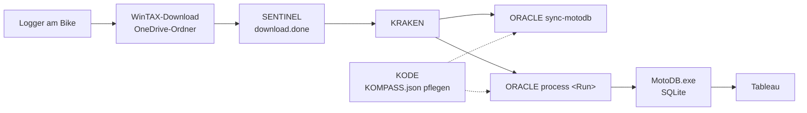

# ORACLE – Workflow-Leitfaden

Schritt-für-Schritt-Anleitung für die korrekte Nutzung von **ORACLE** (und dem Begleittool **SENTINEL**) rund um ein
Rennwochenende. Details zu einzelnen Befehlen und Konfigurationswerten stehen in der [README](../README.md), die
Methoden im Einzelnen in der [Funktionsreferenz](ORACLE-function-reference.md).

> Alle Aussagen beziehen sich auf den Code in diesem Repository. Fundstellen sind als Links angegeben.
> Konsolen- und Logmeldungen von ORACLE und SENTINEL sind englisch; sie werden hier wörtlich zitiert.

---

## Inhalt

1. [Überblick](#1-überblick)
2. [Voraussetzungen](#2-voraussetzungen)
3. [Eingabedaten und Formate](#3-eingabedaten-und-formate)
4. [Vor dem Rennen](#4-vor-dem-rennen)
5. [Während des Rennwochenendes](#5-während-des-rennwochenendes)
6. [Nach dem Rennen](#6-nach-dem-rennen)
7. [Fehlerfälle und Reaktion](#7-fehlerfälle-und-reaktion)
8. [Tipps](#8-tipps)

---

## 1. Überblick



| Werkzeug | Aufgabe | Fundstelle |
|---|---|---|
| **KODE** | Stammdaten (Tracks, Rider, Längen, Ziellinien-Koordinaten) in `KOMPASS.json` pflegen; Track-Längen-Vorschläge bestätigen | separates Repository |
| **SENTINEL** | erkennt, wann ein Run vollständig synchronisiert ist, und schreibt `download.done` | [RunWatcher.cs](../SENTINEL/RunWatcher.cs) |
| **KRAKEN** | startet die Jobs (ORACLE, MotoDB) nacheinander und wertet die Exit-Codes aus | extern |
| **ORACLE** | Metadaten, `.HED`, sVehicle/Lap-Distanzen, Track-Länge, optional GPS-Lap-Split, `oracle.status.json` | [OraclePipeline.cs](../ORACLE/Pipeline/OraclePipeline.cs) |
| **MotoDB** | liest Runs + `loadChannels.xlsx` in die SQLite-DB | extern |

---

## 2. Voraussetzungen

### 2.1 Software und Lizenz

| Bedarf | Wofür | Hinweis |
|---|---|---|
| .NET 8 Runtime (x64) | ORACLE, SENTINEL | Support-Ende .NET 8: 10.11.2026 (siehe [external-tools-notes.md](external-tools-notes.md)) |
| KTM Utils Software Suite (`C:\KTM Tools\KTM Utils Software Suite`: `KtmDataHandler.dll`, `KtmSharedUtils.dll`) | alles, was ZTX-Daten liest oder schreibt: `process`, `validate`, `detect`, `detect-start`, `split-laps` | Pfad fest im [ORACLE.csproj](../ORACLE/ORACLE.csproj) referenziert, Laufzeit-Auflösung in [KtmRuntime.cs](../ORACLE/Runtime/KtmRuntime.cs) |
| HASP-Dongle + WinTAX/TelDataX-Runtime | ebenso | ohne Dongle/Runtime schlägt das Laden der Runs fehl (`LoadRun failed …` im Log, [ImportDataCalculator.cs](../ORACLE/Processing/ImportDataCalculator.cs)) |
| — | `sync-motodb` | braucht **weder** Suite noch Dongle, nur `KOMPASS.json` und `loadChannels.xlsx` |

### 2.2 Installation

1. `dotnet publish "ORACLE/ORACLE.csproj" -c Release -o "C:\KTM Tools\ORACLE"` (bzw. das ausgelieferte Paket).
2. `oracle-config.json` liegt **neben `ORACLE.exe`**; fehlt sie, gelten die Standardwerte aus
   [OracleConfig.cs](../ORACLE/Pipeline/OracleConfig.cs). Ist sie ungültig, endet ORACLE mit Exit-Code `7`.
3. SENTINEL analog veröffentlichen; `sentinel-config.json` neben `SENTINEL.exe`
   ([SentinelConfig.cs](../SENTINEL/SentinelConfig.cs)).
4. Auf verwalteten PCs nur aus freigegebenen Ordnern starten (z.B. `C:\KTM Tools\ORACLE`), sonst blockiert die
   Anwendungssteuerung die `.exe`. Zum Testen: `dotnet ORACLE.dll <Argumente>`.

### 2.3 Konfiguration prüfen (`oracle-config.json`)

| Schlüssel | Bedeutung | Prüfen |
|---|---|---|
| `DatabaseDirectory` + `DatabaseFileName` | Ort von `KOMPASS.json` | Datei vorhanden und aktuell? |
| `MotoDbLoadChannelsPath` | `loadChannels.xlsx` von MotoDB | Pfad stimmt, Datei nicht dauerhaft in Excel geöffnet |
| `TeamMappings` | Team-Ordner → Teamname | neues Team? Eintrag ergänzen |
| `TrackLength.SuggestionsDirectory` | gemeinsamer Ordner für Längen-Vorschläge | für alle Maschinen erreichbar (OneDrive) |
| `Gps.LatitudeChannel` / `LongitudeChannel` | GPS-Kanäle (exakter Name) | Standard `Lat_dez` / `Lon_dez` |
| `RaceDetection`, `GpsLapSplit`, `TrackLength` | Schwellenwerte | nur nach Rücksprache ändern |
| `NormalizeDeviceFolderName` | `AA 01` → `AA01` | `false`, falls nachgelagerte Tools Originalnamen erwarten |

Vollständige Liste mit Erläuterungen: [README, Abschnitt 8](../README.md#8-konfiguration--oracle-configjson).

---

## 3. Eingabedaten und Formate

### 3.1 Ordnerstruktur (WinTAX4)

```
<Team>\Wintax\<Saison>\<Motorklasse>\<Event-Typ>\<Event>\<Session>\<Gerät>\Run_xxxx\Lap_xxxxxxxx_xxxxx\
z.B. 01_KTM-FR\Wintax\2026\450\05_RT\RT22_GER-Teutschenthal\R1\AA01\Run_1078\Lap_00001101_00418\
```

Team, Saison, Motorklasse und Disziplin werden am **Muster** der Pfadsegmente erkannt, unabhängig von der Tiefe
([PathMetadataParser.cs](../ORACLE/Metadata/PathMetadataParser.cs)). Der Event-Ordner hat die Form `RTnn_CC-Track`.

### 3.2 Dateien je Run

| Datei | Inhalt | ORACLE liest / schreibt |
|---|---|---|
| `Lap_*\cableData.ztx` | Telemetrie (proprietär, nur über KtmDataHandler) | liest; schreibt beim GPS-Lap-Split neu |
| `Lap_*\LapHeader.xml` | Lap-Metadaten (Startzeit, Lap-Zeit, Alias, Distanz) | liest/schreibt ([XmlRunEditor.cs](../ORACLE/Processing/XmlRunEditor.cs)) |
| `RunLapHeader.xml` | Liste der Laps (`LapInfo/Path`) | liest/schreibt; SENTINEL prüft damit die Vollständigkeit |
| `Car.xml`, `Session.xml` | Bike, Rider, Track, `TrackLen` | schreibt |
| `importData.ztx` | von ORACLE berechnete Kanäle (`sVehicle`) | **wird von ORACLE ersetzt** |
| `{Saison}{Event}_{Bike}{Session}.HED` | INI-artige Metadaten für MotoDB (UTF-8), inkl. Sektion `[WEATHER]` | liest/schreibt ([HedFileService.cs](../ORACLE/Metadata/HedFileService.cs)) |
| `Lap_*\Meteo.xml` | Wetter je Lap im WinTAX-Format | schreibt ([MeteoXml.cs](../ORACLE/Weather/MeteoXml.cs)) |
| `download.done` | Freigabe-Marker (XML) von SENTINEL | nur SENTINEL schreibt |

Beispiel `.HED` (aus RT22 R1 AA01):

```ini
[KTM_NAMING]
bikeName = AA01
trackName = Teutschenthal
trackLength = 1565
riderName = Andrea Adamo
```

### 3.3 Dateien je Gerät (Geräteordner, z.B. `…\R1\AA01`)

| Datei | Zweck |
|---|---|
| `oracle.status.json` | Verarbeitungsstand (Schritte, Revision, Track-Länge, übersprungene/fehlgeschlagene Runs) – [OracleStatus.cs](../ORACLE/Pipeline/OracleStatus.cs) |
| `oracle.lock` | exklusive Sperre während der Verarbeitung – [ProcessingLock.cs](../ORACLE/Pipeline/ProcessingLock.cs) |

### 3.4 Zentrale Dateien

| Datei | Gepflegt mit | Inhalt |
|---|---|---|
| `KOMPASS.json` | KODE | Disziplinen, Tracks (Name, Land, Länge, Untergrund, `Latitude`/`Longitude` der Ziellinie), Rider (Kürzel, Saison, Team) |
| `loadChannels.xlsx` | MotoDB / `ORACLE sync-motodb` | Sheets `CIRCUITS` (Track-Längen) und `HED` werden aus KOMPASS erzeugt |
| `suggestions\*.json` | ORACLE schreibt, KODE bestätigt/lehnt ab | vorläufige Track-Längen |

---

## 4. Vor dem Rennen

| # | Schritt | Wie | Ergebnis |
|---|---|---|---|
| 1 | **Track in KOMPASS prüfen** | KODE → Tracks: Name, Land, Untergrund, **Länge**, **Latitude/Longitude der Ziellinie** | Länge eindeutig (kein anderer Track mit gleicher Länge); Koordinate liegt auf der Strecke |
| 2 | **Rider prüfen** | KODE → Riders: Kürzel (z.B. `AA`), Saison, Team | ORACLE findet den Rider über Kürzel + Saison (+ Team) |
| 3 | **MotoDB-Inputs aktualisieren** | `ORACLE.exe sync-motodb` | `CIRCUITS`/`HED` aktuell; Warnungen bei doppelten Längen beachten |
| 4 | **Konfiguration prüfen** | Abschnitt [2.3](#23-konfiguration-prüfen-oracle-configjson) | Pfade erreichbar |
| 5 | **SENTINEL starten** | `SENTINEL.exe` (läuft dauerhaft, `Ctrl+C` beendet) | Konsole zeigt die überwachten Pfade mit ✅ |
| 6 | **Funktionstest** | `ORACLE.exe validate "<Run eines früheren Events>"` | Exit-Code `0` → Dongle/Runtime funktionieren |

> Fehlt die Länge eines neuen Tracks, ist das kein Hindernis: ORACLE schätzt sie beim ersten Lauf aus den GPS-Runden
> (Median, ganze Meter) und legt einen Vorschlag an (siehe [6.3](#63-track-längen-vorschläge-bestätigen)).
> Für den GPS-Lap-Split und das Wetter ist die **Koordinate** dagegen Pflicht.

---

## 5. Während des Rennwochenendes

### 5.1 Automatischer Ablauf (Normalfall)

1. **Download** – WinTAX lädt den Logger in den OneDrive-Ordner.
2. **SENTINEL** prüft jeden `Run_*` ohne `download.done` im Polling-Intervall (Standard 30 s). Ein Run gilt als fertig, wenn
   - alle in `RunLapHeader.xml` referenzierten Dateien vorhanden sind,
   - keine 0-Byte-Dateien, Cloud-Platzhalter oder gesperrten Dateien existieren und
   - Dateianzahl und Gesamtgröße `StabilityThreshold`-mal (Standard 3) unverändert bleiben.

   Dann wird `download.done` atomar geschrieben ([DownloadDoneWriter.cs](../SENTINEL/DownloadDoneWriter.cs)).
3. **KRAKEN** startet nacheinander `ORACLE.exe sync-motodb`, `ORACLE.exe process "<Run>"` und bei Exit-Code `0`/`4` MotoDB.
4. **ORACLE `process`** führt für den Run aus ([README, Abschnitt 6](../README.md#6-was-process-tut-in-reihenfolge)):
   Reparatur verwaister Lap-Ordner → Metadaten (KOMPASS gewinnt gegen Platzhalter in der `.HED`) → kanonische `.HED`
   → optional GPS-Lap-Split → sVehicle und Lap-Distanzen → XML-Properties → **Wetter während der Runs** (`[WEATHER]`,
   `Meteo.xml`; braucht Internet, ändert nie den Exit-Code) → Track-Längen-Prüfung → `oracle.status.json`.
5. **MotoDB** übernimmt den Run, sofern `trackLength` aus der `.HED` exakt in `CIRCUITS` vorkommt.

### 5.2 Manuelle Verarbeitung

```powershell
# Ganze Session eines Geräts renn-bewusst (Rennen über mehrere Runs zusammengeführt)
ORACLE.exe process "C:\MXTrackData\...\RT22_GER-Teutschenthal\R1\AA01"

# Eine Session mit mehreren Geräten (jedes Gerät eigenständig, eigene Metadaten)
ORACLE.exe process "C:\MXTrackData\...\RT22_GER-Teutschenthal\BC"

# Einzelner Run (wie KRAKEN)
ORACLE.exe process "C:\MXTrackData\...\R1\AA01\Run_1079"

# Nur ansehen: welche Runs sind Rennen? welche Starts sind gültig? (ändert nichts)
ORACLE.exe detect "C:\...\R1\AA01"
ORACLE.exe detect-start "C:\...\R1\AA01"
```

Bereits verarbeitete Runs werden übersprungen (Idempotenz über `oracle.status.json`); `--force` verarbeitet erneut.
Wurde ein Ordner mit einer älteren Verarbeitungsrevision bearbeitet, verarbeitet ORACLE ihn automatisch neu.

### 5.3 Laps per GPS-Ziellinie teilen (optional)

Nur nötig, wenn ein Run als **eine durchgehende Lap** aufgezeichnet wurde.

```powershell
ORACLE.exe split-laps "C:\...\RT37_CHN-Shanghai" --dry-run   # 1. Probelauf: Erkennung + geplante Grenzen je Run
ORACLE.exe split-laps "C:\...\RT37_CHN-Shanghai"             # 2. teilen (transaktional, mit Sicherung)
ORACLE.exe process   "C:\...\R1\AA01" --gps-split            #    oder direkt in der Verarbeitung
ORACLE.exe split-laps "C:\...\R1\AA01\Run_885" --undo        # Rückgängig: Original-Laps wiederherstellen
```

- Bereits geteilte Runs (WinTAX-/ORACLE-Split, Logger-Runden auf der Ziellinie) werden erkannt und **nicht** erneut geteilt.
- Originale liegen unter `Run_x\_ORACLE_original\<Zeitstempel>` mit `split-manifest.json`.
- Vor dem ersten produktiven Einsatz einen geteilten Run in WinTAX öffnen und prüfen.
- Ablauf im Detail: [README, Abschnitt 9](../README.md#9-gps-split-laps-split-laps---gps-split).

### 5.4 Exit-Codes richtig auswerten

| Code | Bedeutung | Reaktion |
|---|---|---|
| `0` | Erfolg | weiter (MotoDB) |
| `1` | Allgemeiner Fehler (Exception, API/Dongle) | Log prüfen |
| `2` | Ungültige Argumente (unbekannte Option, Pfad mit Leerzeichen ohne Anführungszeichen, `merge`) | Aufruf korrigieren |
| `3` | Daten nicht gefunden | später erneut (Sync läuft evtl. noch) |
| `4` | Teilweise erfolgreich (Runs übersprungen/fehlgeschlagen) | MotoDB starten; Runs reparieren, dann `--force` |
| `5` | Ressource gesperrt (`loadChannels.xlsx` in Excel, anderer ORACLE-Prozess) | später erneut |
| `6` | Track-Länge fehlt | MotoDB **nicht** starten; Länge in KODE eintragen oder längeren Run abwarten |
| `7` | Ungültige Daten (defekter Run, ungültige `KOMPASS.json`/`oracle-config.json`) | **kein** Retry; Daten reparieren |

Bei mehreren Geräten/Runs gewinnt der schwerwiegendste Code
([OracleExitCode.cs](../ORACLE/Pipeline/OracleExitCode.cs), `OracleExitCodes.Combine`).

---

## 6. Nach dem Rennen

### 6.1 Ergebnis kontrollieren

1. `oracle.status.json` je Gerät: alle Schritte `success`? `discovery.skippedRuns` und `stint.failedRuns` leer?
   `weather` mit Quelle, Gitterabstand und je Run Streckenzustand/Temperatur/Regen.
2. Log `{AppDir}\logs\oracle-{yyyyMMdd-HHmmss}-{PID}.log` (Logs älter als 60 Tage werden automatisch gelöscht):
   Abschnitte `[inputs]` (verwendeter KOMPASS-/loadChannels-Stand mit SHA-256), `[metadata]`, `[trackLength]`, `[gps]`, `[weather]`.
3. Stichprobe in WinTAX: Run öffnen, Lap-Zeiten und Rider prüfen; Wetter je Lap auf der Meteo-Seite (*Edit Lap Information*).

### 6.2 Wetter prüfen und nachtragen

- Fehlte an der Strecke das Internet (`weather: failed`), holt der nächste `process`-Aufruf das Wetter nach. Für ganze Events:
  `ORACLE.exe weather "C:\...\RT22_GER-Teutschenthal"`.
- Das Modell kennt nur 15-Minuten-Werte im 1–9-km-Raster und verfehlt kurze Schauer manchmal. Stimmt `trackCondition` nicht mit
  den Session-Notizen überein: Werte in der `.HED`-Sektion `[WEATHER]` korrigieren und `weatherSource = manual` setzen.
- Details: [README, Abschnitt 10b](../README.md#10b-wetter-während-der-runs-process-weather).

### 6.3 Track-Längen-Vorschläge bestätigen

Hat ORACLE eine Länge geschätzt (`trackLength.provisional = true` im Status), liegt ein Vorschlag im Ordner `suggestions`.

1. KODE → *More → Track length suggestions…* → übernehmen oder ablehnen.
2. Beim nächsten Aufruf zieht ORACLE die bestätigte Länge in `.HED`, `Session.xml` und `CIRCUITS` nach – auch für bereits
   verarbeitete Runs, ohne `--force` (`trackLength.correctedFrom` im Status).
3. Abgelehnte Längen verwendet ORACLE nicht mehr.

### 6.4 Defekte Runs nachholen

1. Ursache aus Log/Status lesen (`[discovery]`, z.B. Lap-Ordner ohne `cableData.ztx`, mehrfach geteilte Laps).
2. In WinTAX reparieren oder Run neu vom Logger laden.
3. `ORACLE.exe process "<Geräteordner>" --force`.

### 6.5 Aufräumen

- Sicherungen des GPS-Splits (`_ORACLE_original`) erst löschen, wenn die geteilten Runs geprüft sind.
- Von der Reparatur verschobene Lap-Ordner liegen in `_ORACLE_removed` (mit `README.txt`).

---

## 7. Fehlerfälle und Reaktion

| Symptom (Exit-Code / Log-Präfix) | Ursache | Lösung |
|---|---|---|
| Exit `1`/`7`, `LoadRun failed` oder Hinweis auf die KTM-Runtime im Log | Suite/Dongle/TelDataX fehlen | Suite unter `C:\KTM Tools\KTM Utils Software Suite` installieren, Dongle stecken |
| Exit `2` | unbekannte Option oder überzähliges Argument | Pfade in Anführungszeichen; erlaubte Optionen siehe [README, Abschnitt 4](../README.md#4-commands) |
| Exit `3` | Pfad existiert nicht / keine Runs | Pfad prüfen; Sync abwarten |
| Exit `4`, `[discovery] ⚠️ Run skipped …` | defekter `Run_*`-Ordner übersprungen | siehe [6.4](#64-defekte-runs-nachholen) |
| Exit `5` | `loadChannels.xlsx` in Excel offen (ORACLE wartet bis `LockWaitSeconds`) oder `oracle.lock` eines anderen Prozesses | Excel schließen / anderen Lauf abwarten, erneut ausführen |
| Exit `6`, `[trackLength]` | keine eindeutige Track-Länge (fehlt oder von anderem Track belegt) | Länge in KODE eintragen/bestätigen, Längenkonflikte auflösen, erneut ausführen |
| Exit `7` | `KOMPASS.json` oder `oracle-config.json` ungültig, Run-Ordner beschädigt | KOMPASS in KODE öffnen/speichern oder aus `backups` wiederherstellen; Config korrigieren |
| `[gps-split] Skipped: no coordinate in KOMPASS …` | Track ohne `Latitude`/`Longitude` in KOMPASS | in KODE pflegen |
| `[gps-split] No finish line: No GPS pass within 50 m …` | KOMPASS-Punkt liegt neben der Strecke (Abstand im Log) | Koordinate in KODE korrigieren |
| `[gps-split] … unclear lap structure …` | Grenzen ohne GPS-Position | nicht automatisch geteilt; in WinTAX prüfen |
| `[gps-split] ❌ … – run unchanged` | Schreiben/Prüfen fehlgeschlagen, Rollback erfolgt | Ursache im Log (z.B. Speicherplatz), erneut ausführen |
| `[gps] No GPS fix …` | Run ohne gültige Position | sVehicle 0 m, keine Lap-Distanz; Track-Länge kommt aus anderen Runs des Events |
| `[weather] ⚠️ … no connection` / `weather: failed` | kein Internet beim Verarbeiten | nichts tun – nächster `process`-Aufruf oder `ORACLE.exe weather <Pfad>` holt nach |
| `[weather] Skipped: no track coordinate …` | Track ohne `Latitude`/`Longitude` in KOMPASS | in KODE pflegen, dann `ORACLE.exe weather <Pfad>` |
| SENTINEL: Run bleibt `invalid` (z.B. `1 missing file(s) according to RunLapHeader.xml`) | fehlende Datei laut `RunLapHeader.xml`, Platzhalter, 0-Byte-Datei oder Sperre (Grund steht in der Zeile) | OneDrive-Sync prüfen („Immer auf diesem Gerät behalten“), Download wiederholen |
| ORACLE wurde während `split-laps` abgebrochen (Strom, Kill) | `split-manifest.json` im Sicherungsordner ist noch als „pending“ markiert (Journal) | beim nächsten Aufruf stellt ORACLE die Original-Laps automatisch wieder her (`LapSplitStore.RecoverInterrupted`, [LapSplitStore.cs](../ORACLE/Processing/LapSplitStore.cs)) |

---

## 8. Tipps

- **Probelauf zuerst:** `split-laps --dry-run` und `detect` verändern nichts.
- **Pfade mit Leerzeichen** immer in Anführungszeichen.
- **Rider-/Session-Pfad statt Einzel-Run**, wenn ein Rennen über mehrere Runs verteilt ist – dann werden Laps und Distanzen
  durchgehend nummeriert.
- **KOMPASS gewinnt:** Platzhalter wie `Test Rider` in der `.HED` werden ersetzt. Für bewusst von Hand gepflegte `.HED`-Dateien
  `PreferHedMetadata: true` setzen.
- **Mehrere Maschinen:** Längen-Vorschläge und `loadChannels.xlsx`-Zugriffe sind über den gemeinsamen Ordner bzw. einen
  systemweiten Mutex abgestimmt; KRAKEN-Jobs laufen nacheinander.
- **Testdaten:** immer auf einer Kopie arbeiten (z.B. `C:\MXTrackData\BackUp Testdata\…` kopieren), nie auf dem Original.
- **Debugging:** [DEBUG_GUIDE.md](DEBUG_GUIDE.md) (Breakpoints, Launch-Profile, SENTINEL).
