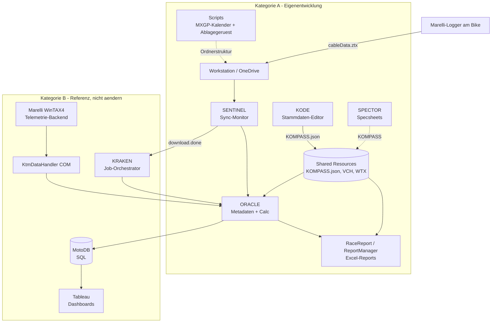
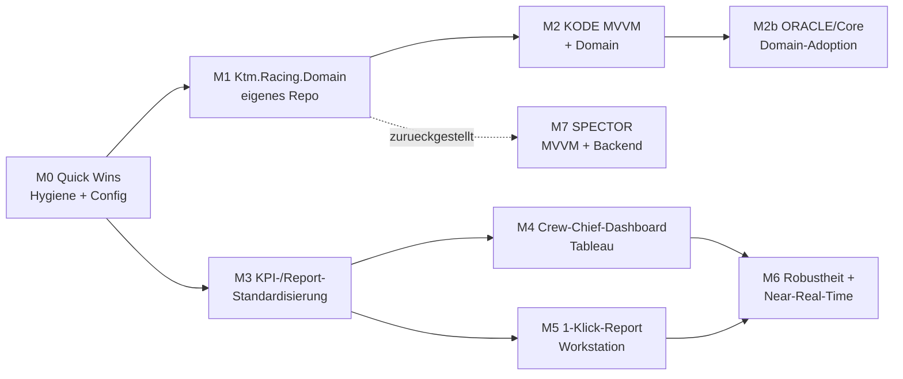

# Gesamtanalyse & Roadmap – KTM Offroad Racing Toolchain

> Read-only-Analyse, Stand 2026-09-05. **Keine Code-Änderungen** – ausschließlich Vorschläge.
> Konsolidiert die fünf Einzelreports (Kategorie A). Freigabe vor jeder Umsetzung erforderlich.

## 0. Getroffene Entscheidungen (bestätigt 2026-09-05)

| # | Thema | Entscheidung | Konsequenz |
| --- | --- | --- | --- |
| E1 | Crew-Chief-Dashboard | **Tableau** (gespeist aus MotoDB); Detailreports = Excel | kein neuer UI-Stack; M4 baut auf MotoDB→Tableau auf |
| E2 | Gemeinsame Bibliothek | Neues, eigenständiges **`Ktm.Racing.Domain`** (net8.0) in **eigenem Repo/Solution** | KtmSharedUtils kommt von einem **Fremdteam ohne Source-Zugriff** → nur als DLL konsumierbar; Domain-Lib muss unabhängig baubar/versioniert sein |
| E3 | Sprache Code-Kommentare/XML-Doc | **Durchgängig Englisch** | neuer/angefasster Code EN; bestehende DE-Kommentare schrittweise angleichen |
| E4 | Arbeits-/Modernisierungsreihenfolge | **1) KODE → 2) ORACLE/Core → 3) SPECTOR** (niedrigste Prio, aktuell ungenutzt) | SPECTOR-Ausbau (M7) wird zurückgestellt |

> Hinweis zu E3: Diese Analyse-Dokumente sind bewusst auf Deutsch (Fachdoku). Eine Migration nach
> Englisch kann bei Bedarf als separate Folgeaufgabe erfolgen – bitte gesondert anstoßen.

## 1. Executive Summary

Die fünf Eigenentwicklungen bilden zusammen eine **Postprocessing-Kette für Marelli/WinTAX4-Telemetrie**:
Stammdaten (KODE → KOMPASS.json), Ressourcen/Kanäle (Shared Resources → VCH/WTX), automatisierte
Verarbeitung & Reporting (Calc & Logging Editor: SENTINEL → ORACLE → RaceReport/ReportManager),
Setup-Dokumentation (SPECTOR) und Hilfsskripte (Scripts: MXGP-Kalender, Doku-Konvertierung).

**Reifegrad-Spektrum:** vom produktionsreifen, gut getesteten **Calc & Logging Editor** (Kern der
Toolchain) über das teil-modernisierte **KODE** bis zum Alpha-Prototyp **SPECTOR**.

**Größte Hebel:**
1. **Gemeinsames Domänenmodell** (KOMPASS/Rider/Track) – heute dupliziert in KODE & Core, in SPECTOR fehlend.
2. **KPI-/Report-Standardisierung** als Basis für ein Crew-Chief-Dashboard.
3. **Konfiguration statt hartkodierter Pfade** (durchgängig, alle Tools).
4. **Konsistente Namens-/Kommentarkonventionen** (DE/EN-Mix vereinheitlichen).

## 2. Ökosystem-Überblick

## 3. Tool-Matrix

| Tool | Zweck | Tech | Reife | Rolle in Toolchain |
| --- | --- | --- | --- | --- |
| **Calc & Logging Editor** | Telemetrie-Postprocessing + Reports | .NET 8, Console+WPF, Autofac/ClosedXML/MathNet, COM→WinTAX4 | Produktionsreif | **Kern** – wiederverwenden/erweitern |
| **KODE** | KOMPASS.json pflegen | .NET 8 WinForms, eigenes MVVM | Aktiv (MVVM ~60/30 %) | Stammdaten-Wurzel – erweitern |
| **Shared Resources** | Stammdaten/Kanäle/Installer | JSON, VCH/WTX-XML, C# (KtmSharedUtils), Advanced Installer | Funktional, doku-arm | Fundament – wiederverwenden |
| **Scripts** | MXGP-Kalender, Doku-Konvertierung | Python 3, COM-Doku | Zweckdienlich | Datenvorbereitung/Wissen – härten |
| **SPECTOR** | Bike-/Fahrer-Specsheets | .NET 8 WinForms, self-contained | Alpha (UI only) | Setup-Doku – ausbauen |

## 4. Querschnittsthemen (tool-übergreifend)

1. **Modell-Duplikate:** Rider/Track existiert in KODE **und** in `Ktm.Racing.Core`; SPECTOR braucht dasselbe.
   → Kandidat #1 für geteilte Bibliothek (Abschnitt 7).
2. **KOMPASS.json als de-facto-Vertrag:** Property-Casings (`Riderabbreviation`, `Countrycode`, `Tracklength`)
   sind schema-gekoppelt und propagieren in alle Konsumenten. Änderungen nur konsolidiert + über `JsonPropertyName`.
3. **Hartkodierte Pfade** in nahezu allen Tools (`C:\KTM Tools\…`, OneDrive, `advinst.exe`). → zentrale Konfiguration.
4. **Sprachmix DE/EN** in Kommentaren/XML-Doc, teils innerhalb einer Datei. → einheitliche Konvention (E3).
5. **Namenskonventionen (MS C#):** lowerCamelCase-Methoden/-Properties (KODE), fehlende `_`-Präfixe (Core, SPECTOR),
   generische Designer-Namen (`dateTimePicker1`, `toolStrip2`), Emoji in Kommentaren (SPECTOR).
6. **Nur-MX-Daten:** KOMPASS.json aktuell v. a. MX; Lat/Lon leer. → Datenpflege für weitere Disziplinen/GPS.
7. **Repo-Hygiene:** Office-Sperrdatei (`~$…xlsx`) eingecheckt, leere/tippfehlerhafte Platzhalterdateien, leere READMEs.

## 5. Priorisiertes Gesamt-Backlog (nur Vorschlag)

Aufwand: **S** ≈ Stunden, **M** ≈ Tage, **L** ≈ Woche(n). Prio: Hoch/Mittel/Niedrig.

| ID | Tool | Fundstelle | Problem | Vorschlag | Aufwand | Prio |
| --- | --- | --- | --- | --- | --- | --- |
| B01 | Scripts | `MXGP…py:37` | `verify=False` (TLS aus) | Firmen-CA/Proxy korrekt konfigurieren | S | **Hoch** |
| B02 | Shared Res. | `~$Racereport_Inputs_MX.xlsx` | Sperrdatei eingecheckt | Entfernen + `.gitignore` `~$*` | S | **Hoch** |
| B03 | übergreifend | KODE/Core-Modelle | Rider/Track-Duplikat | `Ktm.Racing.Domain` extrahieren | M | **Hoch** |
| B04 | KODE | `Riders/TracksKODE.cs:12` | UI-Control exponiert | Kapselung über VM | S | **Hoch** |
| B05 | KODE | MainKODE | MVVM unvollständig | MVVM + `RelayCommand` fertigstellen | M | **Hoch** |
| B06 | Calc Editor | `RaceReportOptions` u. a. | hartkodierte Pfade | zentrale Konfiguration | M | **Hoch** |
| B07 | SPECTOR | gesamte App | keine Backend-Logik | MVP: KOMPASS laden + 1 Export | L | **Hoch** |
| B08 | Scripts | Repo | keine `requirements.txt`/Tests | Deps pinnen + Minimaltests | S | Mittel |
| B09 | übergreifend | Kommentare | DE/EN-Mix | Sprachkonvention + Angleichung | M | Mittel |
| B10 | KODE | Models | `Riderabbreviation` etc. | `JsonPropertyName` + PascalCase | M | Mittel |
| B11 | Calc Editor | `ImportDataCalculator` | `_`-Konvention/`SVehicleCalc` | Felder/Methoden angleichen | S | Mittel |
| B12 | SPECTOR | Code-Behind | keine Trennung | MVVM von Beginn an | M | Mittel |
| B13 | Shared Res. | `README.md` | leer | Repo-Doku + Versions-Single-Source | S | Mittel |
| B14 | Scripts | Scraper | brüchiger Selektor | robustere Selektoren + 0-Event-Alarm | M | Mittel |
| B15 | KODE/Calc | öffentl. Member | fehlende XML-Doc | XML-Doc ergänzen | S | Niedrig |
| B16 | übergreifend | KOMPASS.json | nur MX, Lat/Lon leer | Datenpflege Disziplinen/GPS | M | Niedrig |
| B17 | Calc Editor | Kanalnamen | kryptisch | Kanal-/Kürzel-Glossar | S | Niedrig |

## 6. Architektur-Bewertung

**Je Tool:** Der Calc & Logging Editor ist sauber geschichtet (Core-Lib + eigenständige Apps + Tests) und
architektonisch vorbildlich. KODE ist auf gutem MVVM-Weg, aber inkonsistent (Main hinkt nach). Shared Resources
ist funktional, aber build-/doku-seitig heterogen. Scripts ist pragmatisch, aber ohne Test-/Dependency-Hygiene.
SPECTOR ist ein UI-Gerüst ohne Substanz.

**Übergreifend:** Es fehlt eine **gemeinsame Domänen-/Vertrags-Schicht**. Jedes .NET-Tool interpretiert
KOMPASS.json eigenständig; das erzeugt Duplikate und Drift-Risiko. Die Kopplung an native x64-DLLs + HASP-Lizenz
(nur im Calc Editor) ist funktional gekapselt (`KtmRuntime`/Autofac), erschwert aber CI. Die Excel-Datei als
Steuer-/Austauschformat ist praktisch, aber brüchig (Sperrdateien, kein Schema).

## 7. Bewertung: gemeinsame Utility-/Domänen-Bibliothek

**Empfehlung: Ja – aber fokussiert.** Es gibt echten, belegbaren Mehrwert (kein „Abstraktion um ihrer selbst willen"):

- **Konkretes Duplikat:** `RiderEntry`/`TrackEntry` in KODE ≈ Rider/Track in `Ktm.Racing.Core`; SPECTOR bräuchte dasselbe → **3 Konsumenten**.
- **Gemeinsamer Vertrag:** KOMPASS.json-Laden/-Validieren/-Serialisieren + Country-Lookup ist überall gleich.

**Vorschlag – `Ktm.Racing.Domain` (net8.0), klein gehalten:**

| Enthält | Bewusst NICHT enthalten |
| --- | --- |
| KOMPASS-Modelle (Rider/Track/Discipline) mit `JsonPropertyName` | Telemetrie-/WinTAX4-Zugriff (bleibt in Core) |
| Laden/Speichern/Validieren von KOMPASS.json | UI-Logik |
| Country-Lookup (ISO 3166) | Report-Excel-Erzeugung (bleibt in Core) |
| Pfad-/Konfig-Abstraktion für KOMPASS | native/HASP-Themen (KtmSharedUtils) |

**Konsumenten:** KODE (ersetzt eigene Models/Service), Calc Editor/Core (nutzt statt eigener Kopie),
SPECTOR (Dropdown-Datenquelle). **Distribution:** internes NuGet oder Projektreferenz.
**Abgrenzung zu KtmSharedUtils (Entscheidung E2):** KtmSharedUtils wird von einem **anderen Team ohne
Source-Zugriff** entwickelt und darf nur als **veröffentlichte DLL** konsumiert werden. `Ktm.Racing.Domain`
entsteht daher in einer **eigenständigen Umgebung** (eigenes Repo/Solution, unabhängig baubar und versioniert)
und enthält reine, testbare Managed-Domänenlogik – **keine** Abhängigkeit vom KtmSharedUtils-Quellcode.

## 8. Vergleich mit professioneller Motorsport-Software

Wichtige Einordnung: **Marelli WinTAX4 ist bereits im Einsatz** – es ist das professionelle
Analyse-/Telemetrie-Backend, auf dem die Eigenentwicklungen via `KtmDataHandler` (COM) aufsetzen.
Die Eigenentwicklung ist also **kein Ersatz**, sondern die **Automatisierungs-/Reporting-Schicht darüber** –
konzeptionell analog dazu, wie Werksteams ATLAS/MoTeC mit eigenen Pipelines ergänzen.

| Fähigkeit | Profi-Tools (Marelli WinTAX4, McLaren ATLAS, MoTeC i2 Pro) | KTM-Ist | Potenzial |
| --- | --- | --- | --- |
| Telemetrie-Erfassung/-Analyse | Kern-Feature (Waveform, Overlay, Track-Map, Histogramme) | WinTAX4 (zugekauft) | beibehalten |
| Math-/Virtual-Channels | umfangreiche Formelbibliotheken | **VCH-Dateien** (eigenes Äquivalent) | VCH-Katalog versionieren/dokumentieren |
| Multi-Run/Lap-Vergleich | Standard (Overlay/Compare) | `SessionMergeService` + `ChannelReduction` | ausbauen (Fahrer-/Session-Vergleich im Report) |
| Track-Map/GPS | integriert | `sVehicle` aus GPS (Haversine) + Lat/Lon in KOMPASS | Streckenkarten/Sektoren im Report |
| Auto-Reports/Templates | teils (i2 Reports, ATLAS-Sessions) | **RaceReport** (datengetrieben, Excel) | Template-Governance + KPI-Katalog |
| Zentrale Datenhaltung | Session-/Datenserver, schnelle Queries | Dateibasiert (ZTX) + MotoDB (SQL) + Excel | zentraler KPI-Store für Dashboard |
| Engineer-Dashboards | Live-/Post-Session-Displays | Tableau (downstream MotoDB) | Crew-Chief-Dashboard formalisieren |
| Near-Real-Time/Trackside | ATLAS: live; MoTeC: near-live | aktuell **Batch/Post-Session** | optionale Near-Live-KPIs |

**Ableitung für den professionellen Renneinsatz:** Die Architektur (Profi-Analysewerkzeug + eigene Automatisierung
+ BI) ist grundsolide und branchenüblich. Für Renneinsatz-Reife zählen v. a.: (1) **standardisierter KPI-Katalog**
für den Crew Chief, (2) **Robustheit/Observability** der Pipeline (SENTINEL/KRAKEN/ORACLE), (3) **schnellere/zentrale
Datenbereitstellung** statt Excel-Handoffs, (4) perspektivisch **Near-Real-Time** für Kernkennwerte am Track.

## 9. Roadmap – gemeinsame Postprocessing-Toolchain

**Zielbild:** (a) Technischer Crew Chief ruft zentrale Kennwerte ab (Dashboard/Report);
(b) Reports lassen sich per Workstation automatisiert generieren.

| Meilenstein | Inhalt | Abhängig von | Wiederverwendung | Aufwand | Risiko |
| --- | --- | --- | --- | --- | --- |
| **M0 Quick Wins** | B01, B02, B13; Pfade→Config beginnen; Glossar | – | – | S–M | gering |
| **M1 Geteiltes Domänenmodell** | `Ktm.Racing.Domain` in **eigenem Repo/Solution** (KOMPASS/Rider/Track) | M0 | KODE-/Core-Modelle **ablösen** | M | mittel (Schema-Vertrag) |
| **M2 KODE-MVVM (zuerst)** | MVVM fertig, Domain adoptieren (B04/B05/B10) | M1 | KODE **erweitern** | M | gering |
| **M2b ORACLE/Core-Adoption** | Core/ORACLE nutzt `Ktm.Racing.Domain` statt eigener Kopie | M1, M2 | Core **erweitern** | S–M | gering |
| **M3 KPI-/Report-Standardisierung** | Crew-Chief-KPI-Katalog, Template-Governance, VCH-Katalog | M0 | `Ktm.Racing.Core.Report` **erweitern** | M | mittel |
| **M4 Crew-Chief-Dashboard** | Zentrale Kennwerte in **Tableau (aus MotoDB)** – E1 bestätigt | M3 | MotoDB+Tableau (Kat. B) **wiederverwenden** | L | mittel–hoch (Datenfluss) |
| **M5 1-Klick-Report Workstation** | ReportManager/CLI: End-to-End auf Knopfdruck, optional geplant | M3 | ReportManager/ORACLE **erweitern** | M | gering |
| **M6 Robustheit + Near-Real-Time** | Pipeline-Monitoring/Logging; optionale Near-Live-KPIs | M4, M5 | SENTINEL/ORACLE **erweitern** | L | hoch (Trackside/Timing) |
| **M7 SPECTOR-Produktisierung** | **zurückgestellt (E4: niedrigste Prio, aktuell ungenutzt)** – MVVM + Backend + Export (B07/B12) | M1 | SPECTOR **ausbauen** | L | mittel |

**Empfohlene Sequenz (E4):** M0 → M1 → **M2 (KODE zuerst)** → **M2b (ORACLE/Core)** → M3 → (M4 ∥ M5) → M6. **M7 (SPECTOR) zurückgestellt** – niedrigste Priorität.

## 10. Wiederverwenden / Erweitern / Ablösen

| Baustein | Einstufung | Begründung |
| --- | --- | --- |
| `Ktm.Racing.Core` (Report/Oracle/Merge) | **Wiederverwenden/Erweitern** | reifes Fundament der Toolchain |
| Ktm.Racing.ReportManager (WPF) | **Erweitern** | Einstieg für 1-Klick-Report/Automation |
| ORACLE / SENTINEL (CLI) | **Wiederverwenden** | bewährte Pipeline-Kopplung an KRAKEN |
| KODE | **Erweitern** | MVVM fertigstellen, Shared-Model adoptieren |
| KtmSharedUtils | **Erweitern/abgrenzen** | native/Infra-Utils behalten; Domäne separat |
| KOMPASS.json | **Wiederverwenden/Erweitern** | Vertrag beibehalten, Daten/Schema pflegen |
| Rider/Track-Modelle (dupliziert) | **Ablösen** | durch `Ktm.Racing.Domain` ersetzen |
| SPECTOR-Backend | **Neu aufbauen** | derzeit nur UI-Gerüst |
| MXGP-Scraper | **Wiederverwenden/härten** | Datenvorbereitung; Security/Robustheit verbessern |
| Marelli WinTAX4 (Kat. B) | **Wiederverwenden** | professionelles Analyse-Backend – behalten |
| MotoDB + Tableau (Kat. B) | **Wiederverwenden** | Dashboard-Backend – nicht verändern |

## 11. Nächste Schritte

1. ✅ Entscheidungen E1–E4 bestätigt (2026-09-05).
2. **Freigabe für M0 Quick Wins** (risikoarm) einholen – Backlog B01/B02/B13.
3. `Ktm.Racing.Domain` als eigenständiges Repo/Solution aufsetzen (M1, Schlüssel-Enabler).
4. KODE zuerst modernisieren (M2), danach ORACLE/Core auf das geteilte Modell umstellen (M2b); SPECTOR (M7) zurückgestellt.

> Hinweis: Dieses Dokument ist reine Analyse/Empfehlung. Umsetzung erst nach ausdrücklicher Freigabe.
