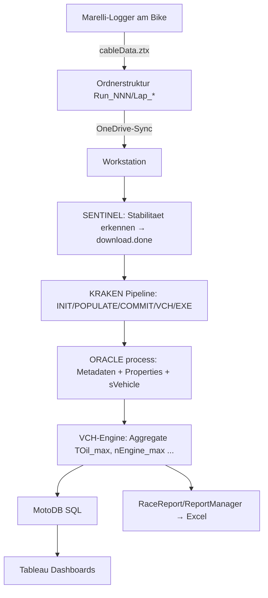

# KTM Offroad Racing Automated Calculation and Logging Editor – Analyse

> Read-only-Analyse, Stand 2026-09-05. Keine Code-Änderungen vorgenommen.
> Konsolidiertes Backlog & Roadmap: `docs/analysis/00_Gesamtanalyse-und-Roadmap.md`.

## 1. Zweck

Das reifste Tool im Ökosystem und faktisch der **Kern der Postprocessing-Toolchain**.
Es automatisiert Berechnung, Datenanreicherung und Report-Erzeugung für Offroad-Rennen:
Es konsumiert **WinTAX4/Marelli-Telemetrie** (`cableData.ztx`, binäres ZTX-Format),
reichert sie mit KOMPASS.json-Metadaten an, rechnet abgeleitete Kanäle (z. B. GPS-Distanz
`sVehicle`) und erzeugt strukturierte Race-Reports (Excel).

Die Lösung besteht aus mehreren eigenständig deploybaren Teilen (ORACLE, SENTINEL,
ReportManager) plus gemeinsamer Core-Bibliothek, die in die **KRAKEN**-Job-Pipeline
integriert sind.

## 2. Solution-Layout

Solution: `Ktm.Racing.slnx`

| Projekt | Typ / TFM | Rolle |
| --- | --- | --- |
| **Ktm.Racing.Core** | Library, `net8.0` | Domänenlogik: Oracle (Metadaten/Calc/Pipeline), Merge (Session-Merge), Report (Report-Erzeugung), Runtime (native DLL-Bootstrapping) |
| **ORACLE** | Exe (Console), `net8.0` | CLI-Orchestrator für die KRAKEN-Pipeline: `process`/`merge`/`validate` + Legacy-Modus |
| **SENTINEL** | Exe (Console), `net8.0` | OneDrive-Sync-Monitor: erkennt Run-Stabilität → schreibt `download.done` (triggert KRAKEN) |
| **Ktm.Racing.ReportManager** | WinExe (WPF), `net8.0-windows` | Interaktive GUI (MVVM) zur Run-Auswahl und Report-Erzeugung |
| **Ktm.Racing.Tests** | xUnit, `net8.0` | Integrationstests (skippable, wenn Testdaten/DLL-Suite fehlen) |

Zentrale Klassen: `OraclePipeline` (Orchestrierung `ProcessRunAsync`/`ValidateRun`),
`KompassService` (Lookup Track/Rider), `RunPropertyEditor` (Run-/Lap-Properties via
Marelli-API), `ImportDataCalculator` (`sVehicle`-Berechnung), `SessionMergeService`,
`RaceReportService`. Runtime-Bootstrap über `KtmRuntime` (native DLL-Auflösung) und
`KtmDataHandlerFactory` (Autofac-DI).

## 3. Tech-Stack

| Aspekt | Details |
| --- | --- |
| Runtime | .NET 8; **x64 zwingend** (native `TelDataZTXx64.dll`) |
| UI | Console (ORACLE/SENTINEL), WPF/MVVM (ReportManager) |
| NuGet | Autofac 6.3, ClosedXML 0.105, MathNet.Numerics 5.0, System.Configuration.ConfigurationManager 9.0 |
| Externe DLLs (KTM-Suite) | KtmDataHandler, KtmSharedUtils(+Cpp), TelDataZTX, KtmLicenseHandler, HASP-Stack, log4net, Newtonsoft.Json |
| Interop | COM-basierter Zugriff auf **Marelli WinTAX4** (Sysma/Wintax-Automation) über KtmDataHandler |

## 4. Datenpipeline & Formate

Wesentliche Formate:

| Format | Rolle |
| --- | --- |
| `cableData.ztx` | binäre Marelli-Telemetrie (Zeitreihen: RPM, Öltemp, GPS …), gelesen über KtmDataHandler/`TelDataZTX` |
| WinTAX4-XML (`Session.xml`, `Car.xml`, `LapHeader.xml`) | Run-/Lap-Metadaten, gesetzt via `RunPropertyEditor` |
| **KOMPASS.json** | Stammdaten (Track/Rider-Lookup, Fallback zu HED) |
| HED-Datei (INI-artig) | Per-Run-Override der Metadaten |
| `download.done` | SENTINEL-Trigger für KRAKEN |
| `oracle.status.json` | Idempotenz-/Status-State pro Run (`--force` überschreibt) |
| `Racereport_Inputs_*.xlsx` | Steuerdatei (aktive Kanäle: LOAD=1 & CALC=1) |
| VCH (XML) | Virtuelle-Kanal-Definitionen (Unit, Decimals, Frequenz, Expression) |
| Excel-Report (XLSX) | Ausgabe via ClosedXML (Track/Session/Driver + Kanalwerte) |

Kernberechnung `sVehicle` (`ImportDataCalculator`): Haversine-Distanz aus GPS
(Lat/Lon), Kumulierung + Spline-Interpolation (MathNet), neuer Kanal in Metern.

## 5. Reporting

`RaceReportService` orchestriert: Input-Excel lesen → VCH-Settings (Unit/Decimals) →
Run-Discovery → Single-Run (direkte Aggregate) bzw. Multi-Run (erst Merge, dann Aggregat,
dauer­gewichtete Reduktion in `ChannelReduction`) → VCH-Formatierung → Excel-Export.
Datengetrieben (keine hartkodierten Templates). Beispiel-KPIs: `TOil_max`, `nEngine_max`,
`TEng_ActiveLC_avg`, `NGearShifts` – berechnet durch die (externe) VCH-Engine.

## 6. Tests

xUnit-Integrationstests gegen reale Testdaten + DLL-Suite (via `SkippableFact`,
Skip wenn nicht verfügbar). Abdeckung u. a.: Run-Discovery, Excel-Writer/-Appender,
Input-Reader (LOAD/CALC-Filter), VCH-Settings-Reader, `ChannelReduction`, Fallback-Verhalten.

## 7. Abhängigkeiten

- **KRAKEN** (Kat. B): ruft ORACLE als EXE-Job; Kopplung über Exit-Codes + Statusdateien.
- **MotoDB** (Kat. B): läuft nach ORACLE (Abhängigkeit von `oracle.status.json`).
- **Tableau** (Kat. B): downstream von MotoDB (keine direkte Kopplung).
- **Shared Resources** (Kat. A): KOMPASS.json + VCH-Dateien (hartkodierte Pfade in `RaceReportOptions`).
- **KTM-Utils-Suite**: KtmDataHandler/KtmSharedUtils (referenziert, nicht eingebettet; Auflösung über `KtmRuntime`).

## 8. Architektur-Bewertung

**Stärken:** Saubere Schichtung (Core-Library vs. eigenständige Apps), robuste Abstraktion
über die native DLL-Suite (Autofac-DI + Runtime-Bootstrap), idempotente Verarbeitung
(`oracle.status.json`), datengetriebenes Reporting, umfangreiche `docs/`-Dokumentation
(PIPELINE_ANALYSE, SESSION_MERGE_WORKFLOW, DEBUG_GUIDE), vorhandene Integrationstests.

**Schwächen/Risiken:**
- Hartkodierte Pfade (KOMPASS.json, VCH, Testdaten) statt durchgängiger Konfiguration.
- x64/native-DLL- und HASP-Lizenz-Kopplung erschwert CI/Testbarkeit.
- Domänenmodelle (Rider/Track) dupliziert gegenüber KODE (kein geteiltes Modell).
- `merge`-Kommando laut Doku temporär deaktiviert (Redesign) – offener Punkt.

## 9. Code-Qualität – Befunde

**Namensgebung:** Insgesamt nahe an MS-Konventionen; punktuelle Abweichungen:

| Fundstelle | Ist | Konvention |
| --- | --- | --- |
| `ImportDataCalculator.cs` – `ztxAccessRead/Write` | privates Feld ohne `_` | `_ztxAccessRead` |
| `ImportDataCalculator.cs` – `currentRunPath`, `resultDataset` | private Felder ohne `_` | `_currentRunPath` … |
| `ImportDataCalculator.cs:143` – `SVehicleCalc()` | präfixbasiert | `CalculateSVehicle()` |
| Domänenkürzel `sVehicle`, `nEngine`, `TOil`, `TEng` | Marelli-Notation | fachlich korrekt, aber für Außenstehende kryptisch → Glossar |

Underscore-Konvention wird **uneinheitlich** angewandt (`_disciplines`, `_options`, `_browse`
korrekt; einige Felder in `ImportDataCalculator` ohne `_`).

**Kommentare:** XML-Doc ist überwiegend **umfangreich und gut strukturiert**
(`
`, `<list>`, `<para>`, `<code>`, teils ASCII-Diagramme). Sprache **gemischt
DE/EN**, teils innerhalb derselben Datei (z. B. `KompassService`, `ImportDataCalculator`).
Keine TODO/HACK-Marker. Enums teils spärlich dokumentiert.

## 10. Verbesserungsvorschläge (priorisiert – nur Vorschlag)

Aufwand: **S** ≈ Stunden, **M** ≈ Tage, **L** ≈ Woche(n).

| Prio | Fundstelle | Problem | Vorschlag | Aufwand |
| --- | --- | --- | --- | --- |
| Hoch | `RaceReportOptions`, `KompassService` u. a. | Hartkodierte Pfade | Zentrale Konfiguration (`appsettings`/oracle-config) für alle Pfade | M |
| Hoch | Rider/Track dupliziert vs. KODE | Modell-Duplikat | Gemeinsames Domänenmodell in geteilte Lib (siehe Gesamtdoc) | M |
| Mittel | `ImportDataCalculator` Felder | `_`-Konvention uneinheitlich | Feldbenennung vereinheitlichen; `SVehicleCalc`→`CalculateSVehicle` | S |
| Mittel | DE/EN-Kommentarmix | Uneinheitlich | Kommentar-/Doc-Sprache festlegen (Empfehlung EN) und angleichen | M |
| Mittel | `merge` deaktiviert | Offener Redesign | Merge-Redesign abschließen oder Status klar dokumentieren | M |
| Niedrig | Glossar fehlt | Kryptische Kanalnamen | Kanal-/Kürzel-Glossar in `docs/` | S |

## 11. Rolle im Gesamtsystem

Dieses Tool ist das **Rückgrat der Toolchain** und der natürliche Ort, um die gemeinsame
Domänen-/Report-Bibliothek zu beheimaten. Für das Zielbild „Crew-Chief-Dashboard +
automatisierte Reports“ ist die `Ktm.Racing.Core`-Report-Schicht die zentrale
Wiederverwendungsbasis.
