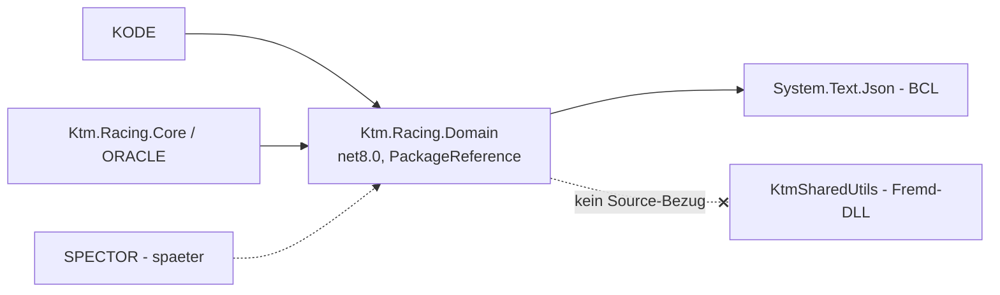

# M1 – Strukturvorschlag: `Ktm.Racing.Domain` (eigenständiges Repo)

> **Historisches Dokument.** Beschreibt den Stand vor Oktober 2026. Der Session-Merge wurde entfernt, und der Race Report Manager ist nicht mehr Teil dieses Repositorys. Aktuelle Beschreibung: [README](../../README.md), [ORACLE-workflow](../ORACLE-workflow.md).

> Vorschlag zur **Freigabe**, Stand 2026-09-05. **Noch kein Code** – erst nach Bestätigung wird gescaffolded.
> Umsetzt Entscheidung **E2** (eigenständige, unabhängig baubare Bibliothek; KtmSharedUtils nur als DLL).
> Gehört zu Meilenstein **M1** der Roadmap (`00_Gesamtanalyse-und-Roadmap.md`).

## 1. Ziel & Scope

Eine kleine, **testbare Managed-Bibliothek**, die das heute duplizierte Domänenmodell rund um
**KOMPASS.json** vereinheitlicht und zum verbindlichen Vertrag macht.

| Enthalten (In-Scope) | Bewusst NICHT enthalten (Out-of-Scope) |
| --- | --- |
| KOMPASS-Modelle (Rider/Track/DisciplineData/Database) | Telemetrie-/WinTAX4-/ZTX-Zugriff (bleibt in `Ktm.Racing.Core`) |
| Laden/Speichern/Serialisieren von KOMPASS.json | Report-/Excel-Erzeugung (bleibt in Core) |
| Validierung (Pflichtfelder, Eindeutigkeit) | UI/WinForms/WPF |
| Track/Rider-Lookup (heute `KompassService`) | native/HASP-/Lizenzthemen |
| Country-Lookup (ISO 3166, eingebettet) | KtmSharedUtils-Quellcode-Abhängigkeit |
| Pfad-/Ziel-Abstraktion (keine hartkodierten Pfade) | KRAKEN-/SENTINEL-Pipelinelogik |

## 2. Rahmenbedingungen (aus E2)

- **Eigenes Git-Repo + eigene Solution**, unabhängig baubar und **semver-versioniert**.
- **Zielframework `net8.0`** (kein `-windows`): nutzbar von KODE, Core/ORACLE (net8.0) und
  ReportManager/SPECTOR (net8.0-windows referenzieren net8.0 problemlos). Keine UI-/OS-Kopplung.
- **Keine Abhängigkeit auf KtmSharedUtils** (Fremdteam, kein Source-Zugriff). Die Lib kommt mit
  reiner BCL aus (`System.Text.Json`); optionales Logging nur über `Microsoft.Extensions.Logging.Abstractions`.
- **Code/Kommentare Englisch** (E3), MS-Namenskonventionen per `.editorconfig` erzwungen.



## 3. Repo-/Solution-Struktur

```
Ktm.Racing.Domain/                      (neues Git-Repo)
├─ Ktm.Racing.Domain.sln
├─ Directory.Build.props                (LangVersion, Nullable=enable, Version, Analyzer)
├─ .editorconfig                        (MS-Naming, EN, Analyzer-Regeln)
├─ .gitignore                           (.NET-Standard: bin/ obj/ .vs/ ~$*)
├─ README.md                            (EN)
├─ CHANGELOG.md
├─ azure-pipelines.yml                  (build → test → pack → push Azure Artifacts)
├─ src/
│  └─ Ktm.Racing.Domain/
│     ├─ Ktm.Racing.Domain.csproj       (net8.0, GeneratePackageOnBuild)
│     ├─ Kompass/
│     │  ├─ Rider.cs
│     │  ├─ Track.cs
│     │  ├─ DisciplineData.cs
│     │  ├─ KompassDatabase.cs
│     │  ├─ Discipline.cs                (enum + sichere Parse)
│     │  ├─ KompassSerializer.cs         (zentrale JsonSerializerOptions)
│     │  ├─ IKompassRepository.cs / KompassRepository.cs
│     │  ├─ KompassLocationOptions.cs / KompassSaveResult.cs
│     │  ├─ IKompassLookup.cs / KompassLookup.cs
│     │  ├─ KompassValidator.cs / ValidationIssue.cs
│     │  └─ KompassFlattener.cs          (flach ↔ verschachtelt für Grid-Editoren)
│     └─ Geo/
│        ├─ Country.cs
│        ├─ ICountryProvider.cs / CountryProvider.cs
│        └─ Resources/countries_ISO3166-Alpha3.json  (Embedded Resource)
└─ tests/
   └─ Ktm.Racing.Domain.Tests/
      ├─ Ktm.Racing.Domain.Tests.csproj  (xUnit, net8.0)
      ├─ Assets/KOMPASS.sample.json      (Golden-File)
      ├─ KompassRoundTripTests.cs
      ├─ KompassLookupTests.cs
      ├─ KompassValidatorTests.cs
      └─ CountryProviderTests.cs
```

## 4. Datenmodell & JSON-Vertrag (Kernstück)

**Prinzip:** saubere PascalCase-C#-Properties, exakter JSON-Vertrag über `[JsonPropertyName]`.
Damit wird B10 (Namenskonvention) gelöst, **ohne** die KOMPASS.json-Wire-Form zu ändern
(ORACLE liest sie zur Laufzeit, KODE schreibt sie).

**Rider** (Objekt in `Riders[]`):

| JSON-Key | C#-Property | Typ | Anmerkung |
| --- | --- | --- | --- |
| `Rider` | `Name` | string | voller Fahrername (C#-Property ≠ Typname) |
| `Riderabbreviation` | `Abbreviation` | string | z. B. „AA" |
| `Season` | `Season` | string | z. B. „2026" |
| `Team` | `Team` | string | |

**Track** (Objekt in `Tracks[]`):

| JSON-Key | C#-Property | Typ | Anmerkung |
| --- | --- | --- | --- |
| `Country` | `Country` | string | |
| `Countrycode` | `CountryCode` | string | ⚠ Inkonsistenz Ist-Daten: KODE nutzt Alpha-2 („AT"), Shared Resources Alpha-3 („ARG") → Validierungs-Kandidat |
| `Track` | `Name` | string | |
| `Tracklength` | `TrackLength` | string | Meter als String; Convenience `TrackLengthMeters : int?` |
| `Latitude` | `Latitude` | string | kann leer sein; Convenience `Coordinate : (double,double)?` |
| `Longitude` | `Longitude` | string | kann leer sein |

**Wire-Modell** (verschachtelt, discipline-basiert):

```
KompassDatabase  = IDictionary<string /*Discipline*/, DisciplineData>
DisciplineData   = { Tracks: List<Track>, Riders: List<Rider> }
```

- Disziplin bleibt **String-Key** (MX/SX/Enduro/Rally) → 100 % vertragstreu und erweiterbar.
  Zusätzlich `enum Discipline` als typsichere Convenience mit sicherer Parse/Fallback.
- **Werte bleiben String** (verlustfrei, auch leere Lat/Lon); typisierte Zugriffe nur als
  `[JsonIgnore]`-Convenience. Das sichert byte-genaue Round-Trips.

## 5. Öffentliche API (Auszug, zur Abstimmung)

```csharp
namespace Ktm.Racing.Domain.Kompass;

public sealed class Rider {
    [JsonPropertyName("Rider")]              public string Name { get; set; } = "";
    [JsonPropertyName("Riderabbreviation")]  public string Abbreviation { get; set; } = "";
    [JsonPropertyName("Season")]             public string Season { get; set; } = "";
    [JsonPropertyName("Team")]               public string Team { get; set; } = "";
}

public sealed class Track {
    [JsonPropertyName("Country")]     public string Country { get; set; } = "";
    [JsonPropertyName("Countrycode")] public string CountryCode { get; set; } = "";
    [JsonPropertyName("Track")]       public string Name { get; set; } = "";
    [JsonPropertyName("Tracklength")] public string TrackLength { get; set; } = "";
    [JsonPropertyName("Latitude")]    public string Latitude { get; set; } = "";
    [JsonPropertyName("Longitude")]   public string Longitude { get; set; } = "";
    [JsonIgnore] public int? TrackLengthMeters { get; }
    [JsonIgnore] public (double Lat, double Lon)? Coordinate { get; }
}

public interface IKompassRepository {
    KompassDatabase Load(string path);
    Task<KompassDatabase> LoadAsync(string path, CancellationToken ct = default);
    KompassSaveResult Save(KompassDatabase db, KompassLocationOptions targets);
}

public sealed class KompassLocationOptions {          // keine hartkodierten Pfade
    public required string PrimaryPath { get; init; }
    public IReadOnlyList<string> AdditionalTargets { get; init; } = [];
}

public interface IKompassLookup {
    Track? FindTrack(string discipline, string countryCode, string trackName);
    Rider? FindRider(string discipline, string abbreviation, string season, string team);
}

public sealed class KompassValidator {
    IReadOnlyList<ValidationIssue> Validate(KompassDatabase db);   // Pflichtfelder, Eindeutigkeit, Code-Alphabet
}
```

## 6. Serialisierung

Zentrale, geteilte Optionen in `KompassSerializer` – **identisch** zu KODEs heutiger Ausgabe, um
byte-kompatible Dateien zu garantieren:

```csharp
new JsonSerializerOptions {
    WriteIndented = true,
    DefaultIgnoreCondition = JsonIgnoreCondition.WhenWritingNull,
    Encoder = JavaScriptEncoder.UnsafeRelaxedJsonEscaping   // Umlaute (Österreich …)
};
```

## 7. Konfiguration / Pfade

Die Lib enthält **keine** hartkodierten Pfade. Konsumenten übergeben Ziele über
`KompassLocationOptions` (adressiert B06):
- **KODE**: `PrimaryPath` = Benutzerpfad; `AdditionalTargets` = OneDrive-Backup + Shared-Repo.
- **ORACLE**: `PrimaryPath` aus `oracle-config.json`.

## 8. Abgrenzung zu KtmSharedUtils

Bewusst **null Abhängigkeit** zur Fremd-DLL: maximale Unabhängigkeit/Testbarkeit, keine
Kopplung an fremden Build. Falls später doch KtmSharedUtils-Funktionen nötig sind, nur über
Interface + injizierte Implementierung im **Konsumenten** – nicht in der Domain-Lib.

## 9. Tests (xUnit)

- **Round-Trip/Golden-File:** `KOMPASS.sample.json` laden → serialisieren → strukturelle/byte-Gleichheit.
- **Lookup:** Track (Countrycode+Track), Rider (Abbrev+Season+Team), inkl. Negativfälle.
- **Validierung:** Pflichtfelder, Duplikate, Alpha-2/Alpha-3-Mismatch.
- **CountryProvider:** Name↔Code, unbekannte Codes.

## 10. Packaging, Versionierung & CI

- **NuGet-Paket** `Ktm.Racing.Domain` via `GeneratePackageOnBuild`; Version zentral in `Directory.Build.props`.
- **Vertrieb:** internes **Azure Artifacts**-Feed (Azure-DevOps-Kontext). Übergangsweise lokale
  `.nupkg`/Projektreferenz möglich.
- **CI (`azure-pipelines.yml`):** restore → build → test → pack → push (auf Tag).
- **SemVer:** Start `0.1.0` während Migration; `1.0.0`, sobald KODE **und** ORACLE adaptiert sind.

## 11. Migration der Konsumenten (Reihenfolge E4: KODE → ORACLE → SPECTOR)

| Konsument | Heute | Ersetzen durch | Meilenstein |
| --- | --- | --- | --- |
| KODE | `Models/RiderEntry`, `TrackEntry` | `Domain.Rider/Track` (+ `KompassFlattener` fürs Grid) | M2 |
| KODE | `Services/KompassPersistenceService` | `KompassRepository` + `KompassLocationOptions` | M2 |
| KODE | `MainKODEViewModel` Validate/Build/Serialize | `KompassValidator`/`KompassSerializer` | M2 |
| Core/ORACLE | `KompassService` (Modelle + Lookup) | `KompassRepository` + `KompassLookup` | M2b |
| SPECTOR | (noch nichts) | `KompassRepository` als Dropdown-Quelle | M7 (zurückgestellt) |

## 12. Risiken & Gegenmaßnahmen

| Risiko | Gegenmaßnahme |
| --- | --- |
| Vertrags-Drift (JSON) | Golden-File-Round-Trip-Test; `JsonPropertyName` exakt einfrieren |
| Disziplin-Erweiterbarkeit | Dictionary-Wire-Form + Enum-Convenience mit Fallback |
| Leere Lat/Lon | String-Wire + tolerante typisierte Accessoren |
| Feed noch nicht bereit | Übergangs-Projektreferenz / lokales NuGet |
| Alpha-2 vs Alpha-3 Codes | Validator meldet Inkonsistenz; Datenpflege (B16) separat |

## 13. Offene Fragen (vor dem Scaffolding)

1. **Vertrieb:** Gibt es ein internes **Azure Artifacts**-Feed, das ich als Ziel annehmen soll –
   oder starten wir mit Projekt-/lokaler NuGet-Referenz?
2. **Repo-Hosting/Name:** Repo-Name `Ktm.Racing.Domain` ok? In welchem Azure-DevOps-Projekt anlegen?
3. **Disziplin-Modell:** Dictionary-Wire + `enum Discipline`-Convenience – einverstanden?
4. **Typisierte Convenience** (`TrackLengthMeters`, `Coordinate`) gewünscht, Wire bleibt String – ok?

## 14. Nächste Schritte (nach Freigabe)

1. Leeres Repo + Solution scaffolden (`src`/`tests`, Directory.Build.props, .editorconfig, CI-Skelett).
2. Modelle + `KompassSerializer` + Round-Trip-Test gegen echte KOMPASS.json (Vertrag absichern).
3. `KompassRepository`/`KompassLookup`/`KompassValidator`/`CountryProvider` + Tests.
4. `0.1.0` paketieren; danach M2 (KODE-Adoption) starten.

> Hinweis: reiner Vorschlag. Erst nach deiner Freigabe (und Antworten auf §13) beginne ich mit dem Scaffolding.
